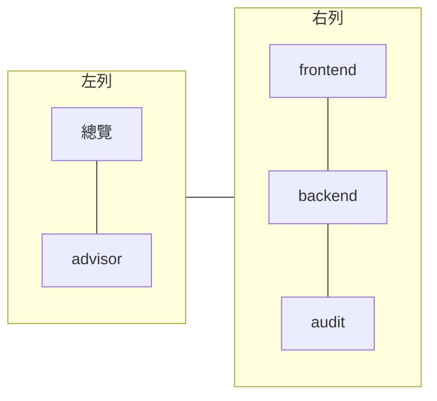

# Codex Session Coordinator

本地多 agent 会话协同工作流：一个主会话（lead）统筹文档、任务、契约与集成，前端、后端、测试审计和顾问（advisor）角色分别执行工作。每个托管角色可以分别选择 Codex 或 Claude 执行：Codex 走 Codex App Server，Claude 走 Claude Agent SDK。通过 SQLite 持久队列和单一协调 daemon 管理会话，通过 Dashboard 和 Herdr 观察进展，最终由人工验收。

项目包含 **工作流运行时 + MCP 接口 + Skill 操作指引**，不是仅靠提示词运行的 Skill，也不是独立的 Codex 终端客户端。

## 1. 能力与边界

| 角色 | 职责 | 推荐使用方式 |
| --- | --- | --- |
| lead | 拆解任务、选择模型、同步契约、整合与提交验收 | 使用已有主会话，即 external lead |
| frontend | 前端实现与验证 | 独立 CLI Task 与 Git worktree |
| backend | 后端实现与验证 | 独立 CLI Task 与 Git worktree |
| audit | 测试证据核对、审计、提出返修 | 只读沙箱；有实际证据才能记录通过 |
| advisor | 应 lead 请求做咨询或仲裁，给出结构化建议 | 只读；建议不改变审计结论，由 lead 记录是否采纳 |

- 执行方：`roles.<role>.agent` 为每个托管角色选择 `codex` 或 `claude`（默认 `codex`）；`leadAgent` 记录主会话所用的 agent。当前实践是 Claude 当主会话，Codex 负责前后端，Claude 负责审计和顾问。每条执行记录都带执行方、核验过的模型、思考强度和用量，方便比较。

- 消息支持协助请求、契约更新和测试/debug；派发与回执持久化，重启后可核对历史。
- CLI Session Task 按实际 Git owner、repository、worktree、版本和租约校验。
- 跨 agent 的项目记忆是业务仓库里的一份文档（runtime.json 的 `projectMemory.path`）：lead 写入，worker、审计和顾问只读；任务状态与交接以 CLI Session Task 为准。PowerContext 已退役。
- 模型与思考强度显式记录，真实执行受次数、并发、输入长度、执行时限和有效期控制。
- 观察标签页只读，只在用户向主会话显式要求时打开，可看各角色派发状态、执行方、实际模型与最新输出；不展示完整原生会话或命令输出。
- `completed` 代表一次执行结束，`passed` 代表对应审计通过；业务任务最终只能由人工接受。

## 2. 环境要求

必需：

- Node.js **>= 24**、npm。
- 本项目源码与依赖。

真实执行另需：

- 已安装并完成认证的 Codex CLI，支持 `app-server`。
- 可用的 CLI Session Task MCP，以及已登记的项目仓库与 worktree。
- （可选）业务仓库内的项目记忆文档，供 `projectMemory.path` 引用。
- 当前 Git worktree 的 `user.name`、`user.email` 完整。

可选：Herdr 观察标签页（Kitty 仅手动观察实例）、Microsoft Edge CDP 浏览器测试。

本地验证环境：macOS、Node.js 26.5.0、Codex CLI 0.161.0、Claude Code 2.1.294（Agent SDK 0.3.293）、Herdr 0.9.3、Kitty 0.48.2。其他版本或平台应先做协议预检；当前终端入口主要面向 macOS/Unix。

## 3. 安装与基础验证

进入项目目录后运行：

```sh
npm ci
npm run typecheck
npm run build
npm test
```

构建产物位于 `dist/`。首次运行、修改源码后，先重新构建，再启动使用 `dist/` 的 MCP、Herdr 或其他进程。

### 3.1 Agent 自动安装、注册与引导启动

下面的入口适合让 Codex Agent 在实际 coordinator checkout 中执行。它不会覆盖已有 Skill、不会登记项目仓库，也不会代替人工审批或真实模型授权。

```sh
set -eu
COORDINATOR_ROOT=$(pwd)
CODEX_SKILLS_DIR="${CODEX_HOME:-$HOME/.codex}/skills"
SKILL_DEST="$CODEX_SKILLS_DIR/codex-session-coordinator"

npm ci
npm run typecheck
npm run build

if [ -e "$SKILL_DEST" ] || [ -L "$SKILL_DEST" ]; then
  echo "Skill already exists: $SKILL_DEST"
else
  mkdir -p "$CODEX_SKILLS_DIR"
  cp -R "$COORDINATOR_ROOT/skills/codex-session-coordinator" "$SKILL_DEST"
fi
VALIDATOR="${CODEX_HOME:-$HOME/.codex}/skills/.system/skill-creator/scripts/quick_validate.py"
if [ ! -f "$VALIDATOR" ]; then
  VALIDATOR="$HOME/.codex/skills/.system/skill-creator/scripts/quick_validate.py"
fi
python3 "$VALIDATOR" "$SKILL_DEST"

echo "Skill installed and discoverable at $SKILL_DEST"
echo "Next: create a private runtime config, run group-init once, then human-control init and daemon."
```

如果 Skill 目录已存在，先检查来源和版本，不要静默覆盖。MCP 不需要注册到全局：角色 MCP 由受控 App Server 启动参数注入；项目记忆是业务仓库里的文档，由 runtime 的 `projectMemory.path` 指定，不需要额外服务。

自动引导的最小顺序是：

1. 复制 `config/example.json` 到私有运行目录并填写实际项目、Task、仓库 worktree 与项目记忆文件路径。
2. 仅首次运行 `COORDINATOR_ROLE=lead npm run group-init -- /path/runtime.json`。
3. 在用户自己的终端执行 `npm run human-control -- /path/runtime.json init`，完成人工凭据初始化。
4. 启动 `npm run daemon -- /path/runtime.json`，再运行 `npm run project-preflight` 和 `npm run worker-preflight`。
5. 健康检查通过后启动 Dashboard；需要观察时按 README 第 8 节由用户显式要求打开 Herdr 观察标签页。
6. 真实执行前，主会话必须记录每个角色的 `model`、`effort`、调用额度、并发、输入上限和过期时间，等待人工批准后再设置 `realExecution`。

Agent 可以自动完成安装、构建、配置预检和 Mock 启动；真实 Task 写入、人工审批、Provider 调用和最终验收仍保持门控。

若需要验证本机 Codex App Server 的配置解析与模型目录：

```sh
npm run protocol-preflight
```

该命令会创建临时 App Server 连接，不启动模型 turn、不修改全局配置。通过只表示协议与配置解析可用，不表示真实工具调用、业务开发或审计已完成。

## 4. Mock 快速入门

Mock 适合先核对队列、控制接口与 Dashboard，不调用真实模型，也不能作为真实业务验收证据。

### 4.1 创建独立运行目录

以下是**首次安装**示例。配置存在时停止，不覆盖已有配置；恢复现有群组时直接使用原配置，跳过初始化。

```sh
node --input-type=module <<'JS'
import { readFile, mkdir, chmod, writeFile } from 'node:fs/promises';
const directory = '.state/quickstart';
await mkdir(directory, { recursive: true, mode: 0o700 });
await chmod(directory, 0o700);
const config = JSON.parse(await readFile('config/example.json', 'utf8'));
Object.assign(config, {
  groupId: 'quickstart',
  databasePath: 'state.sqlite',
  socketPath: 'c.sock',
  credentialFile: 'roles.json',
  humanCredentialFile: 'human.json',
  allowedRoots: ['../..']
});
await writeFile(`${directory}/runtime.json`, JSON.stringify(config, null, 2), {
  mode: 0o600, flag: 'wx'
});
JS
```

配置中的相对路径以 **runtime.json 所在目录** 为基准，不以命令执行目录为基准。Unix socket 目录必须由当前用户拥有、权限为 `0700`；凭据文件为 `0600`。socket 路径应短一些，避免 macOS 路径长度限制。

### 4.2 初始化群组与人工控制凭据

```sh
COORDINATOR_ROLE=lead npm run group-init -- .state/quickstart/runtime.json
npm run human-control -- .state/quickstart/runtime.json init
```

第二条必须由用户在真实交互终端执行，输入 `yes` 创建独立人工控制凭据。不要把人工凭据交给执行角色。两种初始化都不用于重置现有群组；已有文件会拒绝覆盖。

### 4.3 启动协调器

在一个终端前台运行：

```sh
npm run daemon -- .state/quickstart/runtime.json
```

保留该终端。另开终端查询状态：

```sh
npm run client -- .state/quickstart/runtime.json lead automation_status '{}'
```

如需体验角色线程初始化，在项目目录中执行：

```sh
npm run client -- .state/quickstart/runtime.json frontend automation_role_initialize \
  "{\"cwd\":\"$PWD\"}"
```

这是 Mock 线程，不是一次真实模型执行。后端、审计同理，将角色名替换为 `backend`、`audit`。

### 4.4 启动 Dashboard

```sh
npm run dashboard -- \
  --database .state/quickstart/state.sqlite \
  --group quickstart \
  --port 25426 \
  --web-root web
```

访问 <http://127.0.0.1:25426/>。服务仅监听本地回环地址，读取数据库，不提供人工批准或业务写入入口。

先检查健康，再查看数据：

```sh
curl --fail http://127.0.0.1:25426/health
curl --fail http://127.0.0.1:25426/api/snapshot
```

端口被占用时选择其他端口，不结束占用者。

## 5. 接入真实项目

真实模式模板是 [config/app-server.example.json](config/app-server.example.json)，它只提供身份配置骨架，**不能原样完成真实开发**。其中服务地址、仓库 worktree 与项目记忆路径均需替换为当前项目的实际值。

准备顺序：

1. 在 CLI Session Task 注册实际仓库/worktree；以 `git config user.name` 原始值作为 owner。主会话和前后端分别登记 Task，完成冲突检查、attach/start、租约验证。
2. 在业务仓库准备项目记忆文档，在 runtime.json 写 `"projectMemory": { "path": "<文件>" }`（相对 runtime.json 解析，文件必须存在）。例如 LKF 用 docs worktree 的 `开发协同/项目记忆.md`，LegalAudit 用工作区的 `docs/项目记忆.md`。
3. 将 `mode` 设为 `real`（`app_server` 为旧名），真实模式只需要 `taskMcpUrl` 与 `repositories`；配置里出现 `powerContext` 段会加载失败（PowerContext 已退役）。推荐 `leadMode: "external"`，让当前主会话统筹，不另外创建自动 lead 模型 turn。
4. 配置独立前后端 worktree，添加到 `repositories`、`allowedRoots` 与 `workerTasks`。
5. 配置外部主任务观察引用及有效期，再做项目与 worker 预检。
6. 用户授权模型、思考强度和调用额度后，才配置 `realExecution` 并派发。

关键配置：

| 字段 | 用途 |
| --- | --- |
| `repositories` | 每个实际 repository/worktree 的登记引用，含主 worktree 与两个 worker worktree |
| `externalTaskObservation` | 外部主会话 Task、当前持租约 session 与观察有效期；不授予 daemon 修改主任务的权限 |
| `workerTasks` | 两条记录，分别为 frontend/backend；含 `role`、`binding`、`sessionId`、`expiresAt` |
| `workerTasks[].binding` | `taskRef`、Git `owner`、`repositoryId`、实际 `worktreePath`、最新 `expectedVersion` |
| `taskMcpUrl` | CLI Session Task MCP 地址；真实模式必填 |
| `projectMemory.path` | 业务仓库内的项目记忆文档；相对 runtime.json 解析，文件必须存在 |
| `realExecution` | 用户批准的有界真实执行授权；用 advisor 时还需 `choices.advisor` 与 `advisor` 额度（独立计数） |
| `roles` | 托管角色的执行方，例如 `{"audit":{"agent":"claude"}}`；不写时为 codex |
| `leadAgent`／`leadWorktree` | 主会话的 agent 与工作目录；`lead:attach` 按 git 根目录匹配 `leadWorktree` 找到本组 |
| `advisor.suggestAfterRejections` | 同一契约连续被拒绝多少轮后提示 lead 仲裁，默认 2 |
| `mode` | `mock` 或 `real`（`app_server` 为旧名） |

前后端必须使用不同 Task 和实际 worktree，不能用 `./path` 或符号链接制造“不同目录”。写入派发会再次检查真实路径、Git 身份、任务版本、有效租约与冲突。

### 项目记忆与执行门控

跨 agent 的项目记忆只有一份：业务仓库里的项目记忆文档（`projectMemory.path`）。

| 角色 | 项目记忆 | 实际能力与边界 |
| --- | --- | --- |
| lead | 读写 | 唯一写入方，记录长期决策、约束、偏好与经验；任务状态、租约和交接写在 CLI Session Task，不写进记忆文件 |
| frontend／backend | 只读 | 角色指令给出文件路径并说明只读；结果通过 coordinator 回执提交 |
| audit | 只读 | 审计结果走 coordinator validation，执行沙箱只读 |
| advisor | 只读 | 建议走 coordinator advice 记录 |

Claude 角色会把记忆文件所在目录作为额外可读目录（记忆文件可以在登记的 worktree 之外，例如独立的 docs worktree）。

worker 工具白名单、App Server 沙箱、CLI Task 有效租约、真实模型有界额度、人工审批及浏览器独占租约是不同门控，必须分别满足。真实额度耗尽或到期时继续关闭派发；观察标签页和 Dashboard 可继续读取历史。

不要把密钥、人工凭据或运行目录提交到 Git。

### 5.1 身份与 worker 预检

```sh
npm run project-preflight -- /absolute/path/runtime.json
npm run worker-preflight -- /absolute/path/runtime.json /absolute/path/worker-tasks.json
```

`worker-tasks.json` 是两条 frontend/backend 登记的 JSON 数组，结构与配置中的 `workerTasks` 一致，但使用 **`role`** 字段。worktree 路径使用绝对路径。两种预检不调用模型：项目预检核对 Task MCP 可连通、每个登记 worktree 的 Git 身份、项目记忆文件可读，不检查 Task 租约；worker 预检只核对 frontend/backend 的 CLI Task owner、租约与 worktree。

预检失败时先修复服务或身份配置，不扩权、不换身份盲目重试。首次群组初始化、人工凭据创建、daemon 和 Dashboard 启动沿用第 4 节，改用真实配置的路径与 groupId。

### 5.2 外部主会话保活

真实配置采用 external lead 时，由宿主注入**实际会话引用**并定期发送：

```sh
npm run client -- /absolute/path/runtime.json lead automation_lead_heartbeat \
  '{"sessionRef":"ACTUAL_HOST_SESSION_REF","cwd":"/absolute/path/lead-worktree"}'
```

这是一条心跳，不是持续保活服务。普通使用中由 `lead:attach` 启动的 lead 守护进程每 20 秒发送，并在主会话退出时释放；手工调试时才需要自己发送。主会话或配置授权到期后应停止自动调度并核对状态。

新项目接入（Herdr，Claude lead + Codex 前后端 + Claude 审计/顾问）见 `docs/new-project-herdr.md`：`npm run project:init` 一次生成私有运行目录、配置和辅助脚本（`--memory <文件>` 写入 `projectMemory.path`）；lead 是普通 `claude` 会话，由 skill 执行 `lead:attach` 接入。

## 6. 模型与思考强度

下面是 `realExecution` 的**结构示例**，占位符不能直接运行；授权引用、Task、有效期和额度必须来自当次人工确认：

```json
{
  "authorizationRef": "CURRENT_HUMAN_APPROVAL_REFERENCE",
  "expiresAt": "REPLACE_WITH_APPROVED_ISO_8601_DEADLINE",
  "taskRefs": ["FRONTEND_TASK_ID", "BACKEND_TASK_ID", "AUDIT_TASK_ID"],
  "maxCalls": 5,
  "maxConcurrent": 2,
  "maxInputCharacters": 12000,
  "maxTurnMs": 300000,
  "choices": {
    "frontend": { "model": "gpt-6-luna", "effort": "medium" },
    "backend": { "model": "gpt-6-luna", "effort": "medium" },
    "audit": { "model": "gpt-6.1-sol", "effort": "high" }
  }
}
```

这些模型组合是本项目已验证的选择示例，不保证所有账号都有相同模型目录。Codex 角色以 App Server `model/list` 为准，Claude 角色以 Agent SDK `supportedModels()` 为准（`npm run protocol-preflight -- "$PWD" --claude` 可零调用查看）；Claude 角色的 `choices` 可写 `claude-opus-5-5`、`claude-sonnet-5-5`、`claude-haiku-5-5` 等。

- 主会话可根据风险、影响范围、依赖与失败证据选择级别；**真实有界授权会固定各角色批准的 model/effort，不自动升级**。
- 需要更强模型时，先记录原因，再取得新的授权；修改配置不能代替人工授权。
- 次数按授权（`authorizationRef`）统计：新授权有自己的 `maxCalls`，旧授权已用的次数不退还也不清零；并发上限和结果未知的调用跨授权生效，旧授权下的未知结果须先核对。次数包含已启动后失败、中断的调用，返修也消耗次数。
- `maxTurnMs` 最长 3600000（1 小时）。业务回执截止时间不短于 `maxTurnMs` 加 60 秒；`receiptTimeoutMs` 只能把它延长，不能缩短。Task 租约（30 分钟）短于长 turn 时，由 lead 在运行期间续租；turn 启动后续租不影响执行。
- frontend、backend 不执行 `git commit`（worktree 的 Git 元数据在 Codex 沙箱可写范围之外）；改动保留在 worktree，审计通过后由 lead 提交并合并。
- 输入上限是执行包字符数，次数上限是调用次数；它们不是精确 token 或费用上限。
- 修改运行配置不会热加载，应核对在途执行后受控重启原 daemon；不要重复启动同一群组，也不要借重建状态库重置额度。

Dashboard／观察窗的模型标识：

| 显示 | 含义 |
| --- | --- |
| 请求模型／思考强度 | 派发时声明的配置 |
| 运行时已确认 | Codex：原始会话中对应 turn 的模型上下文已核验；Claude：会话记录中本轮 assistant 消息的模型一致 |
| 未确认 | 已执行，但缺少可验证的实际模型证据 |
| 未执行 | 尚未取得执行 turn |
| 实际思考强度未知 | 证据未提供 effort，不能用请求值补齐 |

运行时证据不等于独立观测到的上游物理模型或计费路由。

## 7. 日常操作

### 7.1 查 schema、状态与暂停

```sh
npm run client -- /absolute/path/runtime.json lead schema
npm run client -- /absolute/path/runtime.json lead automation_status '{}'
npm run client -- /absolute/path/runtime.json lead automation_pause '{"paused":true}'
```

恢复自动调度：

```sh
npm run client -- /absolute/path/runtime.json lead automation_pause '{"paused":false}'
```

恢复前核对 Task、租约、模型额度与当前执行；解除暂停不会自动补齐这些条件。暂停调度不代表中断已运行的 turn，也不代表释放原生 CLI Task 租约。

参数可先做无副作用校验，例如：

```sh
npm run client -- /absolute/path/runtime.json lead automation_pause '{"paused":true}' --dry-run
```

### 7.2 契约 → 派发 → 审计 → 返修

通过主会话 MCP 或 `client` 按以下顺序操作；具体参数以 `schema` 输出为准：

1. `automation_contract_publish` 发布契约 revision、源码摘要和 baseline。
2. 受影响角色用 `automation_contract_ack` 确认准确 revision。
3. `automation_dispatch` 提交执行包：Task binding、目标、允许路径、依赖、验收标准、验证命令、风险和契约引用。
4. 执行角色用 `automation_work_complete` 提交摘要和实际证据。运行时终止与业务回执均核对后，派发才完成。
5. 审计使用 `automation_validation_create`、`automation_validation_record`，按准确契约和 baseline 记录 `passed`、`rejected` 或 `error`。
6. 被拒绝时在自己的有效任务租约内修复，发布新基线并重新审计；旧记录保留。
7. 验证完成后提交 CLI Task 为 `pending_acceptance`，人工最终接受。

同一次操作结果未知时，用原 operationId 核对 `automation_operation_get` 或原生 CLI Task operation result，不换新 ID 盲目重放。只允许 `automation_cancel_queued` 撤销**从未启动**的派发；失败归档不退款、不等于审计通过。

external lead 模式下，主任务的原生 Task 状态变更由宿主主会话完成；不能把 daemon 的只读观察权限当作 task_submit 权限。不同原生 Task 的集成证据也需要宿主核对，不会因为某个观察窗显示完成就自动通过。

### 7.3 人工审批与接管

先列出当前有效请求，再按最新 ID 响应：

```sh
npm run human-control -- /absolute/path/runtime.json approvals
npm run human-control -- /absolute/path/runtime.json respond CURRENT_APPROVAL_ID
```

用户在交互终端选择 `accept`、`decline` 或 `cancel`。如需接管或释放某角色：

```sh
npm run human-control -- /absolute/path/runtime.json takeover audit
npm run human-control -- /absolute/path/runtime.json release audit
```

接管须输入当前线程状态与交接原因，不代表强制中断、最终验收或无限授权。

## 8. Herdr 与 Kitty 观察

| 终端环境 | 入口 |
| --- | --- |
| Kitty 外层、里面运行 Herdr | 在 Herdr 窗格直接启动 `claude`，由 skill 接入（`lead:attach`）；需要观察时对主会话说“打开观察窗”，skill 执行 `herdr:open` |
| 只有 Kitty | 在 Kitty 中直接启动 `claude` 接入；接入不再启动 Kitty 控制器，观察只能手动用 `kitty:start --observe-only` 开观察实例（在 Herdr 内运行会被拒绝） |
| 两者都没有 | Dashboard 加普通终端 |

`lead:attach` 只负责接入：按需启动 daemon、发 lead 心跳、续 worker 租约，不打开任何窗格，也不启动布局控制器；结果里的 `layout` 只说明当前是否在 Herdr 中、能否打开观察标签页。一个协同组只允许一个布局控制器，Herdr 与 Kitty 共用 `layout-controller.lock`。

### Herdr：独立观察标签页

观察标签页只在用户向主会话**显式要求**时打开（例如“打开观察窗”“打开观察标签”“看看各角色进度”），skill 执行：

```sh
npm --prefix /absolute/path/codex-session-coordinator run -s herdr:open -- /absolute/path/runtime.json
```

返回一行 JSON：

| 状态 | 含义 |
| --- | --- |
| `OPENED` | 已新建观察标签页 |
| `ALREADY_OPEN` | 本组的观察标签页已在运行 |
| `NOT_HERDR` | 主会话不在 Herdr 中 |
| `NO_BUILD` | 协调器尚未构建，先 `npm run build` |
| `BUSY` | 另一个布局控制器正在运行 |
| `OPEN_FAILED` | 控制器未就绪，查看 `<运行目录>/herdr-follow.log` |

标签页建在调用者所在的 workspace，名为「流水線協同 · <groupId>」；不拆分主会话所在标签，焦点留在主会话。五个窗格一次打开，每个窗格都以角色名重命名：



左列（總覽与 advisor 上下各半）约占标签宽度的 30%，右列约占 70%，frontend、backend、audit 各占右列高度的三分之一。

- 每个窗格顶部是固定的一行标题（角色 · 状态 · 执行方 · 已核验模型），下面是只读摘要；整帧原位刷新，不闪烁、不滚动。
- 总览列出每个角色的派发状态、执行方与模型、最新输出。
- 角色窗格在标题下展示任务、执行摘要、最多 5 条验证证据与最近操作事件；小窗格会减少显示条数。总览标题行另有在线角色数、待审批数和派发总数。
- 窗格内运行的是只读观察器（`herdr-watch`），worker 真正运行在 Codex App Server 线程或 Claude Agent SDK 会话中，不是另一个原生 TUI。

生命周期：

- 用户说“关闭观察窗”时，skill 执行 `npm --prefix <coordinator> run -s herdr:close -- <runtime.json>`，返回 `CLOSED`、`NOT_OPEN` 或 `CLOSE_TIMEOUT`。
- 主会话（claude）退出时，控制器自行关闭整个观察标签页。
- 用户手动关闭标签页（或其中的总览窗格）时，布局控制停止，不会重建；需要时再让主会话打开。
- 用户关闭某个角色窗格后，同一次执行不会再把它打开，只有出现更新的派发或新的审批才重新打开；观察器被换成别的进程的窗格交还给你，控制器不再碰它。
- 控制器日志在 `<运行目录>/herdr-follow.log`；窗格映射 `herdr-panes.json` 记录 `observerTab`、`overviewPane`、`panes`。

需要收起已空闲的角色窗格时，向正在运行的控制器发送请求即可，不需要停止它：

```sh
npm run herdr:compact -- /absolute/path/runtime.json [--role advisor]
```

只关闭没有在执行的自有窗格；观察器已被替换的窗格交还给你，不会被关闭。

`npm run herdr:follow` 是 `herdr:open` 在后台启动的控制器本体（`dist/scripts/herdr-follow.js`），日常不要单独运行；已有控制器时也不要再启动第二个。

### Kitty：手动观察实例（已知限制）

`lead:attach` 不再启动 Kitty 布局控制器，Kitty 下也没有观察标签页；Kitty 控制器本身未改动，只能通过下面的手动入口使用（后续待补）。`kitty:start --observe-only` 开一个不含 lead、只做观察的项目专用 Kitty 实例，它使用本次进程的 `--config NONE`、`allow_remote_control=socket-only` 和私有 Unix socket，不修改系统或个人 Kitty 配置：

```sh
npm run kitty:start -- /absolute/path/runtime.json --observe-only
```

主窗此时运行交互 shell，不发送 lead 心跳。它是终端验证入口，不代表完整业务执行。

Kitty 窗格布局：左列是主窗和它下面的 advisor，右列从上到下依次是 frontend、backend、audit；位置固定，关闭后重开也回到原位置。角色有新派发或新的待审批时打开观察窗，创建时保留焦点，执行完成后保留结果。只控制该 tab 中的主窗和记录的自有观察窗；外来窗口被忽略，观察器被替换的窗口交还给你；主窗消失、布局被改动或创建结果未知时停止控制并保留现场。

收起已空闲观察窗，可在另一终端请求正在运行的同群组控制器：

```sh
npm run kitty:compact -- /absolute/path/runtime.json --compact
```

在途、等待审批、未核对或快照截断时不收起对应窗格。主窗始终保留；下次角色激活会重新创建观察窗。高级 `kitty:follow` 入口须在原专用 Kitty 主窗上下文中使用，不能伪造 `KITTY_WINDOW_ID` 或 socket。恢复控制器会复用原 `kitty-panes.json`；切换到新 Kitty 实例时旧映射会被拒绝，先核验旧实例、锁 PID/argv 和记录窗格，不能直接删除映射或重跑初始化。

旧 `scripts/open-kitty-panes.sh` 与 `kitty/session.conf` 是固定元数据观察入口，仅为兼容保留。Herdr 与 Kitty 各自的映射独立，观察器不执行模型任务。

## 9. Skill／MCP 接入

Skill 位于 [skills/codex-session-coordinator/SKILL.md](skills/codex-session-coordinator/SKILL.md)，同时适用于 Codex 与 Claude。安装位置：`~/.codex/skills/codex-session-coordinator` 与 `~/.claude/skills/codex-session-coordinator`（ZCode 的 `~/.zcode/skills` 可用软链指向 Codex 那份）。

Claude 主会话还需要用户级登记 `cli_session_task`（`claude mcp add --scope user --transport http cli_session_task <task-mcp-url>`）。项目记忆是业务仓库里的文档，不需要插件或额外服务。

MCP 入口为：

```sh
node /absolute/path/codex-session-coordinator/dist/scripts/mcp-server.js
```

在宿主 MCP 配置中为每个角色提供：

| 环境变量 | 值 |
| --- | --- |
| `COORDINATOR_ROLE` | `lead`、`frontend`、`backend`、`audit` 或 `advisor` |
| `COORDINATOR_GROUP_ID` | 当前 groupId |
| `COORDINATOR_DB_PATH` | 当前数据库绝对路径 |
| `COORDINATOR_SOCKET_PATH` | 当前 daemon socket 绝对路径 |
| `COORDINATOR_CREDENTIAL_FILE` | 对应受控角色凭据文件路径 |
| `COORDINATOR_BINDING_GENERATION` | 当前绑定 generation，首次为 `1` |

使用统一 daemon 时必须设置 socket，不能把旧的独立数据库 MCP 模式混作同一自动调度器。宿主应按角色隔离 capability；不把包含所有角色凭据的文件开放给不可信 worker。daemon 创建的 worker 已通过受控环境注入本角色 capability，并使用限定工具策略。

Skill 已同步真实有界执行与 external lead 流程。它不代替运行时授权。安装 Skill 不会自动注册全局 MCP、登记项目仓库、赋予角色权限或启动模型。

## 10. 浏览器测试

统一使用已有 Microsoft Edge，Browser Harness 与 Playwright 通过同一个 CDP 接入。优先独立开发 Profile，保留该 Profile 自己的登录状态；不复制日常 Profile 或 Cookie。日常 Edge 与 Codex Edge 可以并存，两个 `user-data-dir` 完全分离。

1. 先检查业务依赖服务健康，再确认真实 CDP 协议、Edge 身份与任务目标。端口监听成功不代表 CDP 可用。
2. CDP 不可用时停止浏览器验证；日常 Edge 已运行不构成冲突，只要它没有占用专用 Profile，且为 Codex Edge 指定独立 CDP 端口。
3. 日常 UI／DOM／console／network 排查用 Browser Harness；确定性断言和流程回归用 Playwright `connectOverCDP`。
4. 多角色共享浏览器时，用独占租约覆盖完整操作过程；只操作本任务创建的 page/context。
5. 测试完清理自有资源并断开客户端，保留 Edge。

项目已依赖 `playwright-core`，无需运行 `playwright install`；禁止自动启动 Chromium、Chrome 或其他浏览器作为回退。

`browser` runtime 配置可声明 CDP、允许 origin、健康端点和可选 Harness 入口。受控启动入口为 `python3 scripts/start-edge.py`，默认使用 `~/.edge-codex/Default` 与 `9222`；若日常 Edge 已占用 `9222`，使用 `COORDINATOR_EDGE_CDP_PORT=9223 python3 scripts/start-edge.py`，并把 runtime 的 `browser.cdpEndpoint` 同步为 `http://127.0.0.1:9223`。入口只检查目标 Profile 是否被占用，不会关闭或接管日常 Edge；两个目录不能共享 Cookie。首次访问需要登录时，在 Codex Edge 窗口中由用户手动登录一次，后续沿用该专用 Profile。隔离 context 可能出现没有登录状态的新窗口，这是临时测试上下文，不代表原 Profile 被清空。

## 11. 常见问题

| 现象 | 检查与处理 |
| --- | --- |
| `TASK_GATE_CLOSED` | Task/worktree/版本/租约、授权有效期或 model/effort 不满足条件；按错误 nextAction 核对 |
| `BUDGET_EXHAUSTED` | 调用额度或输入上限耗尽；不自动升级、退款或重建状态 |
| socket 目录 `FORBIDDEN` | 目录是否当前用户所有、非符号链接、权限 `0700`；凭据文件是否 `0600` |
| socket 路径过长 | 为该群组选择短而独立的私有 socket 目录；保留数据库及原记录 |
| `Approval not found` | ID 已失效、所属配置／群组不对或请求不再活跃；重新列当前请求，不重放旧 ID |
| 审批响应 schema 不支持 | 带字段表单／URL 等类型可能必须走原生 runtime 审批路径；不要伪造 approve 响应 |
| `needs_reconciliation`／预算 `unknown` | 先核对原始 thread/turn、回执和 operation；不盲目重试或重复计费 |
| 实际模型未确认 | 查看原始对应 turn 的证据；请求模型、thread 默认模型不能冒充实际证据 |
| 审计标题 `failed` | 最新未撤销派发失败；历史失败保留但不再污染当前标题。审批、在途执行和未核对结果优先显示相应状态 |
| Herdr 控制器停止或 lock 存在 | 查 `<运行目录>/herdr-follow.log`、原 PID、`herdr-panes.json` 映射和实际占用；不直接删除 lock、关闭外来窗格或启动第二个控制器 |
| `PowerContext is retired` | runtime.json 仍有 `powerContext` 段；删除该段，改用 `projectMemory.path` |
| `LEAD_CONFLICT` | 另一个 lead 会话仍在线；暂停、等旧 lead 心跳过期，再由人工执行 `human-control lead-rotate` |
| `PROVIDER_UNAVAILABLE` | Claude 运行时无法启动（登录、额度等）；在用户终端检查 `claude` 登录，不自动换 agent 或模型 |
| Claude 预检不是登录账号 | `protocol-preflight --claude` 要求 `accountInfo()` 返回订阅账号；子进程环境必须包含 `USER`、`LOGNAME` |
| Edge `/json/version` 返回 404 | 当前监听不是可用 CDP；停止测试，核对受控启动参数，不关闭用户 Edge或换浏览器 |

接管连接使用 `connectOverCDP(endpoint, { noDefaults: true })`，避免对共享默认 context 应用下载、焦点或媒体覆盖。测试自身的隔离 context 可以设置 viewport 与 reducedMotion。受控启动显式选择已有 Profile 的 `Default`，可使用 `--no-first-run` 跳过引导；不得为隐藏引导清空 Profile 或修改登录资料。新窗口、首次运行界面、隔离 context 均不证明新建了 Profile；应以实际进程参数和任务自有 `edge://version` 页面核对加载路径。

## 12. 停止、恢复与验收

- **暂停派发**：使用 `automation_pause`。先核对在途 turn，暂停不替代运行时中断。
- **停止自有服务**：前台 daemon／Dashboard 用所在终端的 Ctrl-C；后台进程先核对准确 PID、argv 和所属群组再停止。不要广泛杀进程。
- **恢复**：保留原 runtime、SQLite、角色凭据及 session 引用；重新绑定并核对 Task、租约、generation、授权与未知结果。不要重跑 group-init，也不要复制临时审批或旧额度。
- **提交验收**：checkpoint 保存新鲜证据，再提交 `pending_acceptance`。多原生 Task 分别提交；审计通过不自动设置 `done`。
- **最终接受**：由用户在 CLI Session Task 的人工验收入口完成。

## 13. 验证记录与当前限制

测试、类型检查与构建结果按日期记录在验证文档中（最近一次为 2026-10-16 观察标签页与 PowerContext 退役）；此前已完成真实前后端并行执行、审计拒绝／修复／复审，以及共享 Edge CDP 的 Dashboard 页面验证。观察窗格整帧原位刷新已在真实 Herdr 标签页核对：不闪烁、不滚动。

详细记录见 [docs/verification.md](docs/verification.md)。本机运行证据保存在忽略的 `.state/` 下，不是安装依赖或可移植演示数据。

本轮另以独立 Mock 群组验证首次初始化、前后端线程初始化、协助消息领取和完成、停止与恢复、重复初始化拒绝；恢复后的快照与线程 ID 一致。自动验证使用隔离的人工凭据 fixture，没有模拟用户审批或调用真实模型。当前 Dashboard 已迁移到 `25426`，HTTP 健康、静态资源与 snapshot 通过；后续已补测 25426 页面 E2E。Skill 已安装到 `~/.codex/skills/codex-session-coordinator`，新会话或下一轮可发现。

### 已验证

- Codex 前后端并行、审计返修与最终复审；人工最终验收门控保留。
- Herdr 观察标签页（2026-10-16，Mock 组）：`lead:attach` 不开窗格；`herdr:open` 新建独立标签页并一次打开五个窗格，主会话标签不变；`herdr:close` 关闭整个标签页。
- Kitty 动态观察（早期验证）：独立 Mock 数据驱动真实终端 `1 → 3 → 4`，恢复复用窗格、保留焦点、收起保留主窗；没有新增真实模型调用。
- PowerContext 已退役（提交 `611c730`）：runtime.json 不再接受 `powerContext` 段，跨 agent 记忆改为业务仓库内的项目记忆文档。

### 交付待办与验证范围

- 25426 页面复测已通过：真实四角色与模型回执、自动刷新、503 保留快照／重试、键盘入口、390px 无溢出；无页面错误。测试自有隔离 context 已关闭，共享 Edge 仍存活。
- 本次集成改动已形成受控本地提交；提交后的图谱核验结果记录在交付说明中。未推送远程。
- Mock 停止／恢复验证不等于真实模型运行中的崩溃恢复；完整原生输出、本轮端到端人工 TTY 初始化，以及任意版本／平台兼容性均未声称已验证。

### 明确的设计边界

- 观察窗保留有限概要，不展示完整命令 stdout/stderr 或原生交互 TUI。用户已确认本版不需要完整原生输出。
- “实际模型”证据只证明 Codex turn 配置或 Claude 会话记录中的模型，不证明上游实际物理模型路由。
- 模型与思考强度由主会话选择，但必须落在当次有界人工授权内；不自动升级、不恢复已耗尽额度。
- worker、审计和顾问只读项目记忆文档；主会话统一维护长期项目记忆，任务状态与交接仍以 CLI Session Task 为准。审计通过不能代替用户接受 Task。
- 观察标签页只在 Herdr 中可用，且只在用户显式要求时打开。Kitty 控制器未改动，但 `lead:attach` 不再启动它，只能通过手动 `kitty:start --observe-only`／`kitty:follow` 使用；Kitty 下的按需观察入口待后续补齐。
- Claude 已作为执行方与主会话接入；Codex 暂不作为主会话使用；ZCode 不参与本工作流。
