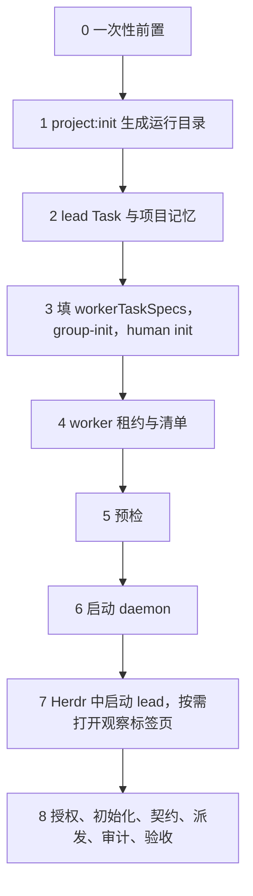

# 新项目接入：Herdr 下的多 agent 协同（lead + frontend/backend/audit/advisor）

适用于在 Kitty 里运行 Herdr、由 Claude Code 担任 lead、Codex 做前后端、Claude 做审计和顾问的项目。命令都在协调器目录（下称 `COORD`，即本仓库）执行；`R` 指 `project:init` 生成的私有运行目录 `$COORD/.state/<group>`。



## 0 一次性前置（每台机器做一次）

- 协调器：`npm ci && npm run build`。
- 终端：Kitty 中运行 Herdr；lead 一律在 Herdr 窗格里启动（不要用 Claude Code 的后台恢复会话做 lead，那样没有心跳，也打不开观察标签页）。
- Claude Code：用户级 MCP `cli_session_task`。不需要 PowerContext 插件或服务（已退役）。
- Codex：已登录。worker 的 Codex 由 daemon 启动、不继承代理环境变量，出网依赖 Clash Verge TUN；Claude Code 与 Codex 的域名由 Clash Verge 全局脚本走 149.52.57.145 桥接，bigmodel 直连。

## 1 生成运行目录

```sh
npm run project:init -- --group my-app-20261010 \
  --repo ~/playground/my-app --repo-id my-app \
  --frontend ~/playground/my-app-workers/frontend --backend ~/playground/my-app-workers/backend \
  --memory ~/playground/my-app/docs/项目记忆.md \
  --create-worktrees --base main
```

- `--create-worktrees --base` 会建两个 worker worktree（分支 `feat/<group>-frontend|backend`）；已经建好就去掉这两个参数。worker worktree 路径必须以 `/frontend`、`/backend` 结尾。
- `--memory` 指向业务仓库里的项目记忆文档（必须已存在），写入 `runtime.json` 的 `projectMemory.path`；不写时可以之后手动补。例如 LKF 用 docs worktree 的 `开发协同/项目记忆.md`，LegalAudit 用工作区的 `docs/项目记忆.md`。
- `--env-from <已有 daemon.env>` 可选，只复制其中的 `COORDINATOR_*` 行。
- 生成 `R`（0700）：`runtime.json`（0600，不含任何令牌）、`daemon.env`（0600）和辅助脚本：

| 脚本 | 谁来执行 | 作用 |
| --- | --- | --- |
| `start-daemon.sh` | lead | 加载 `daemon.env` 并启动 daemon |
| `human-init.sh` | 你，真实终端 | 初始化人工控制凭证 |
| `human-approvals.sh` | 你，真实终端 | 查看待审批 |
| `lead-rotate.sh` | 你，真实终端 | lead 会话 ID 变化时轮换 |
| `worker-hold.sh` | lead | 创建并持有 worker Task 租约（长期运行） |
| `renew-workers.sh` | lead | 让 `worker-hold` 续租两个 worker 租约 |

- 运行目录已存在时拒绝覆盖。命令最后会打印剩余步骤清单。
- 把命令写进脚本执行，可以避开终端把 `--` 自动替换成长破折号的问题。

## 2 lead Task 与项目记忆（需要 agent 或你本人）

- 在业务仓库开一个 Claude Code 会话，按 `task-recovery` 技能：未登记仓库先 `repository_bootstrap`，再 `session_context`（owner 用 `git config user.name` 原值），然后 `task_create` + 主机证据 + `task_start` 建 lead Task。
- 项目记忆：确认 `runtime.json` 的 `projectMemory.path` 指向业务仓库里的记忆文档（相对 `runtime.json` 解析，文件必须存在）。lead 是唯一写入方，只写长期决策、约束、偏好和经验；worker、审计和顾问只读。任务进度、租约和交接以 `cli_session_task` 为准，不写进记忆文件。
- `runtime.json` 不能再有 `powerContext` 段，否则加载时报 `PowerContext is retired`。

## 3 worker Task 描述、group-init、human init

- 在 `R/runtime.json` 加 `workerTaskSpecs`（没有就拒绝创建 worker Task）：

```json
"workerTaskSpecs": {
  "frontend": { "title": "…", "goal": "…", "acceptanceCriteria": ["…"], "nextAction": "等待 coordinator 派发" },
  "backend":  { "title": "…", "goal": "…", "acceptanceCriteria": ["…"], "nextAction": "等待 coordinator 派发" }
}
```

- `COORDINATOR_ROLE=lead npm run group-init -- R/runtime.json`
- 你在真实终端：`sh R/human-init.sh`

## 4 worker 租约与清单

```sh
nohup sh R/worker-hold.sh > R/worker-hold.log 2>&1 &
npm run worker-task -- R/runtime.json manifest <授权到期 ISO 时间> > R/manifest.json
```

把清单写进 `runtime.json` 的 `workerTasks`，并写 `externalTaskObservation`：`{"taskRef":"<lead Task>","sessionId":"<lead 的 CLI Task 会话>","expiresAt":"<授权到期>"}`。租约 30 分钟：lead 每 20 分钟执行 `sh R/renew-workers.sh`，lead 自己的 Task 用主机证据 + `task_checkpoint` 续租。续租会让 Task 版本 +1，派发时用最新版本；主机证据约 15 分钟有效，派发和归档要在续租后尽快做。

## 5 预检（零模型调用）

```sh
npm run project-preflight -- R/runtime.json
npm run worker-preflight -- R/runtime.json R/manifest.json
npm run protocol-preflight -- "$PWD" --claude
```

- `project-preflight`：Task MCP 可连通、每个登记 worktree 的 Git 身份、项目记忆文件可读。
- `worker-preflight`：只核对 frontend/backend 的 CLI Task owner、租约与 worktree。

## 6 启动 daemon

```sh
nohup sh R/start-daemon.sh > R/daemon.log 2>&1 < /dev/null &
grep '"status":"ready"' R/daemon.log
```

配置只在启动时加载。daemon 每次重启后，4 个角色都要重新 `automation_role_initialize`（见第 8 步）。

daemon 与 `worker-hold` 会把 pid 记在 `R/daemon.pid`、`R/worker-hold.pid`。lead 正常退出时，lead 守护进程会在没有在途派发和待审批时自动停止它们；仍有在途工作就保留，下次启动 lead 继续接管。需要手动停止时执行 `npm run group:stop -- R/runtime.json`（加 `--if-idle` 则只在空闲时停）。

## 7 在 Herdr 中启动 lead，按需打开观察标签页

在 Kitty 里的 Herdr 窗格中进入业务仓库，直接启动 `claude`。对话里说明要做的事（例如"开始协同：……"），skill 会执行 `lead:attach` 接入本组：按需启动 daemon 与 worker 租约、发心跳。接入不打开任何窗格；退出 `claude` 时 lead 在场登记释放，组空闲则自动停止。

想看各角色进度时，对主会话说"打开观察窗"（或"打开观察标签""看看各角色进度"），skill 执行 `herdr:open`：在当前 workspace 新建标签「流水線協同 · <groupId>」，不拆分主会话的标签，一次打开五个窗格——左列總覽和它下面的 advisor，右列从上到下 frontend、backend、audit。每个窗格有固定标题行（角色 · 状态 · 执行方 · 已核验模型），整帧原位刷新、不滚动。

- 说"关闭观察窗"时 skill 执行 `herdr:close`；退出 `claude` 时整个标签自动关闭。
- 手动关掉标签（或總覽窗格）后布局控制停止，不会自己重建；手动关掉某个角色窗格后，只有更新的派发或新的审批才会重开。
- 控制器日志：`R/herdr-follow.log`。

换会话时，旧 lead 心跳过期（约 60 秒）后新会话自动接替；旧 lead 仍在线则接入返回 `LEAD_CONFLICT`。`sh R/lead-rotate.sh` 保留为人工强制轮换手段。

## 8 授权、初始化、契约、派发、审计、验收

1. 向用户列出 `realExecution`（Task、各角色模型与思考强度、`maxCalls`、`maxConcurrent`、`maxInputCharacters`、`maxTurnMs`（最长 3600000）、advisor 额度、到期时间），批准后写入并重启 daemon。额度按 `authorizationRef` 计数，`maxCalls` 上限 8，追加时开新的授权引用。不要写 `receiptTimeoutMs`。
2. 初始化 4 个角色：`npm run client -- R/runtime.json <role> automation_role_initialize '{"cwd":"<worktree>"}'`（audit、advisor 用 lead 的业务仓库）。
3. lead 发布契约（`automation_contract_publish`），按需咨询 advisor，派发 frontend/backend。Codex worker 的验证命令写 `npm run typecheck` 和 `node --import tsx --test <文件>`，不要写 `npx tsx` 或 `npm test`（沙箱会报 `listen EPERM`）；worker 不提交。
4. lead 在沙箱外复跑全量测试与构建，导出 worker diff 作为审计基线，派发 audit。审计通过后 lead 提交并合并、做页面测试，再提交 `pending_acceptance`；最终验收由你完成。

## 常用检查

| 目的 | 命令 |
| --- | --- |
| 协调器状态 | `npm run client -- R/runtime.json lead automation_status '{}'` |
| 暂停 / 恢复调度 | `npm run client -- R/runtime.json lead automation_pause '{"paused":true}'`（`false` 恢复） |
| 待人工审批 | `sh R/human-approvals.sh`（你，真实终端） |
| 打开观察标签页（用户要求时） | `npm --prefix $COORD run -s herdr:open -- R/runtime.json` |
| 关闭观察标签页 | `npm --prefix $COORD run -s herdr:close -- R/runtime.json` |
| 收起空闲角色窗格 | `npm run herdr:compact -- R/runtime.json [--role advisor]` |
| AI 域名出口 | `curl -s https://api.openai.com/cdn-cgi/trace`、`curl -s https://api.anthropic.com/cdn-cgi/trace`，`ip=` 应为 149.52.57.145 |
