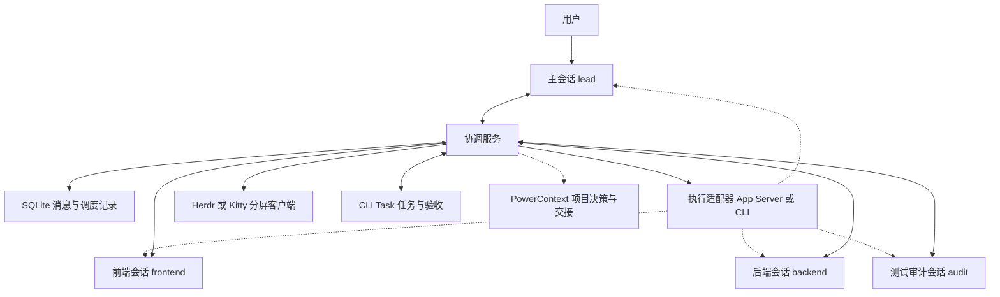
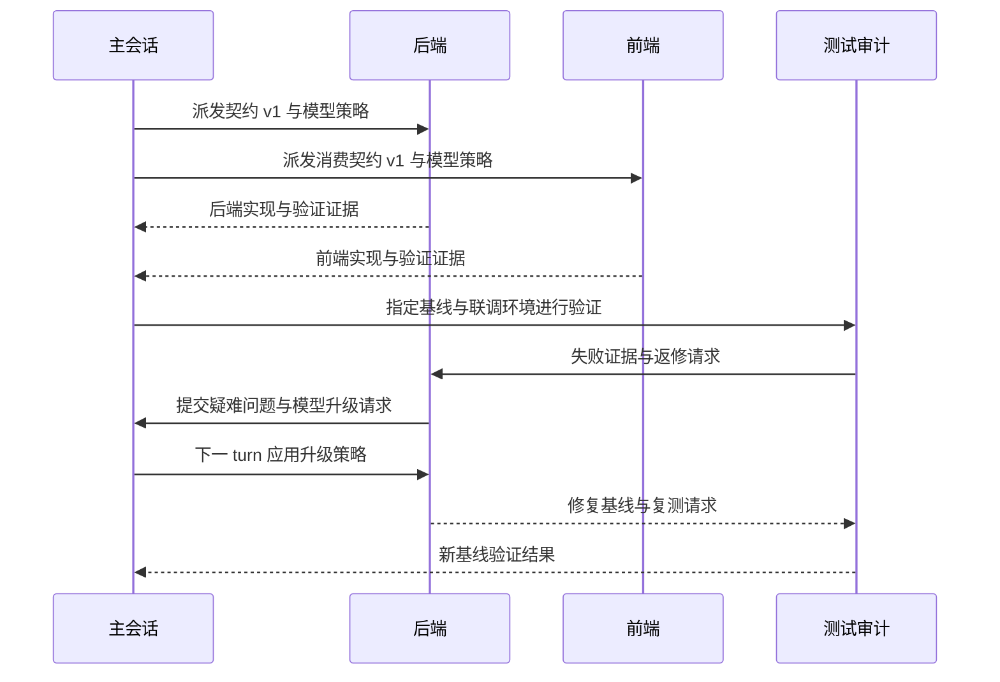
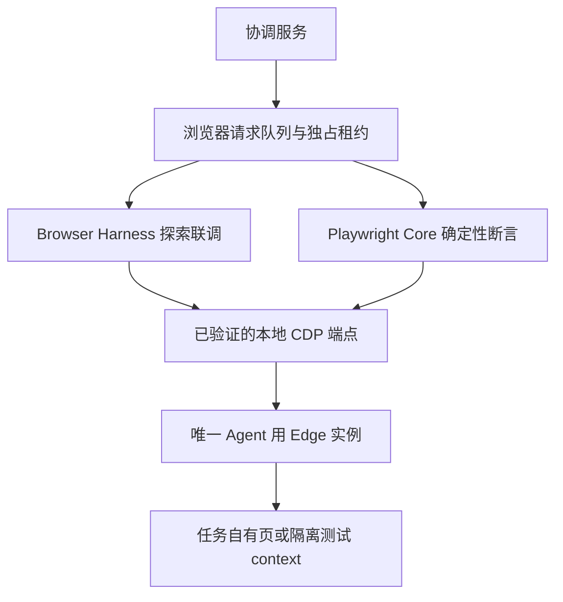

本方案设计一个面向本地软件开发的 Codex 会话群组：主会话负责需求、正式文档、契约与统筹，三个执行会话分别负责前端、后端、测试审计。主会话判断复杂度并选择模型与思考强度，协调服务负责把策略应用到目标会话，以及通信、唤醒和恢复。

推荐采用工作流、角色运行配置、常驻协调服务、MCP 和 Skill 的组合，以 Herdr 或 Kitty 分屏观察。正式自动调度以 Codex App Server 为执行接口；Herdr 与独立 CLI 会话用于早期试运行和终端操作适配。

版本为 2026 年 10 月 3 日设计草案。本次产出是方案，实际服务、角色配置、Skill 和模型调用尚未实施。下文标明为建议的规则、接口和数据结构均属于拟建设内容。

## 1 目标与范围

已确认目标：

- 建立一个主会话与三个执行会话的群组，角色分别为 lead、frontend、backend、audit。

- 会话可以直接提出协助、契约同步、验证和 debug 请求。

- 主会话使用较强模型与较高思考强度，前后端优先使用快速模型，测试审计根据任务使用较强模型。

- 主会话在允许范围内自动决定执行会话的模型与思考强度。

- 用户可以通过 Herdr 或 Kitty 分屏查看执行、阻塞和结果，并人工接管。

- 保留现有项目、任务登记、跨仓库边界和用户最终验收规则。

第一版按单用户、本机、一个项目群组、最多四个角色设计。跨机器调度和 GLM 等其他执行器留出适配接口，后续按真实需求增加。

成功标准是完整跑通契约确认、前后端并行实现、测试发现问题、协助请求、模型升级、返修、恢复和用户验收。

## 2 形式与技术路线

| 方案 | 优点 | 局限 | 用途 |
| --- | --- | --- | --- |
| Codex 原生子 agent 加角色配置 | 直接复用并行委派与结果汇总 | 长期群组、业务回执和独立终端控制仍需验证或补充 | 验证角色分工 |
| 四个独立 CLI 加 Herdr 加协调服务 | 容易观察，保留完整交互终端 | 终端状态无法独立证明请求完成；动态模型切换需要适配验证 | 早期试运行 |
| App Server 加协调服务加分屏客户端 | 有结构化线程、turn 和事件接口，便于应用模型策略 | 需实现观察客户端与人工接管 | 正式自动调度 |

选择第二条作为可选试运行入口，第三条作为正式版本目标。协调服务的业务协议保持一致，执行适配器分别对接 CLI 和 App Server。

Codex 原生子 agent 支持角色配置及模型、思考强度声明，CLI 提供 agent 线程查看入口。[官方子 agent 文档](https://learn.chatgpt.com/docs/agent-configuration/subagents)

本机 Codex 0.160.0 已通过 help 和导出的协议 schema 核对相关配置能力；已有 codex queue 命令，但它的投递、唤醒、覆盖参数和失败恢复语义尚未实测，不作为可靠业务队列的既定替代。

## 3 系统结构



主会话决定工作范围、契约和模型策略。协调服务执行确定性的校验、领取、投递、回执和恢复，不另设一个高级模型作为隐藏调度者。

每个目标线程由协调器串行启动 turn；四个角色可同时执行。模型推理并发上限与本地测试进程数量分别管理。

工作流定义步骤与门禁；角色配置定义默认模型、工具和范围；Skill 教会 agent 使用 MCP 工具。MCP 负责提供操作并校验角色权限。[Skill 与 MCP 的职责](https://developers.openai.com/plugins/concepts/skills)

## 4 角色和修改边界

| 角色 | 主要职责 | 修改范围 | 主要交付 |
| --- | --- | --- | --- |
| lead | 分析需求、影响面、正式文档、契约决策、模型分配、组织联调 | 授权的文档与契约范围 | 执行包、契约修订、决策与验收汇总 |
| frontend | UI、数据消费、前端状态与局部测试 | 授权的前端仓库或目录 | 实现、消费契约证据与验证结果 |
| backend | API、业务逻辑、数据库与后端测试 | 授权的后端仓库或目录 | 实现、接口证据与迁移建议 |
| audit | 测试计划、契约验证、集成验证、代码审计与问题定位 | 默认不修改业务实现；测试文件需单独授权 | 复现步骤、审计发现、验证与返修请求 |

主会话维护正式文档和契约版本。前后端可提交契约提案，不能同时修改同一份权威契约。审计发现缺陷后交回对应实现角色；若审计需要修改测试契约，先确认范围并登记对应业务任务。

跨仓库按实际登记对象分别绑定任务、worktree 和 Git 身份。角色不等于任务 owner，也不等于 PowerContext Principal。

同一仓库存在重叠写入时，优先隔离 worktree 或串行安排。同仓直接接管也必须满足当前任务服务的绑定、冲突和租约规则；恢复机制不自行绕过这些检查。

## 5 自动模型与思考强度策略

使用可配置的逻辑档位，任务记录实际 model 与 effort。以下是首批推荐候选，启动时根据账号和模型目录校验：

| 档位 | 候选组合 | 使用条件 |
| --- | --- | --- |
| execution | gpt-6-luna 加 high | 契约明确、范围小、可独立验证的执行任务 |
| analysis | gpt-6.1-sol 加 high | 跨模块修改、复杂状态、契约协调与审计 |
| deep_analysis | gpt-6.1-sol 加 xhigh | 疑难定位或高风险设计，且该强度受支持 |

主会话默认 analysis；前后端默认 execution；测试审计默认 analysis。audit 运行固定测试命令时可使用 execution，分析根因和形成审计判断时恢复 analysis。

官方建议 Luna 用于快速且范围明确的工作，Sol 用于复杂任务，并建议 Luna 的显式思考强度从 high 开始。档位名称表达工作用途，不将不同模型的 high 视为相同耗时。[官方模型建议](https://learn.chatgpt.com/docs/agent-configuration/subagents)

主会话按五个方面判断：需求与契约是否明确、上下游影响范围、业务风险、失败与新证据、验证是否可复现。选择模型时给出简短原因，不要求输出内部推理过程。

模型策略执行流程：

1. 主会话在执行包中声明档位、实际 model、effort、原因和完成后恢复的默认档位。

2. 协调器校验允许的模型、支持的强度、并发上限与预算。

3. 协调器在新 turn 开始时显式应用 model 和 effort，并记录调度证据。

4. 从会话发现复杂度超出预期时提交升级请求与证据，主会话重新判断。

5. 同一问题连续两次有证据的实现失败时触发重新评估，不自动无限升级。环境退出、网络故障和信息缺失按各自原因处理。

6. 完成后下一次派发显式恢复角色默认档位，避免一次升级影响后续所有工作。

App Server 的 turn/start 支持 model 与 effort，且覆盖会成为后续 turn 的默认值。运行中的追加输入不用于切换配置。[App Server 配置与 turn 接口](https://learn.chatgpt.com/docs/app-server)

运行前读取 model/list 的支持选项；目录出现一个模型不构成账号访问成功的证明。访问失败时，只允许降级到预先批准的组合；审计质量门槛不足时保持阻塞并报告，不静默降级。

预算分为 token 使用、调用次数和并发上限。金额估算只有在使用方式、价格和统计来源明确时启用；不把订阅额度等同于按 token 支付的金额。用户先选择允许范围，范围内自动调配。

## 6 会话标识与生命周期

群组使用 group_id；角色使用 role_id。每个角色绑定运行记录，包含 Codex thread_id、CLI Task session 引用、repository、worktree、pane_id、model、effort、binding_generation 和 control_owner。

这些标识分别表示群组、职责、模型会话、业务登记和终端界面，不能混用。一个角色在第一版只有一个有效执行绑定；新会话接替时增加 generation，使旧会话的回执和租约失效。

建议的显示状态为 idle、running、waiting_message、waiting_human、recovering、offline。角色离线不取消其任务或未完成消息。

恢复顺序：

1. 获取群组与角色绑定。

2. 核对线程、当前 turn、仓库身份、分支、worktree 和任务状态。

3. 对账在途投递、未知操作结果与过期领取。

4. 完成原任务服务要求的恢复、冲突与租约检查。

5. 恢复已保存线程；线程无法恢复时建立新绑定，并传入精简恢复包。

6. 对账成功后再开始新工作。

人工接管使用明确的控制权交接。用户接管期间，协调器停止对该线程提交新 turn；返还控制权后重新核对当前 turn、工作区和待办。人工输入与自动调度不同时驱动同一个线程。

## 7 通信队列与消息协议

采用本地 SQLite 持久化协作请求。投递采用至少一次语义，使用唯一消息 ID、领取租约和版本检查抑制重复业务处理；不承诺跨 Codex、CLI Task 和 Git 的分布式恰好一次执行。

建议消息类型：

| 类型 | 目的 | 典型接收方 |
| --- | --- | --- |
| task_dispatch | 派发执行包 | 实现或审计角色 |
| assistance_request | 请求协助或补充信息 | 任意相关角色 |
| contract_proposal | 提出契约修改 | lead |
| contract_published | 通知已确认契约版本 | 消费角色 |
| validation_request | 请求指定版本的验证 | audit 或消费者 |
| validation_result | 返回通过、失败或执行错误 | 请求方与 lead |
| debug_request | 请求定位问题 | 相关实现或审计角色 |
| model_escalation_request | 请求更强模型 | lead |
| blocked_notice | 报告阻塞 | lead |
| decision_request | 请求人工决策 | lead 转交用户 |

消息公共字段包括 message_id、group_id、sender_role、recipient_role、type、correlation_id、reply_to、priority、task_ref、contract_ref、artifact_refs、payload、created_at、expires_at 和 operation_id。

请求处理状态为 pending、claimed、completed、failed、cancelled。投递尝试、Codex turn 与请求状态分别记录。completed 必须有业务回执，终端空闲或 turn 正常结束都不能单独证明协助请求已解决。

忙碌会话的新请求先排队。纯上下文补充可在策略允许时追加到现有 turn，新的工作任务在当前 turn 结束后启动。等待人工批准时展示原始原因，不自动输入确认键。

SQLite 事务维护领取和投递 outbox；服务中断后先对账。领取使用版本、过期时间和 generation 防止旧会话继续处理。超时转入升级或人工处理，保留请求，不静默丢弃。

前后端可直接通信，lead 订阅契约变化、阻塞、升级、验证失败和阶段结果。日志和短进度合并成摘要，消息回复携带关联请求，不把同一个事实在所有会话循环转发。

## 8 执行包与上下文管理

每个执行包至少包含目标、业务任务引用、仓库与 worktree、允许修改范围、基线 commit 或工作区指纹、契约版本、验收标准、验证命令、依赖、model、effort 和退出条件。

快速执行模型收到的是可执行的方案：字段、接口行为、边界情况和验收点应已明确。实现仍需读取当前代码并判断，不能机械复制过期指令。

子会话只加载当前任务所需上下文：执行包、相关契约、项目规则、图谱和必要源码。主会话接收结构化摘要、差异和证据引用，原始长日志留在执行记录中。

会话压缩或重建时，恢复包包含当前目标、已完成项、精确基线、未完成请求、未决决定、验证证据和下一步。长期会话不意味着永久保留全部对话；重要事实必须有可核对的制品或状态来源。

## 9 契约同步与测试返修

契约有一个明确的权威文件或制品，携带 contract_id、revision、digest、基线引用及兼容性说明。未提交内容以草案 revision 和摘要区分，不冒充已提交版本。

契约变更先由实现角色提出；lead 分析完整影响面并确认，必要时按项目规则提交用户确认。发布后消费者回复采用的 revision 或具体差异。

兼容变更允许使用旧版本继续独立工作；破坏性变更只阻塞受影响任务。消费者需刷新 API schema、类型、Mock、缓存或测试断言中的相关部分，并在真实验证证据中注明版本。

联调按输入、授权、API、持久化、返回值、前端解析、最终展示及旁路消费者逐环验证。开始接口或浏览器测试前检查所有依赖服务；后端或 pipeline 改动后先按项目启动方式重启，再确认健康。



修复后创建新验证周期，旧失败证据保留。审计报告 passed、rejected 或 error；基础设施故障归为 error，不能据此拒绝代码行为。涉及最终交付时引用确切 commit；存在未提交改动时，明确证据对应的是工作树状态。

审计同时运行多个项目测试时，隔离端口、数据库、测试数据和服务环境，不让模型并行产生运行资源冲突。

## 10 与现有协同系统的职责边界

| 信息 | 权威来源 | 协调服务保留内容 |
| --- | --- | --- |
| 业务目标、任务状态、租约、依赖和验收 | CLI Task | 引用、版本、同步状态 |
| API 契约、代码和测试 | Git 仓库与实际制品 | 基线、摘要、证据引用 |
| 当前 turn 与执行输出 | Codex 执行接口 | 调度记录与事件投影 |
| 协作消息与角色绑定 | 本协调服务 | 完整消息与恢复记录 |
| 项目长期决策与正式交接 | PowerContext 项目 Scope | 相关制品引用 |
| 代码结构 | 经核验的 Codebase Memory 图谱 | 查询与索引证据 |

业务实现仍按 session_context、任务查找或创建、attach、冲突检查、start、checkpoint、submit 的现有规则执行。Git owner 从实际 worktree 的 Git 配置读取，不能用角色名称代填。

消息回执完成、Codex turn 完成和业务任务验收分别记录。Agent 提交已验证结果至 pending_acceptance；只有用户能最终接受。主会话汇总不等于人工验收。

已有依赖验证与返修协议优先复用。协调服务只通知和唤醒，不另建一套冲突的验收状态机。跨服务部分成功用相同 operation_id 或业务关联键对账，不盲目重放。

Codebase 图谱按实际目标 checkout 核验，提交后更新并验证。PowerContext 保存稳定项目事实，不用作每条实时消息的总线。当前方案整理不创建业务实现任务，也不修改这些共享系统。

## 11 终端观察与人工介入

Herdr 提供持久终端和 agent 状态观察，并提供 CLI 与 socket API；Kitty 可作为分屏展示客户端。[Herdr 官方介绍](https://herdr.dev/)

四个角色对应四个 pane，显示角色、任务、仓库与分支、请求和有效模型配置、当前 turn、队列长度、最近进度、阻塞原因及证据入口。审计通过与用户验收显示为独立状态。

试运行阶段直接查看四个 CLI 终端。正式 App Server 阶段，由观察客户端消费结构化事件并显示执行进度。若当前 Codex 支持原生 TUI 附着既有线程，先验证附着与控制权语义后启用；未验证前使用只读事件视图，不额外启动一个写入相同工作区的会话。

本机 herdr agent prompt 帮助明确说明等待结果不绑定具体 turn，因此 Herdr 的 idle 或 done 状态只能用于界面观察，业务完成由协议回执与验证证据决定。

显示 model 与 effort 时区分请求配置、运行配置回执和服务重路由。只验证启动参数时不得标记为实际模型调用已验证。能够取得重路由事件时更新显示并重新评估审计质量门槛。

人工批准需求按执行器原有审批机制呈现。MCP 消息不能冒充用户批准，主会话也不能代替用户自动批准推送、部署或最终验收。

## 12 故障处理与调度约束

| 情况 | 处理方式 |
| --- | --- |
| 从会话退出 | 保留任务与消息，角色进入 offline，按恢复流程重新绑定 |
| lead 退出 | 已获授权的执行可继续；新派发、契约决策和升级请求排队，直到 lead 恢复 |
| 协调服务重启 | 恢复 SQLite、角色绑定和 outbox，先对账在途 turn，再领取新请求 |
| 投递结果未知 | 查询已保存的线程、turn 与回执；无法确认时标记 needs_reconciliation 并停止重复启动 |
| 重复消息 | 相同逻辑请求复用 operation_id，已完成结果返回原回执 |
| 模型不可用或额度不足 | 使用明确允许的替代组合，或报告阻塞；不无限重试 |
| 任务租约失效或 scope 冲突 | 停止业务写入，调用任务服务的恢复路径 |
| 契约不匹配 | 停止受影响联调，提交精确差异和版本 |
| 人工接管 | 自动调度停止提交新 turn，返还后对账 |
| 超过预算 | 停止新增推理调用，显示已用量与待办，等待用户调整 |
| 相互等待形成循环 | lead 调整执行顺序，区分硬依赖与可并行协助 |

群组暂停停止新任务派发并保留队列。正在运行的 turn 默认让其到达安全检查点；用户明确要求中止时，再调用执行器中断接口。中断不自动回滚文件或撤销已发生的外部操作。

本地服务优先使用 Unix socket 或回环地址。MCP 调用方绑定角色与群组，发送方身份由认证上下文确定；消息只能引用授权项目和路径。凭据、敏感环境变量和审批信息不写入消息正文或方案。

## 13 拟建接口和实现边界

建议协调服务采用 TypeScript、Node.js、SQLite 和 MCP，沿用现有工具链。第一版不需要额外的高级模型调度进程或独立 Web Dashboard。

以下名称是拟建接口，不是当前已安装工具：

| 接口 | 作用 |
| --- | --- |
| group_create | 建立群组及初始角色、运行策略 |
| group_get | 读取群组、角色、队列与阻塞 |
| role_bind | 绑定运行实例，校验控制权和 generation |
| work_dispatch | lead 派发执行包并声明 model 与 effort |
| message_send | 发送协助、契约和验证等消息 |
| message_claim | 领取请求并获取处理租约 |
| message_complete | 记录结构化结果和证据 |
| model_escalation_request | 从会话请求重新评估 |
| group_pause 和 group_resume | 控制新派发 |
| control_takeover 和 control_release | 人工控制权交接 |

第一版表结构包含 groups、roles、runtime_bindings、messages、delivery_attempts、processing_leases、dispatch_runs、event_log 和 usage_snapshots。任务与契约保存引用，不复制权威系统状态。

模块分为配置校验、消息与存储、调度、执行适配、任务适配、MCP 和观察客户端。运行事实显示由事件构建；涉及状态变更的决定由当前数据库版本、执行器和任务服务核对。

Skill 首先建设一个协调操作入口，明确恢复、领取消息、反馈证据与请求升级的流程；稳定后再拆分群组启动等专门 Skill。现有 task-recovery、dependency-validation、dependency-repair、submit-for-acceptance 按需复用。

实施影响面包括新协调项目、新角色配置、执行适配器、CLI Task 只读和受控操作适配、项目契约消费流程、终端观察和验证夹具。业务仓库新增约定或共享服务接口变更须逐项确认，不默认跨仓修改。

## 14 功能清单与优先级

| 编号 | 功能 | 优先级 | 交付标准 |
| --- | --- | --- | --- |
| F01 | 群组与四角色绑定 | P0 | 身份和工作区可核对，旧绑定不可继续领取 |
| F02 | 消息持久化与关联回执 | P0 | 请求可追踪，重启后保留 |
| F03 | 领取租约与重复处理控制 | P0 | 重复投递与旧会话不会重复完成业务 |
| F04 | 忙闲调度与人工等待 | P0 | 一个线程串行启动 turn，四角色可并行 |
| F05 | 主会话模型策略与运行应用 | P0 | model 和 effort 显式传入且有证据 |
| F06 | 契约发布与消费者反馈 | P0 | 版本匹配，差异能阻塞受影响链路 |
| F07 | 测试验证与返修 | P0 | 指定基线、服务预检、失败与复测闭环 |
| F08 | 中断恢复与未知结果对账 | P0 | 恢复不盲目重放 |
| F09 | CLI Task 与人工验收对接 | P0 | 不新增冲突状态机，不自动接受 |
| F10 | 分屏观察与人工接管 | P0 | 四角色可查看，控制权明确 |
| F11 | 使用量与预算控制 | P0 | 记录统计来源，超限不新增调用 |
| F12 | 共享 Edge 浏览器测试与租约 | P0 | 工具复用、串行操作、环境预检与断开保留 |
| F13 | native queue 和 TUI 附着适配 | P1 | 在当前版本实测后可选启用 |
| F14 | PowerContext 正式交接适配 | P1 | 稳定交接可精确引用并对账 |
| F15 | 协作经验与 Skill 细分 | P1 | 基于真实复用证据整理 |
| F16 | 跨机器群组 | P2 | 需要时再增加执行节点 |
| F17 | 非 Codex 执行器适配 | P2 | 复用相同消息协议，分别验证能力 |

优先级统计：P0 共 12 项，P1 共 3 项，P2 共 2 项。P0 可分阶段交付，正式开放自动调度前全部满足。

## 15 分阶段落地

| 阶段 | 工作 | 出口条件 |
| --- | --- | --- |
| 阶段零 | 复核项目与现有服务能力；用 Herdr 和 CLI 试运行四角色；验证模型配置、消息回执与 Edge CDP 前置条件 | 明确可用模型、强度和会话恢复语义；用例证据完整 |
| 阶段一 | 建立协调项目、SQLite 队列、MCP 与恢复机制；先使用固定模型策略；建立浏览器请求与独占租约 | 发送、领取、回执、重复投递和重启测试通过 |
| 阶段二 | 接 App Server、自动模型策略、升级、预算与事件观察 | 请求配置可核对，升级与恢复默认策略可验证 |
| 阶段三 | 接 CLI Task、契约同步、真实前后端与浏览器验证、返修与用户验收 | 一项真实功能完整闭环，包括至少一次拒绝和返修 |
| 阶段四 | 整理稳定 Skill、改进人工操作与恢复体验 | 在多个任务中复用，明确异常和退出行为 |

每个产生业务实现的项目独立登记任务，变更前完成绑定、冲突与租约检查。逐阶段列出实际文件清单供用户确认。现阶段不承诺日历工期；阶段零证据决定后续适配工作量。

## 16 验收用例与方案待确认项

正式版本至少覆盖以下验收：

1. 同时展示四个角色，主会话派发后前后端并行执行，修改范围无冲突。

2. 前端向后端直接请求协助，主会话能看到关键结果且无需逐条转发。

3. 在目标角色忙碌时投递请求，当前 turn 结束后只启动一次对应工作。

4. 连续重复发送同一逻辑请求，得到相同回执或当前领取状态。

5. 主会话将疑难任务升级 model 与 effort，配置证据显示生效，下一任务恢复默认组合。

6. 不支持的模型或强度被拒绝；未批准的替代组合不会自动使用。

7. 契约 revision 不匹配时阻塞受影响验证，更新后复测通过。

8. 审计失败触发返修，新验证引用修复后的精确基线，旧失败记录保留。

9. 分别重启角色和协调服务，未知结果对账后继续，未重复执行已完成操作。

10. 人工批准与最终验收保持用户门控，自动调度不能越权代答。

11. 人工接管时自动投递停止，返还后同步工作区与当前 turn。

12. 验证环境服务退出时先恢复并探测健康，不能将环境失败当代码结论。

13. 超出预算或主会话离线时，待办保留且原因可见。

建议作为当前草案基线的决策是：一个主会话加三个独立角色；正式执行使用 App Server；本地 TypeScript 与 SQLite 协调服务；Herdr 优先观察、Kitty 可替换；主会话决定模型策略；Agent 不执行最终验收。

实施前需要用户确定的参数是协调项目落位、接入的首个业务项目、允许的实际模型与思考强度、预算以及试运行方式。它们是实施配置，不影响当前方案完整性。

本方案中的原生 queue、TUI 附着、账号模型访问和现有共享服务能力仍需阶段零验证。本机已核对 CLI help、Herdr 命令帮助与 App Server 本地 schema，尚未执行真实模型调用或四会话联调。

## 17 浏览器联调与自动化测试方案

### 17.1 本次环境核查

2026 年 10 月 3 日本机检查结果如下。它们是本次观察值，不作为未来会话可直接复用的健康证明。

| 项目 | 结果 | 结论 |
| --- | --- | --- |
| 内存 | 16 GiB | 浏览器操作串行，控制测试页和后台服务数量 |
| Microsoft Edge | 154.0.4258.53，专用实例运行 | 不另行启动 Chrome 或 Chromium |
| 9222 监听 | 专用 Edge PID 37484 监听 127.0.0.1:9222 | Playwright 与 BH 清理、断开后 PID 保留 |
| CDP HTTP 发现 | /json/version 返回 200，并报告 Edg/154.0.4258.53 | HTTP 和匹配的浏览器 WebSocket 接入已验证 |
| DevToolsActivePort | 当前通过专用实例 HTTP 发现取得连接地址 | 无需读取日常 Profile 的受保护文件 |
| 专用 Profile | ~/.edge-codex 已创建并启动 | 独立保存开发登录；首次登录由用户操作 |
| uv | 已安装；Browser Harness 使用 Python 3.12 工具环境 | 工具安装完成 |
| Browser Harness | 0.1.13，官方 Skill 已注册 | 自有背景页 AX/DOM、坐标点击、文本断言与清理通过 |
| Playwright Core | 独立目录安装 1.63.0 | CDP 连接、隔离 context/page、按钮断言、资源清理与断开通过 |
| 环境配置 | 接入脚本为测试进程显式注入 CDP；未修改全局 shell 配置 | 保持受控入口；未下载额外浏览器 |

用户自行退出现有 Edge 后，受控入口以 --remote-debugging-port=9222、--remote-debugging-address=127.0.0.1、--user-data-dir=/Users/macmini/.edge-codex 启动专用实例。当前接入已验证；原日常实例 404 的具体原因不据此推断。

本次已完成 Browser Harness、官方 Skill、Playwright Core 和受控入口准备，专用 Edge 接入及自有测试页交互验证通过。未读取日常 Profile 的凭据，未执行业务 E2E。浏览器基础接入为 verified；实际项目仍需服务健康、测试身份和业务验收链路验证。

### 17.2 共享浏览器结构



Agent 浏览器底座固定为 Microsoft Edge。Browser Harness 与 Playwright 连接同一个经验证的端点，不默认启动 Chrome、Playwright Chromium 或其他 headless 浏览器。

专用 Profile 与浏览器实例的唯一性分别管理。保留日常 Profile，同时允许准备专用开发 Profile；开发期间 Agent 使用一个指定的 Edge 实例。现有实例不符合目标配置时，先由用户决定切换时机，不以自动关闭现有浏览器实现唯一性。

唯一实例仍可能运行多个 renderer 进程。收益是减少额外浏览器实例与测试进程，不承诺只有一个 renderer，也不承诺特定内存或 Swap 数值。

### 17.3 工具选择和调用方式

| 测试目的 | 优先工具 | 必须记录 |
| --- | --- | --- |
| UI 错位、页面状态和交互探索 | Browser Harness | 页面目标、检查结果和必要截图 |
| DOM、console、network 定位 | Browser Harness，先核对实际 helper 能力 | 相关错误、请求与触发步骤 |
| 固定流程、多个状态和断言 | Playwright Core connectOverCDP | 基线、断言和运行结果 |
| 可维护的回归 spec | 测试项目的 Playwright Test 自定义 CDP fixtures | 测试文件、fixture 与结果 |
| HTTP 或公开文档读取 | HTTP 工具 | 响应与来源 |
| 常规网页联调 | 上述 CDP 工具 | 不使用 Computer Use 作为默认入口 |

Playwright 的 connectOverCDP 可连接已有 Chromium 系浏览器；该连接相较原生 Playwright 协议有能力与保真度差异，涉及高级功能时需实测。[Playwright CDP 文档](https://playwright.dev/docs/api/class-browsertype#browser-type-connect-over-cdp)

仅连接浏览器时使用 playwright-core；它不包含 Playwright Test runner。需要 .spec.ts 与 expect 时，项目再选择 @playwright/test 并覆盖默认 browser、context 和 page fixtures，通过 CDP 连接，禁止 runner 默认启动浏览器。初始配置使用一个 browser worker。不运行 playwright install；安装策略也不依赖下载额外浏览器。

不能把 contexts[0].pages()[0] 当作测试页。执行器需核对浏览器、Profile、context 和明确的任务自有 page 或 target。首次测试创建自有页；重复调用使用登记的页引用。Browser Harness 0.1.13 的 new_tab(url) 可能复用当前空白页，所以首次使用 target = new_tab()，再 goto_url(url)，确保创建的页归任务所有。测试结束只清理本次创建且可安全释放的资源。

复用持久登录态与隔离回归测试是两种模式：探索可用专用 Profile 的登录态，回归优先使用同一 Edge 内的新隔离 context 和经批准的测试身份。隔离 context 不自动继承 Profile 登录态；不得复制整个日常 Profile、导出无关 Cookie 或清空共享存储来准备测试。

Playwright 连接所得 browser 的 close 用于断开连接，并清理该连接创建的 contexts；launch 所得对象的 close 会关闭浏览器。因此适配器必须区分连接来源，仅关闭自己创建的 context 和 page，不关闭已有共享 context，不发送 Browser.close CDP 命令，也不终止 Edge 进程。[Playwright 关闭语义](https://playwright.dev/docs/api/class-browser#browser-close)

### 17.4 多会话浏览器租约

Browser Harness 官方说明本地 daemon 有一个可变的当前 tab，多 agent 应串行操作。[Browser Harness 共享浏览器说明](https://github.com/browser-use/browser-harness/blob/main/SKILL.md)

在消息系统中增加 browser_request 类型及浏览器资源租约。租约记录 group_id、任务、角色、browser_binding、page 或 target、generation、到期时间和操作模式。

前端和 audit 可以提出请求；lead 安排优先级。获取租约的角色在一次完整流程中独占浏览器操作，Browser Harness 和 Playwright 互斥使用。命令执行前核对租约与目标，结束后提交证据并释放；业务代码与非浏览器测试仍可并行。

租约过期并不立刻把操作权交给下一会话。先确认原 worker 与 CDP 操作已停止；无法确认时阻塞浏览器通道，保留请求。generation 只能在受控适配器中拦住新的过期操作，不能撤销已经发给浏览器的命令。

共享一个本地 Browser Harness daemon，不按角色或短任务创建多个 BU_NAME。显式固定 BU_CDP_URL 或核验后的 BU_CDP_WS，进程启动时重复注入。端点失效时停止，禁止退回 Chrome 自动发现、自动启动或切换其他端口。

主会话重启后浏览器绑定需重新验证。MCP 角色不能绕开适配器直接操作未授权 page；Browser Harness 权限具有浏览器范围，因此这里的页归属是协同约束，不是物理安全隔离。

### 17.5 预检与证据

每次进入浏览器阶段执行以下顺序：

1. 明确业务任务、目标服务、环境与验证基线。

2. 检查所有依赖服务健康、运行来源与当前代码；需要的后端重启按项目原启动方式执行。

3. 检查指定 Edge 身份、CDP 握手和基础协议响应。HTTP 发现返回 404 时，只有已核对的显式 WebSocket 接入可替代，不能把监听端口当通过。

4. 检查 Browser Harness 或 Playwright 连接能力、工具版本和受控页面归属。

5. 获取浏览器租约，先执行无业务副作用的连通与断开验证。

6. 执行业务测试，记录 contract revision、commit 或工作树指纹、环境、page 归属、断言、console/network 证据与结果。

7. 清理自有测试资源、断开客户端连接、确认 Edge 仍存活，释放租约。

Browser Harness 使用 doctor --json --require-existing-daemon 进行只读诊断，避免诊断触发自动发现或启动。0.1.13 的 browser_ready 依赖已附着 target；关闭自有测试页后它可能为 false，不能直接判定 Edge 已退出。本次结束时已停止本工具目录的 BH daemon，其 alive=false 是预期状态；Edge 的 HTTP 接入仍健康。[Browser Harness 安装和诊断说明](https://github.com/browser-use/browser-harness/blob/main/install.md)

默认不录制。保存截图、trace、HAR 或视频时按任务授权处理，保留已有录制偏好，并防止凭据、个人数据或测试敏感信息进入共享证据。关闭连接不会撤销已发生的 HTTP、表单或数据库操作，业务副作用按测试数据约定处理。

### 17.6 实施影响和验收

后续实施影响包括：

1. 浏览器运行入口与专用 Profile，需确认如何与现有 Edge 共存和切换。

2. Browser Harness 安装及 Codex Skill 注册，使用实际发布版本和生成的 Skill。

3. 测试项目中的 Playwright Core 或 Test 依赖及 CDP fixtures，不修改无关业务仓库。

4. 协调服务的 browser_request、租约、适配器与恢复记录。

5. 角色工具权限、显式 CDP 配置和页面归属约束。

6. 服务预检、Browser Harness 与 Playwright 接入、断开清理和业务验收用例。

端点参数优先由统一测试入口、项目私有配置或 Codex 子进程环境注入。具体项目端点不写成全局长期常量，本次不修改 .zshrc、系统权限、Edge 设置或 AGENTS.md。

新增验收覆盖：两种工具连接同一 Edge；重复调用不新开浏览器；两个角色的浏览器操作正确排队；环境或 CDP 未就绪时停止；断开后现有 Edge 和用户页保留；spec 执行确实使用 CDP fixtures；租约过期后的在途操作先对账。

第一步是准备工具与确认浏览器切换方式，随后在任务自有空白页验证接入、断开和资源归属，最后选定一个健康的开发环境做真实流程。当前环境仍有明确前置缺口，不能宣称浏览器测试链已打通。

### 17.7 本机工具准备结果

已完成本地工具安装、官方 Skill 注册和受控接入入口；跨会话协调器、browser_request 队列和独占租约仍属于后续实施范围。

工具目录：/Users/macmini/playground/.agent-browser-runtime。内含 package.json、锁文件、edge-cdp.mjs、browser-harness-edge.mjs 与局部 AGENTS.md。未修改业务仓库或全局 shell 配置。

```bash
cd /Users/macmini/playground/.agent-browser-runtime
npm run preflight
# 用户自行退出现有 Edge 后：
npm run edge:start
npm run smoke
```

preflight 核对监听进程属于 Edge、HTTP 发现返回 Edge 品牌及匹配的 WebSocket；失败时不启动 BH、不进入浏览器断言。edge:start 遇到现有 Edge 或占用端口立即拒绝，不关闭浏览器；仅在空闲时启动 ~/.edge-codex。smoke 连接后创建自有隔离 context/page，验证按钮点击、清理资源和原 Edge 监听进程保留。它不代表业务 E2E 或已登录场景通过。

BH 入口在预检后明确绑定 Edge WebSocket，使用该工具目录的固定 BH_HOME 和一个共享 default daemon，避免改变其他 BH 使用者的默认状态。BH_RECORD=0、BH_TAB_MARKER=0；不按角色或任务创建多个 daemon。整个浏览器工作仍需串行；多会话使用前必须由协调器提供独占租约。

```bash
npm run bh <<'PY'
target = new_tab()
try:
    goto_url("about:blank")
    print(page_info())
finally:
    close_tab(target)
PY
```

本次验证：专用 Edge 预检通过；Playwright Core 完成 CDP attach、隔离 context/page 创建、按钮点击断言、context 清理和客户端断开；BH 完成自有背景 tab 创建、AX/DOM 检查、坐标点击、文本断言和 tab 清理。随后仅停止本工具目录的 BH daemon，确认 Edge PID 37484 和 9222 监听保持，CDP 预检仍通过。录制为 off，active/latest 均为 none。原有失败拦截与重复启动拒绝也已验证。

下一阶段：用户在专用 Profile 中按需登录开发环境；业务测试先完成项目服务健康检查和测试数据约定。跨会话执行器仍需实现 browser_request 队列、独占租约、任务页引用和崩溃恢复，并与 CLI Task 验收证据连接；本次接入通过不代表这些协同功能或业务 E2E 已实现。
