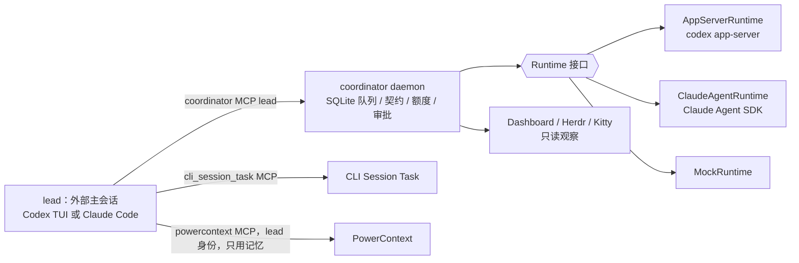
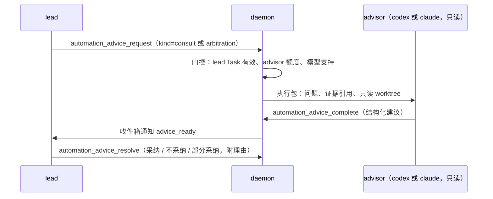
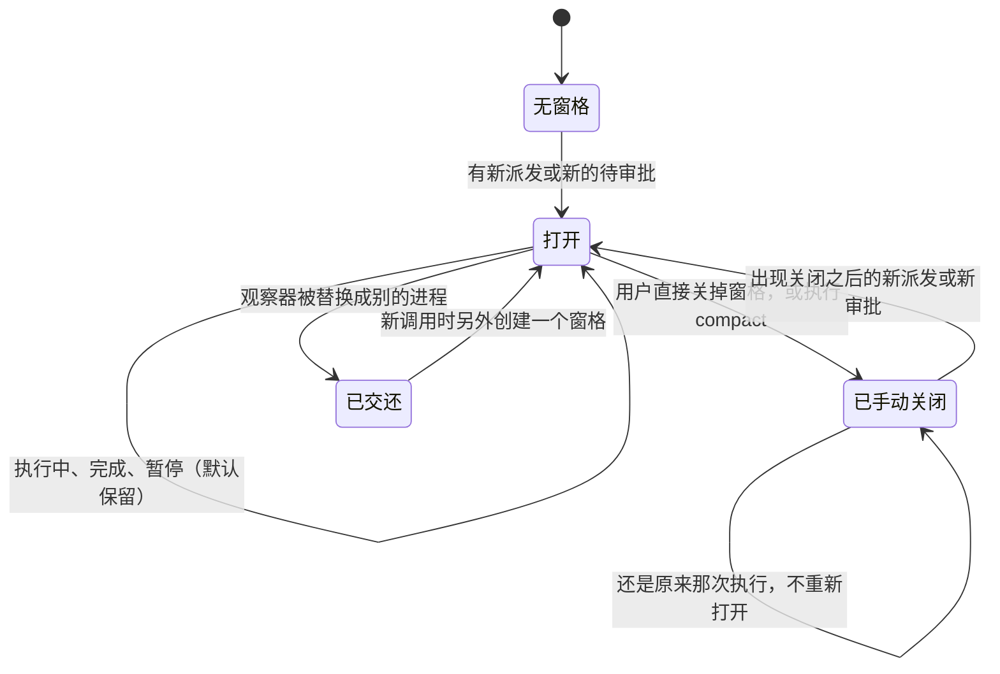

本方案把 coordinator 从"只能编排 Codex"扩展为"按角色选择 Codex 或 Claude"，并新增 advisor 角色，用于咨询和仲裁。典型组合是 Claude 当 lead、Codex 负责前后端实现、Claude 负责测试审计。两方共用同一套队列、门控、额度、审批和证据，现有的全 Codex 配置保持兼容。

版本为 2026 年 10 月 8 日的设计稿，各段内容已经和用户逐段确认。下文中的接口、字段和流程都是拟建设内容，尚未实施。

## 1 目标与范围

已确认目标：

- 每个由 daemon 托管的角色（frontend、backend、audit、advisor）都可以单独选择 `codex` 或 `claude` 来执行；lead 是外部主会话，可以是 Codex TUI，也可以是 Claude Code。
- 跨 agent 调用：Claude lead 可以派发给 Codex worker，再由 Claude 审计，替代原来的 Codex 审计角色；反过来也可以。
- 新增 advisor 机制：以咨询为主，同时支持仲裁；由 lead 主动发起，系统只在满足条件时提示 lead 是否需要仲裁。
- 每次执行都标注由哪个 agent 执行，以及实际模型、思考强度和用量，方便人工比较两方的效果。
- 先登记相关 MCP，补齐 PowerContext Principal 和授权。
- 整理 PowerContext 本地部署：迁移目录、制定备份策略、清理官方启动器。
- 适配当前终端环境：Kitty 外层 → Herdr → agent TUI。

不在本次范围内：

- 开放给内网其他用户（多用户、共享 daemon、按人命名的 Principal）。本次只保证本机可用，路径和命名不写死。
- PowerContext Handoff。本工作流不使用 Handoff，PowerContext 只作为跨 agent 的项目记忆，是辅助能力。
- worker 在执行过程中自主向 advisor 请教。
- 以原生交互 TUI 的形式运行 worker。worker 继续以后台线程方式运行，窗格只做只读观察。
- 维护官方 PowerContext 仓库。我们只维护自己这一版：`multi_principal_server.py` 加上已安装的 powercontext 1.1.0。

成功标准：同一份 runtime.json 能配出"Claude lead + Codex 前后端 + Claude audit + Claude advisor"，真实跑完一轮"契约 → 派发 → 审计 → 仲裁或咨询 → 返修 → 提交验收"；原有的全 Codex 配置不改就能运行；现有 168 项测试不修改即可通过。

## 2 总体方案

评估过三种方案：

| 方案 | 做法 | 结论 |
| --- | --- | --- |
| A：每个角色单独选运行时 | 保留 `Runtime` 接口，新增 `ClaudeAgentRuntime`，daemon 按角色配置创建 | **采用**。两方受同样的门控、留同样的证据，对现有 Codex 链路没有破坏性改动 |
| B：Claude 自己来领任务 | Claude 会话通过 MCP 自己领取派发、提交回执 | 不采用。daemon 管不到执行的开始、结束、超时和额度，两方门控强度不一样 |
| C：两方统一改用 CLI 单次执行 | `codex exec` / `claude -p` | 不采用。要放弃已经验证过的 App Server 能力，等于重写 |



## 3 前置环境整理

所有改动开始之前先完成本节。PowerContext 部署目录不属于本仓库；本节的运维操作由用户明确授权，在该目录自己的 git 仓库里提交，不在本仓库提交。

### 3.1 迁移 PowerContext 部署目录

从 `~/powercontext-demo` 迁到 `~/playground/powercontext`：

1. 先复制到新路径，并初始化 git 仓库；`.gitignore` 包含 `.env`、`principals.json`、`backups/`、`__pycache__/`。
2. 修改 LaunchAgent `com.local.powercontext-multi-principal` 里的 3 处路径（服务脚本、`--env-file`、`--credentials-file`），然后 `bootout` 再 `bootstrap`，服务会中断几秒。
3. 修改 `~/.config/powercontext/` 下 `codex-env.zsh`、`codex-env.fish`、`set-codex-launchd-env.sh` 里的 `.env` 路径；`.zshrc` 和 fish 配置会加载它们。改完后重新运行 `com.local.powercontext.codex-env`。
4. 修改 `configure_zcode_powercontext.py` 里默认的 `principals.json` 路径。
5. 更新 `~/.codex/POWERCONTEXT_MULTI_PRINCIPAL_RUNBOOK.md` 和 `~/.codex/memories/MEMORY.md` 里的路径。历史 rollout 摘要和 ZCode artifacts 是历史记录，保持原样。
6. 清理官方启动器 `com.oceanbase.powercontext`：
   - 现状：没有加载；锁定的是旧版 `.env` 的 inode 和大小（2203 字节，现在是 2977 字节），本来就已经失效；如果被加载，会和现有服务抢 8787 端口。
   - 做法：先确认它确实没有加载，再把 plist 和 `Application Support/powercontext/logs/launchd-retry*` 状态文件归档到 backups，然后从 `~/Library/LaunchAgents` 移出。
   - Codex 的 PowerContext 插件虽然来自官方仓库，但它正连着我们的服务，属于在用，保留。
7. 验证：
   - `/health/ready` 返回 200；
   - 每个 Principal 调用 `/v1/access/me`，返回预期身份；
   - 新开的 Codex shell 能读到授权；
   - ZCode 的 MCP 能正常调用。
8. 旧目录先保留，等用户确认后再删除。验证失败就把 plist 和环境脚本改回旧路径。

### 3.2 备份策略

现状：

| 位置 | 内容 | 体积 |
| --- | --- | --- |
| `~/Library/Application Support/powercontext/backups/` | 3 份数据库备份（9/22–9/24），2 个配置备份目录 | 129M |
| `~/powercontext-demo/` | 1 份数据库备份、2 份 `principals.json` 备份、1 份 `.env` 备份 | 36M |
| 线上数据库 | `powercontext.db` 加 WAL | 106M |

部分备份的 `-shm` 文件修改时间晚于备份时间，说明这些备份之后被读写方式打开过；有一份备份权限是 `0644`。

规则：

- 统一目录 `~/playground/powercontext/backups/<UTC 时间>-<原因>/`，目录权限 `0700`，文件 `0600`。
- 数据库用 SQLite 在线备份接口导出单个一致的文件，不带 `-wal`/`-shm`；同时备份 `principals.json` 和 `.env`；附带 `manifest.json`，记录 sha256、大小、来源、原因和关联的操作。
- 备份检查在每次做新备份前自动运行，也可以随时手动运行：
  - 校验每份备份的 checksum 是否和 manifest 一致；
  - 统计每份的大小、时间，以及是否已经有更新的备份取代；
  - 总量超过阈值时提示，默认阈值是线上数据库体积的 3 倍或 500M。
- 清理规则：
  - 至少保留最近 3 份校验通过的备份，以及和未完成操作关联的备份；
  - 只有超过 30 天、并且已经被更新的备份取代的，才列为清理候选；
  - 前提是服务健康，并且存在一份更新的、校验通过的备份；
  - 先列出清单，等用户确认后再删，不自动删除。
- 现有的分散备份迁入新目录并补建 manifest。被读写方式打开过的几份标记为"非原样"；`0644` 的那份修正为 `0600`。
- 备份脚本只用 Python 标准库实现，在独立的虚拟环境中运行，放在 `~/playground/powercontext/ops/` 下。

### 3.3 终端环境与版本

本机实际环境：Kitty 0.48.2 → Herdr 0.9.3 → agent TUI；Codex CLI 0.161.0；Claude Code 2.1.294。README 里验证过的是 Codex CLI 0.160.0 和 Herdr 0.9.1。实施前要重跑 `protocol-preflight`，并做一次真实的 Herdr 布局验证，然后把 README 里的已验证版本改成实际验证过的。

## 4 架构与配置

### 4.1 角色与执行方

| 角色 | 运行方式 | 可选 agent | 沙箱 |
| --- | --- | --- | --- |
| lead | 外部主会话（Herdr 主窗格里的 TUI） | codex / claude | 由宿主决定 |
| frontend / backend | daemon 托管的后台线程 | codex / claude | 自己的 worktree 可写 |
| audit | daemon 托管 | codex / claude | 只读 |
| advisor | daemon 托管 | codex / claude | 只读 |

### 4.2 runtime.json

```json
{
  "mode": "real",
  "leadMode": "external",
  "leadAgent": "claude",
  "leadWorktree": "/absolute/path/business-repo",
  "roles": {
    "frontend": { "agent": "codex" },
    "backend": { "agent": "codex" },
    "audit": { "agent": "claude" },
    "advisor": { "agent": "claude" }
  },
  "advisor": { "suggestAfterRejections": 2 },
  "realExecution": {
    "choices": {
      "frontend": { "model": "gpt-6-luna", "effort": "medium" },
      "backend": { "model": "gpt-6-luna", "effort": "medium" },
      "audit": { "model": "claude-opus-5-5", "effort": "high" },
      "advisor": { "model": "claude-opus-5-5", "effort": "high" }
    }
  }
}
```

兼容规则：

- 不写 `roles` 时，所有角色都按 `codex` 处理。
- `mode: "app_server"` 作为 `real` 的别名继续可用。
- 不写 `leadAgent` 时按 `codex` 处理。
- 现有配置的加载结果必须保持不变，用快照测试固定。

校验规则：

- `realExecution.choices` 里每个角色的模型，按该角色所属 agent 的实际模型列表校验：Codex 用 `model/list`，Claude 用 `supportedModels()`。不支持的组合在预留额度之前就拒绝。
- advisor 有独立的调用次数和输入上限。没有批准 advisor 额度时，咨询和仲裁请求直接拒绝，不占用 worker 额度。
- `leadWorktree` 必须在 `allowedRoots` 之内，并且对应一个已登记的 repository。

### 4.3 运行时

- `runtimeFactory` 按角色的 agent 创建运行时：`codex` 用现有的 `AppServerRuntime`，`claude` 用新增的 `ClaudeAgentRuntime`。门控、额度、审批和事后核对共用一份代码。
- `ClaudeAgentRuntime` 和 `Runtime` 接口的对应关系：

| `Runtime` 方法 | Claude Agent SDK |
| --- | --- |
| `initialize` | 建立 `query` 会话，读取 `initializationResult()` |
| `listModels` | `supportedModels()` |
| `startThread` | 预先分配 `sessionId`（UUID） |
| `resumeThread` | `resume: sessionId`，并核对返回的会话 ID 是否一致 |
| `startTurn` | 发送一条输入消息，带上 `model`、`effort`、`cwd`；用这条输入消息的 uuid 作为 turnId |
| `interruptTurn` | `interrupt()`；没有响应时终止子进程 |
| `readThread` | `getSessionMessages()`，或读取会话 jsonl，按输入消息划分出各轮及其状态 |
| `readTurnModel` | 从会话记录中取出本轮 assistant 消息的 `model` |

- 安全边界两方对齐：

| 约束 | Codex | Claude |
| --- | --- | --- |
| 不继承用户的插件和 hooks | `features.plugins=false`、`features.apps=false`，逐个禁用继承的 MCP | `settingSources: []`、`strictMcpConfig: true` |
| 只注入本角色的 MCP | `-c mcp_servers.coordinator_role` / `powercontext_role` | `mcpServers` 里只放这两个 |
| 工具白名单 | `enabled_tools`、`approval_mode` | `allowedTools`（如 `mcp__coordinator_role__automation_status`）加 `disallowedTools` |
| 只读沙箱 | `sandbox: read-only` | `sandbox` 设置，并禁用 `Edit`、`Write`、`NotebookEdit` |
| 审批 | App Server 发来的审批请求 | `canUseTool` 回调，接入同一个 `ApprovalBridge` 队列 |
| 环境变量 | 白名单 | **显式传入 `env`**（SDK 默认会继承 `process.env`） |

- 环境变量白名单只放行 `HOME`、`PATH`、`TMPDIR`、`LANG`、`LC_ALL`、`USER`、`LOGNAME`（Claude 依赖后两项读取本机登录态）、`CODEX_HOME`（仅 Codex），以及 `COORDINATOR_*` 角色变量和本角色的授权变量；`HERDR_*`、`KITTY_*`、`CLAUDE_CODE_*` 一律不传。两边都要有测试断言。
- 依赖：`@anthropic-ai/claude-agent-sdk@0.3.293`（2026-10-07 发布）。上表用到的选项已在它的类型定义中确认存在。
- 预检用 `accountInfo()` 确认 Agent SDK 使用本机已登录的 Claude 订阅账号（已在 2026-10-08 预检中验证）。init 消息的 `apiKeySource` 在订阅登录下为 `none`，不作为判断依据。如果不能，`ClaudeAgentRuntime` 内部改为直接驱动 `claude -p --input-format stream-json --output-format stream-json`，对外接口不变。

### 4.4 lead 启动脚本

涉及 `scripts/herdr-resume.sh`、`scripts/kitty-lead.sh`、`scripts/kitty-start.ts`。

- 用法：`npm run herdr:resume -- <runtime.json> --agent codex|claude <会话UUID>`。不写 `--agent` 时用 `leadAgent`，再没有就按 codex，兼容旧用法。
- 修正：现在的脚本写死了 `codex resume "$2" -C "$project_root"`，lead 的工作目录被固定成 coordinator 自己的仓库。改为先进入 `leadWorktree`，再执行 `codex resume <id> -C <dir>` 或 `claude --resume <id>`。Claude 会话按工作目录分开存储，必须在原来的目录里恢复。
- 注入 lead 的 MCP 连接（不做全局注册）：
  - Claude：`--mcp-config <私有运行目录>/lead-mcp.json` 加上 `--settings <私有运行目录>/lead-settings.json`；
  - Codex：用 `-c` 参数注入。
- 内置心跳：每 20 秒调用一次 `automation_lead_heartbeat`，带上 `agent`、真实会话 UUID 和 `leadWorktree`；lead 进程退出时停止。两种 agent 都不依赖模型自己记得发心跳。
- 凭据从私有运行目录里 `0600` 权限的环境文件加载；配置文件里只写环境变量名，不写 token。

### 4.5 换 lead

不使用 PowerContext Handoff。

1. 原 lead 调用 `automation_pause`，并核对在途执行。
2. 新 lead 在原 lead 心跳过期后发送心跳，带上新的会话引用和 agent。
3. 由人工在终端执行 `human-control lead-rotate`：只有在暂停状态下、原 lead 心跳已过期、且 lead 没有在途工作时才执行，lead generation 加一，旧 lead 的连接随即失效。新 lead 用新 generation 发心跳，daemon 记录接替事件（新旧会话、各自的 agent、时间）。不满足条件的心跳返回 `LEAD_CONFLICT`。
4. lead 自己的 CLI Task 由新 lead 用 CLI Task 原生的 session 接替完成。
5. 新 lead 解除暂停。

### 4.6 PowerContext 的定位

- PowerContext 只用来持久保存跨 agent 的项目记忆：worker、audit、advisor 只读，lead 写入。
- lead 写入时带上 `agent`、`model`、`effort`：优先写进 Source 的 metadata；如果 `remember_memory` 不支持自定义 metadata，就写在正文开头，格式为 `[agent=… model=… effort=…]`。实施时先确认用哪种方式。
- 禁用 Handoff 的 7 个工具：`handoff_current_work`、`commit_handoff`、`continue_handoff`、`acknowledge_handoff`、`activate_handoff`、`finalize_handoff`、`get_handoff_report`。Claude lead 用 `permissions.deny` 禁用；Codex lead 的 `enabled_tools` 白名单里不包含它们；daemon 托管角色的白名单本来就没有。

## 5 advisor

### 5.1 流程



### 5.2 接口

| 工具 | 调用方 | 字段 |
| --- | --- | --- |
| `automation_advice_request` | lead | `kind`（consult、arbitration）、`question`、`refs`（派发 ID、审计 ID、契约 revision、路径）、`operationId`；可以指定 model/effort，但必须在已批准的额度范围内 |
| `automation_advice_complete` | advisor | `adviceId`、`recommendation`、`rationale`、`risks`、`confidence`、`evidenceRefs`；仲裁另加 `verdict`：`uphold_rejection`（维持拒绝）、`overturn`（推翻）、`needs_more_evidence`（证据不足） |
| `automation_advice_get` | lead | 查询状态和结果 |
| `automation_advice_resolve` | lead | `decision`（adopted、rejected、partial）和 `note`；只能写一次 |

建议记录的状态：`queued` → `active` → `completed`，失败时为 `failed`，结果未知时为 `needs_reconciliation`。advisor 执行同样使用 durable scheduler 的租约、超时中断和"结果未知时按原 operationId 查询"的规则。

### 5.3 仲裁提示

满足下面任一条件时，daemon 往 lead 收件箱发一条 `arbitration_suggested`，附上相关引用：

- worker 通过消息队列对某个审计 ID 发出异议，新增消息类型 `dispute`，必须引用 `validationId`；
- 同一个 `contractRef` 连续 `rejected` 的审计轮数达到 `advisor.suggestAfterRejections`，默认 2 轮。

系统不会自动派发仲裁，是否发起由 lead 决定。同一条链路只提示一次，出现新的拒绝或新的异议时再提示。

### 5.4 边界

- advisor 只能用 `automation_status`、`automation_events`、`automation_operation_get`、`automation_advice_get`、`automation_advice_complete` 和 PowerContext 的读工具，在目标 worktree 上只读。它没有派发、审计或写消息的能力。
- 仲裁结果不改审计状态。即使 `verdict=overturn`，原来的 `rejected` 记录也保留；要推翻，必须由 audit 重新审计一轮，或者由人工决定。
- 门控沿用 lead 自己的 CLI Task 绑定（Task 必须有效），advisor 不持有任何 Task 租约。
- 每条建议记录 worker、audit、advisor 三方各自的 agent、实际模型和思考强度。三方是同一种 agent 时，标记为"同源仲裁"。

## 6 身份与 MCP 登记

### 6.1 Principal

Principal 按角色划分，与执行方是哪个 agent 无关；agent 记录在 coordinator 的证据里。

| Principal | 状态 | 项目 Scope 角色 | `collaborative_writer` |
| --- | --- | --- | --- |
| `coordinator-lead` | 新建（`principals.json` 中现在缺失） | viewer、contributor、reviewer | true |
| `coordinator-frontend` / `coordinator-backend` | 已有，不变 | viewer、contributor | true（工具白名单只开读） |
| `coordinator-audit` | 已有，不变 | viewer、reviewer | false |
| `coordinator-advisor` | 新建 | viewer | false |

- 不使用 Handoff 之后，lead 不再需要 delegator，按最小权限去掉。
- 授权只针对目标项目 Scope，使用 Access API `/v1/access/bindings/create`，带稳定的 `idempotency_key`；不使用 `--bootstrap-access`，因为它会把权限同步到全部 Scope。实施前先确认 bootstrap 具体会同步哪些 Principal，避免以后某次运行时把权限放大。
- Scope 落点：本项目使用 `scp_2759kw81x6233xpacens49sfrc`（标题与外部引用均为 `codex-session-coordinator`）；协调其他业务项目时使用该项目自己的 Scope，不回退到 Default。
- lead 和 advisor 新建 role-session 绑定键，格式为 `{integration: "codex-session-coordinator", kind: "role-session", external_id: "<group>/<role>/<generation>"}`，并绑定到项目 Scope。

### 6.2 MCP

| MCP | lead 是 Claude | lead 是 Codex | daemon 托管的角色 |
| --- | --- | --- | --- |
| `cli_session_task`（`http://172.16.0.90:47321/mcp`） | 在 Claude 用户级登记一次（`claude mcp add --scope user --transport http`）；读工具放行，写工具保持询问 | 已有 | 不注入，Task 门控由 daemon 处理 |
| `coordinator`（lead 角色） | 启动脚本用 `--mcp-config` 注入 | 启动脚本用 `-c` 注入 | 注入本角色的 `coordinator_role` |
| `powercontext`（lead 身份） | 启动脚本注入，`headers.Authorization` 写 `${POWERCONTEXT_COORDINATOR_LEAD_AUTHORIZATION}` | 启动脚本注入，用 `env_http_headers` | 注入本角色的 `powercontext_role`，只开读工具 |
| Handoff 工具 | `permissions.deny` 禁用 | 不在白名单里 | 不在白名单里 |

### 6.3 Skill

- 把 `task-recovery`、`submit-for-acceptance`、`dependency-validation`、`dependency-repair` 复制到 `~/.claude/skills/`。它们的正文没有 Codex 专有引用，依赖已登记的 `cli_session_task`。
- `skills/codex-session-coordinator` 改成两方通用的写法：MCP 工具名同时给出两方的形式，`codex resume` 改为启动脚本加 `--agent`，补充心跳、advisor 和换 lead 流程，并说明不使用 Handoff。是否改名在实施计划里决定；Codex 侧已经安装的副本不能被静默覆盖。
- `references/operations.md` 补充 Claude 的 MCP 登记方式和入口选择表。

### 6.4 登记顺序

每一步对外写入前，都先列出具体命令，等用户确认后再执行。

1. 按 3.2 做备份。
2. 在 `principals.json` 新增 `coordinator-lead`、`coordinator-advisor` 两条凭据，运行 `multi_principal_server.py --check`。
3. 重启 PowerContext 服务，时机由用户确认。
4. 用 Access API 为项目 Scope 授权，并建立 role-session 绑定。
5. 核验：
   - 每个角色调用 `/v1/access/me`，返回预期 Principal；
   - `/v1/access/check` 检查允许项和拒绝项，例如 advisor 和 audit 写入要被拒绝，lead 委派要被拒绝；
   - 精确解析绑定（`allow_default=false`）。
6. 在 Claude 中登记 `cli_session_task`，并复制 skill。
7. 扩展 `project-preflight`，覆盖 5 个角色以及 Claude 运行时的鉴权预检。

## 7 证据与观察

### 7.1 执行记录字段

派发、审计、advisor 建议、仲裁的每条执行记录都带同一组字段：

| 字段 | Codex 来源 | Claude 来源 |
| --- | --- | --- |
| `agent` | 角色配置 | 角色配置 |
| 请求的模型和思考强度 | 派发包 | 派发包 |
| 实际模型 | rollout 里的 `turn_context`（现有逻辑） | `~/.claude/projects/<slug>/<sessionId>.jsonl` 中本轮所有 assistant 消息的 `message.model`，必须一致才采信 |
| 实际思考强度 | `turn_context.effort` | 会话记录中本轮 assistant 行的 `effort`，必须一致才采信，否则显示"未知" |
| 证据来源 | `codex_turn_context` | `claude_transcript`（新增） |
| token 用量 | App Server 的用量通知，取本轮增量 | SDK 结果消息里的 `modelUsage` |
| 费用 | 显示"未知" | `total_cost_usd`，标注"估算，非账单" |
| 耗时、结果 | 本轮开始和结束时间、是否完成、审计结论 | 同左 |

- 读取 Claude 会话记录时，沿用 `model-evidence.ts` 的安全约束：真实路径必须在 `~/.claude/projects` 之下，不跟随符号链接，文件属主是当前用户，大小有上限，格式出错就不采信。
- token 写入新增的按派发记录的 `TurnUsageLedger`；`UsageLedger` 保留给单机 MCP 模式。Codex 取 `thread/tokenUsage/updated` 中 `total` 在本轮内的增量。
- 实际模型对不上或者证据缺失时，显示"未确认"，不用请求值代替。

### 7.2 展示

- **Dashboard**：
  - 每条派发和审计记录带 agent 标签，例如 `codex · gpt-6-luna · medium`；
  - 仲裁记录显示三方标签，三方是同一种 agent 时显示"同源仲裁"；
  - 新增"执行方对比"只读面板，按 agent × 角色汇总：派发数、一次审计通过率、平均返修轮数、平均耗时、token 用量、advisor 建议采纳率；样本少时注明样本量，不下结论；
  - 面板只统计 `completed` 且回执和审计都核对过的记录，失败归档和 `needs_reconciliation` 的单独计数。
- **Herdr/Kitty 观察窗**：标题行带 agent 标签。
- **CLI Task checkpoint**：lead 提交时附带各执行方的 agent、模型和审计结论摘要，验收 `pending_acceptance` 时可以看到。

### 7.3 终端入口与窗格行为

入口选择：

| 环境 | 入口 |
| --- | --- |
| Kitty 外层，里面运行 Herdr（当前环境） | `herdr:resume` |
| 只有 Kitty | `kitty:start` |
| 两者都没有 | Dashboard 加普通终端 |

推荐布局：在 Herdr 里分三个 tab，分别放 daemon（前台运行）、Dashboard（可选）和 lead 主窗格；观察窗按需从 lead 主窗格旁边分屏出来，最多 5 个（frontend、backend、audit、advisor 加 lead 主窗格）。

修正项：

- 一个协同组只允许一个布局控制器，Herdr 和 Kitty 共用一把锁。检测到 `HERDR_ENV=1` 时，`kitty:start` 拒绝运行，并提示改用 `herdr:resume`。
- 在 Herdr 窗格内，`KITTY_WINDOW_ID` 和 `KITTY_LISTEN_ON` 不会被继承，所以误运行 `kitty-follow` 会被现有检查拦下。这一行为要补测试固定。
- Codex worker 的环境白名单不包含 `HERDR_*`；两边的 `herdr-agent-state.sh` 在缺少 `HERDR_ENV`、socket 或 pane 时都会直接退出。所以 worker 即使运行了 hooks，也不会把状态报到用户的窗格。这一行为要补测试固定。

窗格行为（Herdr 和 Kitty 都采用）：



1. 允许随时手动关闭，不管是暂停、完成，还是正在执行。控制器发现自己的窗格不见了，就当作用户主动关闭：从映射里删掉，记一条 `pane_closed_by_user` 事件，然后继续工作，不冻结。正在执行时关闭的，执行照常进行，Dashboard 上显示"观察窗已手动关闭"。
2. 只有新的调用才重新打开。关闭时记下这个角色当时最新的派发 ID 和审批 ID，只有出现比它们更新的派发或审批时才重新创建窗格。
3. 出现新的待审批时也会重新打开窗格；审批本身仍然通过 `human-control` 完成。
4. compact 不用停控制器。Herdr 改成和 Kitty 一样，通过请求文件发给正在运行的控制器：`npm run herdr:compact -- <runtime.json> [--role <name>]`。默认只收起没有在执行的角色。
5. lead 所在 tab 里用户自己开的窗格，控制器忽略，也不会去动它。
6. 自有窗格里的观察器被换成别的进程时，控制器把这个窗格交还给用户：不关闭、不再更新，下次调用时另外创建一个新窗格。
7. 仍然会停止控制的情况：lead 窗格消失或 lead 进程退出、tab 或 workspace 对不上、Herdr 返回无法识别的结果。这几种都会停下并保留现场。
8. `herdr-panes.json` 和 `kitty-panes.json` 增加 `closedAt: {role: {dispatchId, approvalId}}` 和已交还窗格列表。控制器重启后，不会把已关闭的窗格重新打开，也不会去碰已交还的窗格。
9. `WorkerRole` 增加 `advisor`。

## 8 错误处理

沿用现有错误码，以及"出错就关闭、结果不明先核对"的原则。

| 场景 | 处理 |
| --- | --- |
| Claude SDK 子进程退出或输出流断开 | `RUNTIME_DISCONNECTED`，在途的执行标记为 `needs_reconciliation`，不自动重试 |
| 输出流结束但没有收到结果消息 | 结果未知。去会话记录里查本次输入消息的 uuid 和后续内容；以业务回执为准，没有回执就保持待核对 |
| 鉴权失败、限流、订阅用量上限 | 新增错误码 `PROVIDER_UNAVAILABLE`。这次派发记为 `runtime_failed`，额度照常扣除，不自动换 agent 或换模型 |
| 超过 `maxTurnMs` | 先调用 `interrupt()`，没有响应就终止子进程；这次执行记为 unknown，对应的审批作废 |
| daemon 重启 | 用 `resume: sessionId` 恢复 Claude 线程，在途执行按上面的规则核对 |
| 派发时模型和 agent 对不上 | 在预留额度之前报 `INVALID_INPUT`，不扣额度 |
| advisor 执行失败 | 只影响这条建议，状态变为 `failed` 或 `needs_reconciliation`，不阻塞 worker 和审计；lead 收件箱会收到通知 |
| 两个 lead 同时在线 | `LEAD_CONFLICT` |
| 布局控制 | 按 7.3 的规则继续运行或停止 |
| PowerContext 不可用 | 角色初始化时的身份核验失败就拒绝启动；执行过程中读记忆失败，由 worker 写进证据，不阻断执行 |
| 备份 checksum 不一致 | 这份备份标记为损坏，不算有效备份；没有更新的有效备份时，拒绝任何清理 |

## 9 测试与验证

先写测试再实现。凡是不调用真实模型的测试都离线运行。

1. **单元测试**
   - `ClaudeAgentRuntime`：用假的 SDK 输出流，覆盖开始、恢复、执行、中断、结果未知和断开。
   - 环境变量白名单：断言不包含 `HERDR_*`、`KITTY_*`、`CLAUDE_CODE_*`。
   - 工具策略：`allowedTools`、`strictMcpConfig`、`settingSources: []`、只读角色禁用写工具。
   - `canUseTool` 到 `ApprovalBridge` 的映射。
   - 会话记录解析：模型不一致、符号链接、超大文件、别人的会话、格式损坏。
   - 配置：旧配置加载结果不变（快照比对）；按角色创建运行时；按 agent 校验模型；`leadWorktree` 的校验。
   - advisor：请求和完成的幂等性、额度独立、`overturn` 不改审计状态、同源标记、两种提示触发条件、同一链路不重复提示。
   - 换 lead 的门控，以及 `LEAD_CONFLICT`。
   - Herdr 和 Kitty 控制器：手动关闭、只有新调用才重新打开、外来窗格忽略、窗格交还、compact 请求、共用锁、在 Herdr 内拒绝 `kitty:start`、Kitty 环境变量不继承。
   - 启动脚本：用假的 `codex` 和 `claude` 可执行文件，验证 agent 选择、工作目录、注入的 MCP 参数，以及 lead 退出后心跳停止。
   - 用量写入 `UsageLedger`；对比面板的汇总只统计已核对过的记录。
2. **回归**：现有 168 项测试不修改即可通过，只有以下已确认的行为变更例外：`tests/herdr.test.ts` 的外来窗格冻结、观察器被替换后 compact 两项，`tests/kitty.test.ts` 的外来窗格冻结一项，以及启动脚本用法字符串；`typecheck` 和 `build` 通过。
3. **Mock 端到端场景**：配置为 Claude lead + Codex 前后端 + Claude audit + Claude advisor。流程：契约 → 派发 → 回执 → 审计拒绝 → worker 提出 dispute → 自动提示仲裁 → advisor 建议 → lead 记录决定 → 重新审计通过 → 核对 checkpoint 内容。
4. **零模型调用的预检**：Codex 重跑 `protocol-preflight`；Claude 检查 `supportedModels()`、鉴权来源和生效的工具策略；`project-preflight` 覆盖 5 个角色。
5. **PowerContext 运维**：备份脚本用临时 SQLite 库测试一致性备份、manifest 校验、清理候选筛选和各种拒绝清理的条件；迁移按 3.1 的验证清单逐项检查。
6. **真实验证**：以 Dashboard 的"执行方展示"作为真实任务，用新工作流本身来实现它（见 9.1）。
7. **Dashboard 页面测试**：沿用共享 Edge CDP，在 390px 宽度下检查对比面板和 agent 标签，无溢出、无页面错误。

完成标准：以上各项都有实际结果记录，真实验证的结果写进 `docs/verification.md`。没有验证过的项明确列出，不说成已完成。

### 9.1 真实验证任务

用 Dashboard 的"执行方展示"作为真实验证的对象。实施时，这部分**不由 lead 直接实现**，而是在运行时、advisor、证据采集等功能完成并通过离线测试后，通过新工作流派发给 worker 完成：

- **backend（codex）**：修改 `src/dashboard/contracts.ts` 和 `src/dashboard/projection.ts`。快照里增加每条记录的 agent、实际模型、思考强度、token、费用字段，以及"执行方对比"的汇总数据，汇总只统计已核对过的记录。
- **frontend（codex）**：修改 `web/dashboard.html`、`dashboard.js`、`dashboard.css`。增加 agent 标签、"同源仲裁"标记和"执行方对比"面板，遵守 `DESIGN.md` 的约束（只读、未知值明确标注、390px 下无溢出）。
- **audit（claude）**：按契约 revision 和 baseline 审计前后端结果，用实际证据记录结论。
- **advisor（claude）**：至少做一次咨询，例如对比面板的指标定义和小样本时怎么提示。如果审计拒绝，再按 5.3 的流程试一次仲裁。

前提条件：为本仓库建立两个独立的 frontend、backend worktree，在 CLI Session Task 中分别登记 Task 并取得租约；本项目的 PowerContext Scope 已对 5 个角色完成授权。

执行前，lead 要记录各角色的 model、effort、调用次数、并发、输入上限和过期时间，等用户批准 `realExecution` 后才派发。验收由用户在 CLI Session Task 中完成。

## 10 实施顺序

1. 前置环境整理（第 3 节），在 PowerContext 部署目录完成。
2. 身份与 MCP 登记（第 6 节）。
3. 配置与运行时抽象，以及 `ClaudeAgentRuntime`（第 4.1–4.3 节）。
4. advisor（第 5 节）。
5. 证据采集写入存储层（第 7.1 节中除 Dashboard 展示以外的部分）。
6. lead 启动脚本、心跳和换 lead（第 4.4–4.5 节）。
7. 终端控制器修正（第 7.3 节）。
8. Skill 与文档（第 6.3 节、README）。
9. 真实验证：通过工作流实现 Dashboard 的执行方展示（第 9.1 节）。

每一步完成后运行完整测试。会改动外部状态的步骤（第 1、2 步，以及第 9 步的真实执行）在执行前都要单独取得用户确认。

## 11 补充（2026-10-08 晚）：宿主身份与 PowerContext hooks 协议

用户确认的调整：

- **lead 是会话标记，不是 Principal。** lead 只体现在 role-session 绑定键 `<group>/lead/<generation>` 上；lead 读写 PowerContext 使用宿主 agent 自己的身份：Claude 主会话为 `claude-macmini`，Codex 为 `codex-macmini`。今天新建的 `coordinator-lead` 撤销。由 daemon 托管的 frontend、backend、audit、advisor 继续使用各自的 `coordinator-*` Principal。
- **新增 `claude-macmini`**，与 `codex-macmini`、`zcode-macmini` 同级：service 类型、`collaborative_writer=true`、`bootstrap_roles` 为四个 Scope 角色、`bootstrap_admin=true`。
- **Codex 暂不作为 lead。**
- **PowerContext hooks 改成"核心协议 + 宿主适配层"**，由我们自己维护的仓库 `~/playground/powercontext` 承载，Codex 和 Claude 一起切换到这一版，ZCode 暂不处理：
  - 核心包 `powercontext_hooks`：会话绑定（SessionStart）、记忆召回与 prompt 记录（UserPromptSubmit）、PowerContext 工具调用绑定（PreToolUse）、token 统计（Stop）。逻辑沿用官方插件 0.2.0。
  - 宿主配置 `HostProfile`：`CODEX`（`POWERCONTEXT_CODEX_*`、`~/.codex/powercontext`、integration/origin 为 `codex`、MCP 配置用 `env_http_headers`）和 `CLAUDE`（`POWERCONTEXT_CLAUDE_*`、`~/.claude/powercontext`、integration/origin 为 `claude`、MCP 配置用 `headers` 加 `${VAR}`）。
  - 统一入口：`python -m powercontext_hooks --host <codex|claude> <session-start|bind-tools|recall|token-savings>`。
  - 插件外壳 `plugins/codex/powercontext`、`plugins/claude/powercontext` 自包含（构建时复制核心包）；同一目录提供 Codex（`.agents/plugins/marketplace.json`）和 Claude（`.claude-plugin/marketplace.json`）两种本地 marketplace。
  - Codex 切换：`config.toml` 中 `[marketplaces.powercontext]` 改为本地来源，市场名和插件名都不变，hooks 重新信任一次。
  - Claude 安装：`claude plugin marketplace add` 加 `claude plugin install powercontext@powercontext`；token 通过 `~/.config/powercontext/claude-env.{zsh,fish}` 从 `.env` 的 `POWERCONTEXT_CLAUDE_AUTHORIZATION` 读取（只覆盖终端里的 Claude CLI）。
- **coordinator 侧**：lead 启动器不再注入 PowerContext 连接，改用宿主插件的连接，仍禁用 7 个 Handoff 工具；runtime 配置中 lead 的 enrollment 使用宿主 Principal。托管 worker 不加载用户插件（Codex `features.plugins=false`，Claude `settingSources: []`），不受影响。
- **验收**：Codex 适配层的常量和输出与官方插件一致（特征测试）；Claude 新会话中召回、绑定和 prompt 记录生效，Access 审计里的请求身份为 `claude-macmini`；Codex 新会话行为不变。
