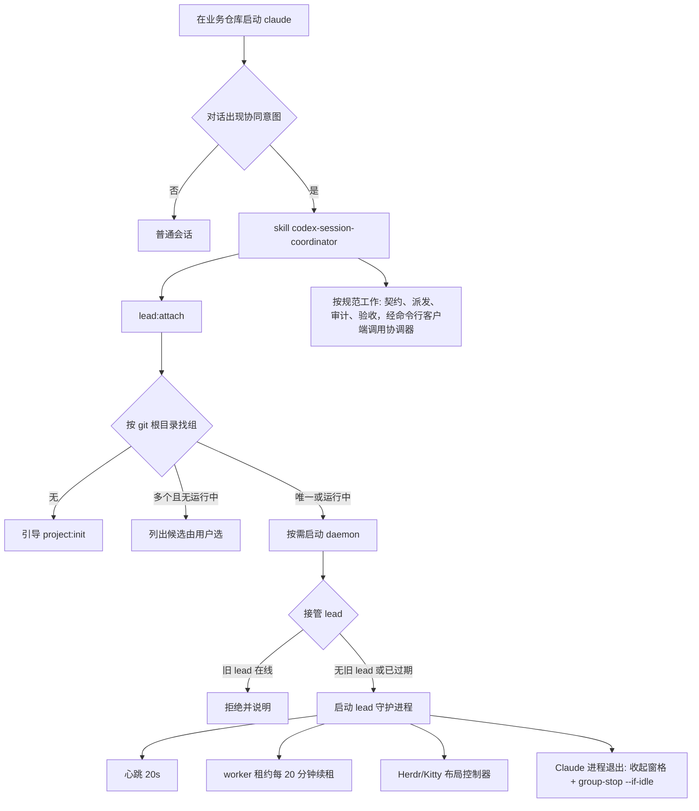

# 设计：普通 claude 会话按意图接入协同（skill 驱动的 lead 接入）

- 日期：2026-10-09（Asia/Taipei）
- 状态：待用户审阅
- 分支：`feat/skill-driven-lead`

## 1. 背景与目标

coordinator 是一套**执行协同的规范**：把 CLI Task（任务与租约）、PowerContext（项目记忆）、codebase-memory（代码图谱）三个 MCP 串起来，约定 lead、worker、审计、顾问如何配合。规范的载体是 skill `codex-session-coordinator`；daemon、心跳、布局控制器、`group-stop` 是执行规范用的运行时工具，不需要以 MCP 形式出现在 lead 会话里。

目前 lead 必须用启动器（`new-lead.sh` / `resume-lead.sh` → `herdr-resume.sh` → `lead-session.js`）启动：它注入 coordinator MCP、发心跳、拉起布局控制器、禁用 Handoff。直接 `claude` 启动的会话不会接入。

**目标**：用户在业务仓库里普通启动 `claude`；对话出现协同意图时，由 skill 在会话内完成接入；用户只与这一个 Claude CLI 会话交互，其余进程与窗格按需开启、随会话退出关闭。

**原则**（已记入长期记忆）：只有主会话由用户操作；派生的窗格和进程都有归属，lead 正常退出时自动收尾；用户接管的窗格不动；异常退出时保留现场便于排查。

**非目标**：不改变派发、审计、授权、验收的业务规则；不做 SessionStart 自动接入（普通会话不应被接入）；不改用户全局 Claude 设置。

## 2. 用户流程

## 3. 组件

| 单元 | 职责 | 接口 / 依赖 |
| --- | --- | --- |
| `src/lead-attach.ts`（新） | 纯逻辑：找组（`resolveGroup`）、环境检查（`attachContext`）、是否已接入（`attachState`） | 输入运行目录列表、git 根目录、环境变量；无副作用，可单测 |
| `scripts/lead-attach.ts`（新，`npm run lead:attach -- --cwd <repo>`） | 会话内接入：找组 → 按需启动 daemon → 接管 lead → 拉起守护进程；可重复执行，已接入则返回状态 | 读取 `CLAUDE_CODE_SESSION_ID`、`CLAUDE_PID`、`HERDR_*` 或 Kitty 环境；输出单行 JSON 结果供 skill 解读 |
| `scripts/lead-supervisor.ts`（新） | 后台守护，生命周期跟随 `CLAUDE_PID`：心跳、worker 续租、布局控制器、退出收尾 | 复用 `herdr-follow` / `kitty-follow`（子进程，`COORDINATOR_LEAD_PID=CLAUDE_PID`）、`group-stop`、`worker-task renew` |
| `src/external-lead.ts`（改） | 旧 lead 心跳过期即可接替，不再要求人工轮换（新 generation）；接替写入 `lead_successions` | 现有心跳接口不变 |
| skill（改） | 写明触发意图、接入步骤、"不使用 Handoff"规则、lead 自身 CLI Task 续租提醒；以接入脚本取代启动器 | `SKILL.md`、`references/operations.md`，仓库与已安装副本同步 |

协调器路径：skill 中写明协调器 checkout 位置，命令以 `npm --prefix <协调器> run ...` 执行；lead 对协调器的调用统一走 `npm run client -- <runtime> lead <命令>`。

## 4. 关键规则

### 4.1 找组

- 候选：协调器 `.state/*/runtime.json` 中 `leadWorktree` 等于当前仓库 git 根目录（取 `git rev-parse --show-toplevel`，规范化真实路径）的组。
- 唯一 → 选中；多个 → 选 daemon 正在运行（`daemon.pid` 存活且命令行含该 runtime 路径）的那个；仍不唯一 → 返回候选列表，由 skill 让用户选；零个 → 返回 `NO_GROUP`，skill 引导 `project:init`（Scope、仓库标识等由用户提供）。

### 4.2 接管 lead

- 会话标识：`sessionRef = CLAUDE_CODE_SESSION_ID`，`agent = claude`，`cwd = leadWorktree`。
- 心跳时若已登记的会话不同：旧心跳已过期（`expires_at <= now`）→ 接替，记录 `lead_successions`；未过期 → `LEAD_CONFLICT`，接入失败并提示"另一个 lead 仍在线"。
- 不再要求 generation 递增；`human-control lead-rotate` 保留为人工强制手段。
- `lead-session.json` 照常记录当前会话，便于排查。

### 4.3 守护进程

- 绑定 `CLAUDE_PID`；每秒检查存活。
- 心跳：每 20 秒 `automation_lead_heartbeat`；失败只在状态变化时写日志（沿用 `heartbeatReporter`）。
- worker 租约：配置了 `workerTasks` 且 `worker-hold` 在运行时，每 20 分钟请求续租（等价于 `renew-workers.sh`）；`worker-hold` 未运行而配置了 `workerTasks` 时由接入脚本先启动它。
- 布局：`HERDR_ENV=1` 且 `HERDR_SOCKET_PATH/PANE_ID/TAB_ID/WORKSPACE_ID` 齐全 → 运行 `herdr-follow`；否则 `KITTY_WINDOW_ID` 与 `KITTY_LISTEN_ON` 齐全 → 运行 `kitty-follow`；都设 `COORDINATOR_LEAD_PID=CLAUDE_PID`；两者都不满足则不开窗格。
- 收尾：`CLAUDE_PID` 消失 → 等布局控制器按已有逻辑关闭自己的窗格 → 执行 `group-stop --if-idle` → 删除 `lead-supervisor.pid` → 退出。
- 记录 `lead-supervisor.pid`（内容含 pid 与 sessionRef），供接入幂等判断。

### 4.4 自动与人工边界

| 自动完成 | 仍由用户决定 |
| --- | --- |
| daemon 启停、`worker-hold` 启动/续租/停止、观察窗格、lead 心跳、过期 lead 接替 | `realExecution` 授权、`human-init`、看板取消或验收、追加额度、收尾方式 |

lead 自身的 CLI Task 租约由会话通过 CLI Task MCP 续（守护进程无法使用会话的 CLI Task 连接），skill 在每次派发/归档前和约 20 分钟间隔提醒 lead 取证并 checkpoint。

## 5. 失败处理

| 情况 | 处理 |
| --- | --- |
| 不在 Herdr 也不在 Kitty | 只启心跳与续租，不开窗格，结果中说明 |
| daemon 启动失败 | 返回日志路径，不自动重试 |
| 旧 lead 在线 | `LEAD_CONFLICT`，不启守护进程 |
| 同一会话重复接入 | 守护进程存活且 sessionRef 相同 → 返回 `ALREADY_ATTACHED` |
| 另一会话的守护进程残留但其 Claude 已退出 | 视为过期：结束残留守护进程后重新接入 |
| 守护进程崩溃 | 窗格保留（沿用规则），心跳停止后 lead 判为离线；再次接入即恢复 |
| Claude 被强制结束 | 守护进程照常收尾 |
| 缺少 `CLAUDE_PID` / `CLAUDE_CODE_SESSION_ID` | 拒绝接入并说明（非 Claude Code 环境） |

## 6. 测试

- `resolveGroup`：唯一、多个（含运行中优先）、零个、子目录启动、符号链接路径。
- `external-lead`：过期即接替并记录 succession；在线时 `LEAD_CONFLICT`；同会话续期不产生 succession。
- `attachState`：同会话已接入、他会话残留守护进程、无守护进程。
- 守护进程脚本级测试：mock 模式真实 daemon + 假 Herdr socket + 假 Claude 进程，验证心跳到达、续租按（测试缩短的）间隔触发、假 Claude 退出后窗格关闭且空闲组停止。
- 接入脚本脚本级测试：缺环境变量拒绝；`NO_GROUP`；正常接入输出结果并留下 `lead-supervisor.pid`。
- 实机验收：测试业务仓库中在 Herdr 里普通启动 `claude`，说"开始协同"，确认自动接入、窗格按需打开、退出后窗格关闭、空闲组停止。

## 7. 迁移

- 新流程实机验收通过后：退役 `new-lead.sh`、`resume-lead.sh` 与 `herdr-resume.sh`、`kitty-lead.sh` 的 lead 模式，删除给 lead 注入 coordinator MCP 的 `buildLeadLaunch` 相关逻辑；`project:init` 不再生成这两个脚本；保留 `lead-rotate.sh`。
- Handoff 禁用改为 skill 规则，不改全局设置。
- 文档：`docs/new-project-herdr.md` 第 7 步改为"在 Herdr 中启动 `claude`，说明要做的事"；skill 触发描述写清意图（开始/继续协同、派发、审计、验收、恢复某组等）。
- 落地后更正 PowerContext 中"已确认只需启动 claude"的不准确记忆。
