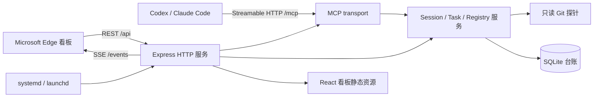

# cli-session-task-mcp

`cli-session-task-mcp` 是供团队内部使用的 MCP 任务协作服务。它把 Agent 会话、Git
worktree、任务租约、结构化 checkpoint、跨仓库依赖和人工验收统一记录在一个可审计的任务
台账中，并提供仓库看板、个人仪表盘和全局只读总览。

服务面向 Codex、Claude Code 等支持 Streamable HTTP MCP 的 Agent 客户端。Agent 负责登记、
执行、验证和提交待验收；人工负责决定、验收、驳回和最终完成，服务不会让 Agent 绕过人工
验收。

## 能力

- 将每个 MCP transport 绑定到明确的 repository、owner 和 worktree。
- 通过任务 scope、Git 状态和活跃租约提前发现并发冲突。
- 用幂等 `operation_id` 和乐观锁 `expected_version` 保护所有任务写入。
- 保存完成项、当前状态、验证结果、阻塞、人工决定和下一步等结构化 checkpoint。
- 支持同仓库多 worktree 切换，以及跨 repository、跨 owner 的任务依赖。
- 在下游仓库看板保留依赖动态、验证请求、反馈理由、已读状态和处理结果。
- 通过 Web 看板完成人工验收、驳回、取消和租约管理。
- 单进程提供 MCP、REST API、SSE、静态看板和健康检查。

## 适用场景

| 场景 | 解决的问题 |
| --- | --- |
| 单仓库开发 | 将 Agent 的目标、改动范围、验证和提交状态留在统一台账中 |
| 多 worktree 并行 | 避免同一 Session 或不同任务误写到错误 worktree |
| 多 Agent 协作 | 在开始写入前识别 scope、文件和租约冲突 |
| 跨仓库依赖 | 上游准备验证后通知下游，下游 Agent 自动执行并保留证据与理由 |
| 跨 owner 协作 | 允许依赖关联和只读查看，同时保持任务写权限属于真实 owner |
| 人工决策 | 在 Agent 对话中核对决定，记录后恢复等待中的任务 |
| 人工验收 | Agent 只能提交 `pending_acceptance`，由任务 owner 最终验收或驳回 |
| 中断恢复 | 用 checkpoint、Git 快照和任务版本恢复上下文，而不是依赖聊天记录 |

不适合把服务直接暴露到公网，也不适合用它替代 Git、CI、代码评审或团队沟通工具。它记录
工作流事实和协作状态，不保存仓库凭据、Provider token 或其他秘密。

## 架构



默认由一个 Node.js 进程监听一个端口：

- `/mcp`：Streamable HTTP MCP。
- `/api`：看板 REST API。
- `/events`：任务与依赖动态 SSE。
- `/board`：React Web 看板。
- `/health`：健康检查，成功返回 `{"ok":true}`。

## 环境要求

- Node.js `>= 24.19.0`
- npm `11.x`
- Git
- SQLite 数据目录的写权限
- 浏览器验收使用 Microsoft Edge
- Linux 生产环境使用 systemd；macOS 本机常驻可使用 launchd

## 本机安装与运行

```bash
git clone <repository-url> cli-session-task-mcp
cd cli-session-task-mcp
npm ci
npm run check
```

使用独立数据目录启动：

```bash
TASK_MCP_DATA_DIR="$PWD/data" \
TASK_MCP_HOST=127.0.0.1 \
TASK_MCP_PORT=47321 \
npm start
```

首次运行前必须先构建；`npm run check` 已包含类型检查、单元/集成测试和构建。启动后验证：

```bash
curl --fail http://127.0.0.1:47321/health
```

常用命令：

| 命令 | 用途 |
| --- | --- |
| `npm run dev:server` | 监听后端 TypeScript 变更 |
| `npm run dev:web` | 启动 Vite 前端开发服务 |
| `npm run typecheck` | TypeScript 静态检查 |
| `npm test` | 单元和集成测试 |
| `npm run build` | 构建 `dist/server` 与 `dist/web` |
| `npm run check` | 类型检查、测试和构建总门禁 |
| `npm run seed:e2e` | 仅向受保护的隔离目录写入 E2E 数据 |
| `npm run test:e2e:edge` | 通过 browser-harness 在 Edge 执行看板冒烟 |

完整的 macOS launchd、隔离 E2E 和端口注意事项见
[本机开发与隔离运行](docs/operations/local-service.md)。

## 运行配置

| 环境变量 | 默认值 | 说明 |
| --- | --- | --- |
| `TASK_MCP_HOST` | `127.0.0.1` | 服务监听地址；局域网服务通常设为 `0.0.0.0` |
| `TASK_MCP_PORT` | `47321` | HTTP、MCP 和看板共用端口 |
| `TASK_MCP_DATA_DIR` | 平台应用数据目录 | SQLite、备份和运行数据目录 |
| `TASK_MCP_ALLOWED_HOSTS` | 本机 Host | 逗号分隔的额外 Host 白名单 |

生产配置不得写入密码或 token。内网 HTTP 部署必须通过网络边界和 Host 白名单限制访问，
不得直接映射到公网。

## Linux 安装与部署

### 独立主机首次安装

```bash
git clone <repository-url> /opt/cli-session-task-mcp
cd /opt/cli-session-task-mcp
./deploy/setup.sh
```

`deploy/setup.sh` 会安装 systemd unit、准备运行目录和 Host 白名单，仅用于新独立主机首次
引导。执行前应审查脚本、服务器用户名、地址和数据目录。

### 日常发布

生产发布采用 artifact 模式：开发机或 CI 执行 `npm ci` 和 `npm run check`，把已验证的
`dist/` 作为不可变 release 上传到服务器。生产机不执行依赖安装或构建。切换后验证：

```bash
systemctl status cli-session-task-mcp
curl --fail http://127.0.0.1:47321/health
journalctl -u cli-session-task-mcp --since "10 minutes ago"
```

还必须验证 `/board`、MCP 工具发现、Host 门禁和数据库 schema。失败时恢复上一 release 的
`dist/` 并重启服务。涉及 schema 迁移时，确认迁移前备份、数据库完整性和目标 schema；
不要复制运行中的 SQLite 主文件充当备份。

具体发布步骤、共享实例地址和回滚要求见 [Linux 部署指南](deploy/README.md)。

## 客户端接入

### Codex

由用户手动把以下配置加入 `~/.codex/config.toml`，然后重启 Codex：

```toml
[mcp_servers.cli_session_task]
url = "http://172.16.0.90:47321/mcp"
required = true
default_tools_approval_mode = "writes"
```

完整说明见 [Codex 接入说明](docs/integration/codex.md)。

### Claude Code

由用户手动执行：

```bash
claude mcp add --transport http --scope user cli-session-task http://172.16.0.90:47321/mcp
claude mcp get cli-session-task
```

完整说明见 [Claude Code 接入说明](docs/integration/claude-code.md)。

团队共享实例、仓库登记和看板配对见
[内部局域网共享服务接入](docs/integration/internal-lan-server.md)。客户端只连接共享服务，
不需要在各自设备启动 Node 服务或维护 SQLite。

## 标准 MCP 工作流

### 1. 绑定实际仓库与身份

先在当前 worktree 读取原始 Git 身份和仓库根目录：

```bash
git config user.name
git config user.email
git rev-parse --show-toplevel
```

每个新 MCP transport 调用一次 `session_context`：

```json
{
  "repository_id": "cli-session-task-mcp",
  "workspace_path": "/absolute/path/to/cli-session-task-mcp",
  "worktree_path": "/absolute/path/to/cli-session-task-mcp",
  "owner": "git config user.name 的原始值"
}
```

`owner` 不得来自对话昵称、历史 Session 或服务器默认值。同一 transport 重复调用
`session_context` 不会改变绑定；空闲时切换同仓库 worktree 使用 `session_rebind`，持有任务
租约时使用 `task_switch`。跨仓库或跨 owner 必须新建 MCP transport。

### 2. 查找或创建任务

先用 `task_list`、`task_get` 查找已有任务。新工作使用 `task_create`，并传入目标、优先级、
验收标准、scope、依赖和第一步：

```json
{
  "session_id": "<session-id>",
  "operation_id": "<fresh-uuid>",
  "expected_version": 0,
  "owner": "<git-user-name>",
  "repository_id": "cli-session-task-mcp",
  "title": "支持某项功能",
  "goal": "描述预期结果",
  "acceptance_criteria": ["关键逻辑有测试", "完整链路验证通过"],
  "next_action": "执行冲突检查并开始实现",
  "priority": "P1",
  "scopes": [
    {"scope_type": "module_path", "scope_value": "src/example.ts"},
    {"scope_type": "worktree_path", "scope_value": "/absolute/path/to/worktree"}
  ],
  "dependencies": ["<optional-task-id>"]
}
```

存量工作只能通过 `task_adopt` 导入，必须恢复原 checkpoint、Git 快照、scope 和依赖，不能
为了绕过正常状态机伪造新任务。

### 3. 冲突检查、认领与开始

按以下顺序调用：

1. `task_conflicts`：检查任务 scope、变更文件、worktree 和活跃租约。
2. `task_attach`：以明确角色附加当前 Session。
3. `task_start`：传当前 `expected_version`，获取任务租约。

存在 warning 时只能在核对证据后通过 `acknowledged_warning_codes` 明确确认。存在真实冲突时
先协调或调整 scope，不得直接开始写入。

### 4. checkpoint 与人工决定

修改范围、依赖、服务状态、测试门禁、提交、阻塞或切换任务时都应写 checkpoint：

```json
{
  "session_id": "<session-id>",
  "operation_id": "<fresh-uuid>",
  "task_id": "<task-id>",
  "expected_version": 2,
  "target_status": "in_progress",
  "checkpoint": {
    "completed_items": ["已完成输入到展示的链路修改"],
    "current_state": "正在验证",
    "verification": [
      {"command": "npm test", "outcome": "passed", "summary": "测试通过"}
    ],
    "blockers": [],
    "confirmed_decisions": [],
    "pending_decisions": [],
    "next_action": "执行构建和浏览器验收"
  }
}
```

如果 checkpoint 中存在待人工决定，必须在当前 Agent 对话中向用户核对问题和最终决定。只有
用户明确确认后才能调用 `task_confirm_decision`：

```json
{
  "session_id": "<session-id>",
  "operation_id": "<fresh-uuid>",
  "task_id": "<task-id>",
  "expected_version": 3,
  "question": "需要确认的原始问题",
  "decision": "用户在当前对话明确确认的最终决定"
}
```

不得推断同意、复用旧对话、让 Agent 自行改写决定，也不得从看板审批动作代填。看板用于任务
验收；人工决定在 Agent 对话中完成核对和记录。

### 5. 依赖与跨 worktree 协作

- `task_dependencies_update` 替换任务的完整依赖列表，可引用跨 repository、跨 owner 任务。
- 依赖动态在下游 repository 看板展示，不会泄漏到无关仓库。
- 查看或标记已读不等于已验证；动态历史在处理后继续保留。
- 下游 Agent 只能通过 MCP 接收、续租、checkpoint 和完成验证；Board 对验证请求和运行历史只读。
- `rejected` 必须携带失败证据；`error` 或超时保持请求 `pending`，由下游 Agent 创建下一次 attempt 重试。
- 同一个请求只能有一个 active run；历史 attempt 保留，新的 cycle 会 supersede 旧请求。
- `session_rebind` 只用于同 repository、同 owner、无活跃租约的 worktree 切换。
- `task_switch` 在一个事务中 checkpoint 当前任务、释放其租约、启动目标任务并切换 worktree。

### 6. 验证并提交人工验收

所有门禁完成后调用 `task_submit`：

```json
{
  "session_id": "<session-id>",
  "operation_id": "<fresh-uuid>",
  "task_id": "<task-id>",
  "expected_version": 4,
  "verification": [
    {"command": "npm run check", "outcome": "passed", "summary": "类型、测试和构建通过"},
    {"command": "npm run test:e2e:edge", "outcome": "passed", "summary": "Edge 冒烟通过"}
  ]
}
```

提交后状态只能进入 `pending_acceptance`。Agent 不得把任务标记为 `done`；任务 owner 在看板
验收或驳回后，任务才进入最终状态或返回修改流程。

### 7. 下游 Agent 验证闭环

验证请求不再通过 Board 响应，也不需要 bootstrap token。下游 Agent 在自己的仓库和
transport 中按以下顺序工作：

```text
session_context
  → dependency_validation_list
  → dependency_validation_receive
  → dependency_validation_checkpoint / heartbeat
  → dependency_validation_complete
```

`receive` 创建或幂等返回该请求的 run，并取得滚动 lease；run 可处于 `queued`、`claimed`、
`running`、`passed`、`rejected`、`error` 或 `cancelled`。`checkpoint` 同时保存进度和
心跳；`complete` 必须提交验证结果与证据。`passed`、`rejected` 会回传给上游并保留历史，
其中 `rejected` 必须有失败证据；执行异常或超时使用 `error`，请求仍保持 `pending` 供下一轮
重试。验证通过只表示下游完成，不能替上游任务绕过 `pending_acceptance`，最终 `done` 只能
由人工在看板验收。

## MCP 工具参考

当前服务提供 32 个工具：

| 工具 | 类型 | 用途与调用时机 |
| --- | --- | --- |
| `session_context` | 写 | 每个 transport 首次绑定实际 repository、owner 和 worktree |
| `session_rebind` | 写 | 空闲 Session 在同 repository、同 owner 间切换 worktree |
| `board_pair` | 写 | 仅在用户提供看板一次性配对码并要求配对时调用 |
| `repository_bootstrap` | 写 | Agent 直接原子创建/匹配项目、登记精确 repository_id 并绑定首个 Session |
| `repository_register` | 写 | 用户明确项目名并要求登记新仓库时调用 |
| `repository_rebind` | 写 | 仓库移动后，在原 Session 中更新登记路径；repository_id 不变 |
| `project_share_create` | 写 | 创建项目成员邀请 |
| `project_share_accept` | 写 | 接受项目成员邀请 |
| `project_members_list` | 读 | 列出项目成员与角色 |
| `project_member_remove` | 写 | 移除项目成员 |
| `project_share_revoke` | 写 | 撤销未使用的项目邀请 |
| `task_list` | 读 | 按 owner、repository、状态和优先级查找任务 |
| `dependency_context_get` | 读 | 读取任务依赖上下文和同步状态 |
| `dependency_validation_list` | 读 | 使用 `session_id`、`owner`、`repository_id` 列出当前绑定仓库的验证请求及 latest run |
| `dependency_validation_receive` | 写 | 使用 `session_id`、`operation_id`、`validation_id`、`owner` 领取验证 run 并取得滚动 lease |
| `dependency_validation_checkpoint` | 写 | 在上述字段外传 `run_id`、`progress`，保存进度并续租 |
| `dependency_validation_complete` | 写 | 在上述字段外传 `run_id`、`status`（passed/rejected/error）、`verification` 和可选 `reason` |
| `operation_result_get` | 读 | 查询不确定写请求的幂等结果 |
| `task_get` | 读 | 读取任务版本、状态、checkpoint、scope 和依赖 |
| `task_recovery_get` | 读 | 读取任务恢复包、近期尝试、租约、验证门禁和下一步 |
| `dependency_repair_list` | 读 | 列出当前上游 owner 和仓库的待处理返修请求 |
| `dependency_repair_receive` | 写 | 领取返修请求并原子恢复上游任务与租约 |
| `task_conflicts` | 读 | 开始写入前检查已有任务或拟议 scope 的冲突 |
| `task_attach` | 写 | 在开始任务前把 Session 以明确角色附加到任务 |
| `task_create` | 写 | 创建版本为 0 的 backlog 任务 |
| `task_adopt` | 写 | 导入带快照和 checkpoint 的存量任务 |
| `task_confirm_decision` | 写 | 记录当前 Agent 对话中用户明确确认的一项决定 |
| `task_start` | 写 | 冲突检查后获取租约并进入 `in_progress` |
| `task_checkpoint` | 写 | 保存结构化进度、Git 快照和非终态状态 |
| `task_switch` | 写 | 原子 checkpoint 当前任务并切换目标任务/worktree |
| `task_dependencies_update` | 写 | 替换完整依赖列表 |
| `task_submit` | 写 | 提交完整验证证据并进入 `pending_acceptance` |

所有写工具都应使用新的 `operation_id`；只有重试完全相同且可能已成功的请求时才复用原
`operation_id`。修改已有任务时使用最近响应中的 `task_version` 作为下一次
`expected_version`。版本冲突后先重新读取任务，不要盲目递增。

## Web 看板与权限

1. 打开 `/board`，未配对浏览器只显示初始化引导。
2. 生成一次性配对码并把完整指令交给已完成 `session_context` 的 Agent。
3. Agent 仅在用户要求后调用 `board_pair`。
4. 配对成功后进入该 owner 的个人视角。

浏览器设备配对 Cookie 会在认证成功时滚动续期；Edge 对持久 Cookie 的上限为 400 天。
正常内部使用无需周期性重新配对。清理站点 Cookie、主动退出或显式撤销后才需要重新配对。

权限边界：

- URL 中的 `owner` 只改变只读查看目标，不改变浏览器配对身份。
- 其他 owner 的项目和任务可只读查看，修改、验收、驳回、取消和释放仍属于真实 owner。
- 依赖动态只对当前配对 owner 可见，并按下游 repository 隔离。
- 一次性配对码、Cookie、token 和其他秘密不得写入 Git、checkpoint 或任务字段。

项目归档（仅人工，经看板操作；不提供 MCP 工具）：

- 个人仪表盘的项目卡片提供“归档”（二次确认）。项目有创建人时仅创建人可归档/还原；
  无创建人的旧项目，当前配对身份在项目列表中可见即可操作，并记录归档人。
- 归档前提是项目下所有 owner 的任务都已结束（`done`/`cancelled`）；否则返回
  `PROJECT_HAS_OPEN_TASKS`，并列出各状态计数、任务 ID 与 owner。
- 归档后数据全部保留，项目从看板项目切换器中移除，只在仪表盘下方默认折叠的“已归档项目”
  区块只读显示，可由有权限者“还原”。
- 已归档项目不可写入：`task_create`、`task_adopt`、`session_context`、`session_rebind`、
  项目分享/接受邀请，以及新仓库登记到该项目，都返回 `PROJECT_ARCHIVED`（HTTP 409），
  需先在看板还原；系统不会自动还原。

## 故障排查

### MCP 无法连接

```bash
curl --noproxy '*' --fail http://172.16.0.90:47321/health
```

健康检查失败时先确认内网、服务状态、监听地址和防火墙；健康检查成功但 MCP 未出现时重启
客户端并检查配置 URL 是否为 `/mcp`。

### `REPOSITORY_NOT_ALLOWED`

目标 repository 尚未登记。不要绑定其他仓库规避错误；从当前 worktree 读取 Git owner、
项目名和路径后，直接在当前 transport 调用 `repository_bootstrap`。该工具会原子完成
项目匹配/创建、精确 repository_id 登记和 Session 绑定；后续仓库仍可使用
`repository_register`。仓库从旧路径搬迁后使用 `repository_rebind`，不要改 repository_id。

### `SESSION_CONTEXT_CONFLICT`

同一 transport 已绑定其他 worktree。空闲时使用 `session_rebind`；有任务租约时使用
`task_switch`；跨 repository 或 owner 新建 transport。

### `TASK_VERSION_CONFLICT`

调用 `task_get` 获取当前版本和 checkpoint，核对并发变更后，以最新版本重试。不要猜测版本。

### 看板要求重新配对

确认是否清理了该站点 Cookie、主动退出、显式撤销或更换浏览器配置。正常访问会滚动续期，
不需要按固定周期重新配对。

### 本机端口冲突

macOS 常驻服务可能已经占用 47321。不要并行运行第二个 `npm start`；使用独立
`TASK_MCP_PORT` 和 `TASK_MCP_DATA_DIR`，或按
[本机服务说明](docs/operations/local-service.md)重启 launchd 服务。

## 数据、备份与安全

- SQLite 由服务进程独占，客户端不直接访问生产数据库。
- schema 迁移前会在数据目录的 `backups/` 中创建备份。
- E2E 必须使用临时端口和受保护的临时数据目录，不得指向生产数据。
- 生产机只运行已验证 artifact，不安装依赖、不构建、不修改 Git 历史。
- 服务默认是内部局域网系统；若需公网访问，必须另行设计 TLS、身份认证和网络边界。
- 不在任务、repository、worktree、checkpoint 或日志中记录密码、token、Cookie 或 session
  secret。
