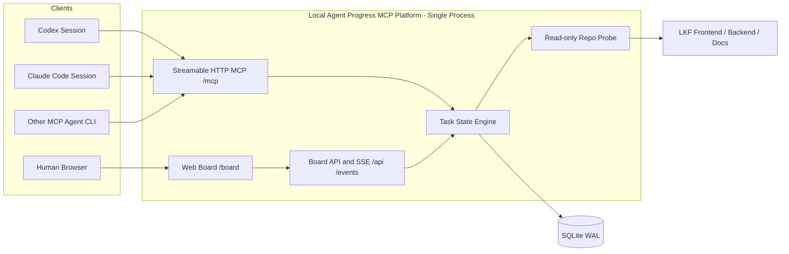
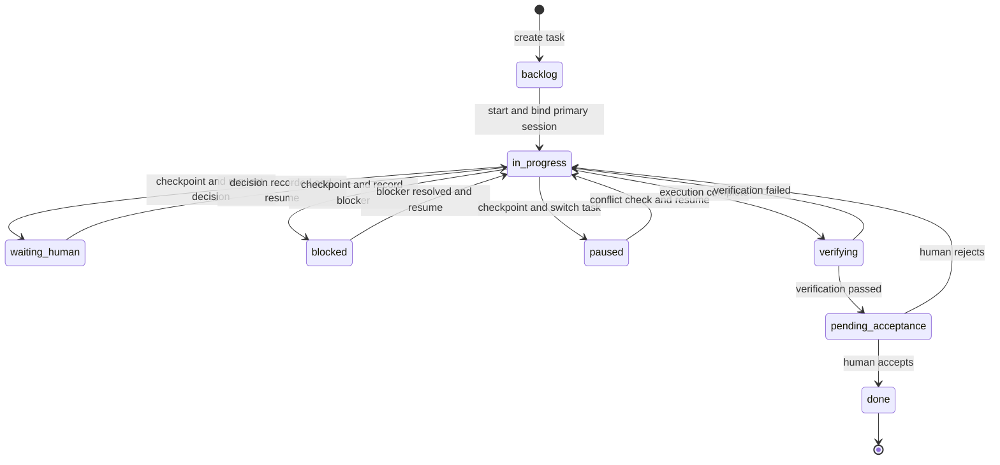
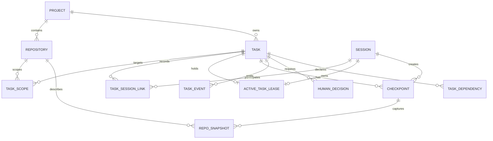

# CLI Session Task MCP 本地任务进度管控平台设计

## 1. 文档信息

- 日期：2026-08-17
- 阶段：设计已确认，实施计划已生成，待执行方式确认
- 首期试点：LKF
- 目标形态：本地单实例 Streamable HTTP MCP Server + Web 看板
- 数据真相源：SQLite WAL

## 2. 背景与目标

当前开发过程中，同一项目可能存在多个 Codex、Claude Code 或其他 Agent Coding CLI Session，同时穿插多个任务。仅依赖单个 Session 的对话记忆会产生以下问题：

- 人无法及时掌握每个任务的真实进度、优先级和下一步。
- 切换任务时没有强制交接，后续 Session 容易丢失上下文。
- 多个 Session 可能在同一仓库、分支、worktree 或文件范围并发写入。
- Agent 已完成执行和“用户已验收完成”容易混为一个状态。

本项目建立跨 Session 的任务台账，将 Session 定位为临时执行者，将结构化任务、checkpoint、仓库快照和人工决定作为长期真相。

首期只服务个人本机 LKF 开发，以 Codex 和 Claude Code 为实机兼容验收目标；验证有效后再扩展为通用 Agent Coding 进度管控平台。

## 3. 核心原则

1. 一个 Session 同一时间只能执行一个活动任务。
2. 一个任务同一时间只能有一个可写主 Session。
3. 其他 Session 可以只读挂接为分析、评审或验证角色。
4. 新任务打断当前任务时，必须先 checkpoint，再进行原子切换。
5. Agent 只能把任务提交为待验收，只有人工可以标记完成。
6. 平台不采集完整对话，只保存结构化交接信息。
7. 平台只读访问白名单仓库，不执行任意 Shell，不修改业务仓库。
8. LKF 是首个配置，不在核心模型中引入 LKF 专属业务字段。
9. 首期采用最小单页看板，相同操作只保留一个入口。
10. 平台身份、任务协议和并发控制不绑定任何 Agent 厂家或原生会话 ID。

## 4. 首期项目边界

LKF 作为一个项目空间，包含三个业务仓库：

- 前端仓
- 后端仓
- 文档仓

Pipeline 属于后端 monorepo 内的模块路径，不单独视为仓库。后端图谱已核实同一 `lkf-backend` 项目内同时包含主应用和多个 Pipeline，包括 `compliance-pipeline`、`cost-pipeline`、`image-gen-pipeline`、`material-price-pipeline`、`market-insight-pipeline`、`hotspot-insight-pipeline` 和 `competitor_pipeline` 等。

任务可以关联一个或多个仓库及模块路径。worktree 是任务的执行工作区，不是 Pipeline 的类型。

首期仓库根路径由人工初始化并加入白名单，平台不自动扫描整台机器。

## 5. 总体架构



### 5.1 组件职责

- MCP 入口：Codex、Claude Code 和兼容 MCP 的 Agent CLI 连接同一个 `/mcp`，客户端元数据标准化后执行相同任务协议。
- Web 看板：人工查看进度、修改优先级、验收、驳回、取消和释放失联 Session。
- Task State Engine：唯一业务入口，负责状态机、事务、幂等、租约和冲突规则。
- SQLite：唯一数据真相源。
- Repo Probe：只读采集 Git 仓库、worktree、分支、HEAD 和变更文件路径。
- SSE：向 Web 看板推送任务和 Session 状态变化。

### 5.2 部署与访问边界

- 平台是一个长期运行的本地进程。
- MCP、Web、API 与 SSE 由同一进程提供。
- 服务只绑定 `127.0.0.1`，首期不提供远程访问。
- Web API 仅允许同源访问，拒绝异常 Host 和 Origin，不开放跨域写入。
- 首期不建设账号系统；远程访问和多用户出现后再引入认证与权限。
- 运行期 SQLite 和备份放在操作系统应用数据目录，不写入业务仓库。
- MCP 注册由人工对每类客户端执行，平台不自动修改任何 Agent CLI 的全局或项目配置。
- 浏览器自动化只通过 browser-harness 接管 Microsoft Edge，不引入独立浏览器测试框架。

## 6. 任务状态机



### 6.1 状态规则

- 只有 `in_progress` 和 `verifying` 可以持有可写主 Session。
- `waiting_human`、`blocked`、`paused` 和 `pending_acceptance` 释放主 Session。
- 任意非终态任务可以由人工取消；取消只改变状态，不删除历史。
- 连续 30 分钟没有 MCP 状态事件时标记为 `stale` 警告，不自动改变任务状态。
- 释放失联主 Session 必须人工确认。

### 6.2 原子任务切换

`task_switch` 按以下顺序处理：

1. 校验当前 Session、当前任务和 `expected_version`。
2. 采集当前与目标任务相关仓库的只读预检快照。
3. 校验 checkpoint 结构完整性。
4. 评估 worktree、分支、模块和已知文件冲突。
5. 在一个数据库事务内写入 checkpoint、仓库快照和事件。
6. 暂停当前任务并释放当前租约。
7. 绑定目标任务及新租约。

预检失败时不执行数据库状态切换；数据库事务失败时整体回滚。

## 7. 数据模型



### 7.1 核心实体

| 实体 | 用途 |
|---|---|
| `projects` | 项目空间，首期只有 LKF |
| `repositories` | 白名单仓库及本地根路径 |
| `tasks` | 状态、优先级、验收标准、下一步和版本 |
| `task_scopes` | 任务涉及的仓库及 Pipeline/模块路径 |
| `sessions` | 平台 Session 身份、客户端类型/版本/能力、传输方式、工作目录和最后活动时间 |
| `task_session_links` | 主执行、分析、评审等历史参与关系 |
| `active_task_leases` | 当前可写主 Session 绑定 |
| `checkpoints` | 结构化交接内容和明确下一步 |
| `repo_snapshots` | worktree、分支、HEAD 和变更文件路径 |
| `task_events` | 追加式状态变更审计记录 |
| `human_decisions` | 待人工处理的问题、结论和验收结果 |
| `task_dependencies` | 阻塞、前置和关联任务关系 |

### 7.2 Checkpoint 结构

Checkpoint 使用带版本号的结构化 Schema，至少包含：

- 已完成事项。
- 当前工作状态。
- 人机协同背景及已确认决策。
- 待人工决定事项。
- 阻塞原因。
- 验证命令与结果摘要。
- 明确的下一步行动。

接管存量任务时额外记录以下可选字段：

- `source_type`：`native` 或 `legacy_adoption`。
- `source_session_label`：便于人工识别的原 Session 标签，不依赖任何厂商的内部会话 ID。
- `adoption_method`：`mcp` 或 `web`。
- `adopted_at`：完成接管的 UTC 时间。

这些字段只描述任务来源，不保存完整对话、文件正文或完整 diff。

### 7.3 数据约束

- `active_task_leases.task_id` 唯一：一个任务只有一个可写主 Session。
- `active_task_leases.session_id` 唯一：一个 Session 只有一个活动任务。
- `tasks.version` 用于乐观并发控制。
- `task_events` 只追加、不覆盖。
- Repo Snapshot 不保存文件正文、完整 diff 或完整对话。
- SQLite 开启 WAL、外键和写入超时控制。
- ID 使用文本型稳定标识，时间统一保存 UTC ISO-8601。
- JSON 字段由应用层 Schema 校验，后续可映射为 PostgreSQL JSONB。
- 状态机和事务放在应用服务层，不依赖 SQLite 特有触发器。
- `sessions.client_family` 是可扩展的规范化字符串；首期定义 `codex`、`claude_code`、`generic_mcp`，原始 MCP `clientInfo.name` 单独保留，未知客户端统一归类为 `generic_mcp`。
- `sessions.capabilities` 保存连接初始化时的能力快照，只用于兼容性判断，不授予额外任务权限。
- 平台 `session_id` 独立于厂商原生会话 ID；原生 ID 不作为租约、幂等或审计主键。

## 8. 并发与冲突规则

### 8.1 硬冲突

以下情况禁止开始或切换任务：

- 同一任务已有另一个有效的可写主 Session。
- 当前 Session 已绑定另一个活动任务且没有提交 checkpoint。
- 两个活动任务指向同一个可写 worktree。
- 已知变更文件集合存在重叠。
- 仓库或 worktree 无法访问，导致无法完成安全预检。

### 8.2 警告冲突

以下情况允许在明确确认风险后继续：

- 同一仓库的不同 worktree 涉及重叠模块，但尚未发现文件重叠。
- 任务存在未完成的软依赖。
- 目标分支与最新 checkpoint 记录发生漂移，但工作区仍可识别。

冲突返回结构化级别、证据和恢复动作，不只返回文本描述。

## 9. MCP 工具契约

### 9.1 首期工具

| 工具 | 类型 | 用途 |
|---|---|---|
| `session_context` | 只读/注册 | 标准化 MCP 客户端元数据，注册应用级 Session，映射仓库和 worktree，返回当前上下文 |
| `task_list` | 只读 | 按状态、仓库、优先级查询任务 |
| `task_get` | 只读 | 获取任务、checkpoint、依赖、决定和仓库快照 |
| `task_conflicts` | 只读 | 检查仓库、worktree、分支、模块及文件冲突 |
| `task_attach` | 轻量写入 | 以分析、评审或验证角色只读挂接任务 |
| `task_create` | 写入 | 创建多步骤任务及仓库/模块范围 |
| `task_adopt` | 原子写入 | 接管存量任务，写入初始 checkpoint、仓库快照和导入事件，并按状态决定是否绑定主 Session |
| `task_start` | 写入 | 冲突检查后开始或恢复任务并绑定主 Session |
| `task_checkpoint` | 写入 | 保存结构化进度并切换到允许的非终态 |
| `task_switch` | 原子写入 | checkpoint 当前任务并切换目标任务 |
| `task_submit` | 写入 | 提交验证证据并进入待人工验收 |

### 9.2 写入要求

所有写工具必须携带：

- `session_id`
- `operation_id`
- `expected_version`
- `task_id` 或完整的新任务数据

`operation_id` 在 Session 范围唯一。相同请求重试时返回第一次结果，不重复执行。

`task_create` 和 `task_adopt` 使用 `expected_version: 0` 表示期望目标尚不存在；其余写入必须使用读取到的当前任务版本。

`task_adopt` 还必须携带稳定的 `legacy_import_key`、来源 Session 标签、目标状态、完整初始 checkpoint 和仓库快照。它只能由 Agent 导入非终态任务，不能直接导入 `pending_acceptance`、`done` 或 `cancelled`；待验收任务只能由人工通过 Web 导入。

### 9.3 统一响应

```json
{
  "ok": true,
  "data": {},
  "meta": {
    "request_id": "req_xxx",
    "schema_version": "1.0.0",
    "task_version": 7
  },
  "next": []
}
```

错误必须包含稳定错误码、`retryable`、冲突证据和建议恢复动作。首期错误码至少包括：

- `CHECKPOINT_REQUIRED`
- `TASK_VERSION_CONFLICT`
- `TASK_LEASE_CONFLICT`
- `TASK_ALREADY_ADOPTED`
- `WORKTREE_CONFLICT`
- `INVALID_TRANSITION`
- `REPOSITORY_NOT_ALLOWED`
- `HUMAN_CONFIRMATION_REQUIRED`
- `STORAGE_BUSY`

### 9.4 MCP Instructions

Server 初始化指令的前 512 字符内必须自包含以下规则：

> 在白名单仓库执行多步骤或修改型工作前调用 `session_context`；开始写入前创建或恢复任务；切换或停止前必须 checkpoint；Agent 只能提交待验收，不能自行标记完成。

平台不读取完整用户对话。首期依赖 Agent 根据指令识别多步骤任务并主动调用工具。

MCP 初始化层读取标准 `clientInfo`、协议版本和 Client Capabilities，并在调用 `session_context` 时合并为平台 Session 元数据。`session_context` 必须显式接收并校验工作目录、仓库和 worktree；不得依赖 `CLAUDE_PROJECT_DIR` 等厂商专属环境变量，也不得把客户端自报路径直接加入白名单。

只有能验证同一 MCP Transport Session 连续性的重连才复用平台 `session_id`；新的 CLI 或扩展进程创建新平台 Session，不能凭客户端类型、目录或厂商原生会话 ID 自动接管旧租约。

### 9.5 存量 Session 与任务接管

平台无法回读尚未接入 MCP 的既有 Session，因此采用一次性显式接管，不把任何厂商的内部会话 ID 当作平台身份。平台 `session_id` 由 `session_context` 在连接后创建，只用于本平台的租约、审计和幂等控制；Transport Session 连续时可以复用。

切换到平台前，每个仍可访问的既有 Session 先在原上下文中整理一份迁移 checkpoint，至少包含：

- 任务标题、目标、优先级和当前状态。
- 已完成事项、当前改动和下一步行动。
- 仓库、worktree、分支、HEAD 和已知变更文件。
- 已确认决策、待人工决定事项和阻塞原因。
- 已执行的验证及结果摘要。

随后配置并启动本地 MCP Server，重新连接需要继续工作的客户端或扩展；连接后先调用 `session_context`，再调用 `task_adopt`。OpenAI 的 [MCP 配置说明](https://learn.chatgpt.com/docs/extend/mcp?surface=cli)要求添加服务后保存并重启相应客户端或扩展，因此首期不假设已经运行的 Session 能热加载新工具。迁移 checkpoint 是重连失败时的恢复来源。

`task_adopt` 在单个事务内完成以下动作：

1. 按 `legacy_import_key` 检查重复接管并执行冲突预检。
2. 创建任务、初始 checkpoint 和 Repo Snapshot。
3. 追加 `legacy_task_adopted` 事件，记录来源 Session 标签、接管方式和时间。
4. 仅在目标状态允许且无冲突时创建主 Session 租约。

存量状态映射如下：

| 原任务情况 | 导入状态 | 主 Session 租约 | 接管入口 |
|---|---|---|---|
| 正在开发 | `in_progress` | 无冲突时绑定 | MCP |
| 正在验证 | `verifying` | 无冲突时绑定 | MCP |
| 等待用户决定 | `waiting_human` | 不绑定 | MCP 或 Web |
| 等待外部依赖 | `blocked` | 不绑定 | MCP 或 Web |
| 已挂起 | `paused` | 不绑定 | MCP 或 Web |
| 已完成但尚未人工验收 | `pending_acceptance` | 不绑定 | 仅 Web |

接管规则：

- 按任务优先级逐个接管，完成一个任务的 checkpoint 和核对后再处理下一个。
- 同一 `legacy_import_key` 的重复请求返回既有结果，不新建任务。
- 同一 `legacy_import_key` 的来源 Session 标签、项目、仓库/worktree 或规范化标题与既有记录不一致时，拒绝写入并返回 `TASK_ALREADY_ADOPTED`，不得覆盖既有接管记录。
- 两个存量 Session 声明同一可写 worktree 时，相关导入任务都落为 `paused`，释放已有的存量导入租约并记录冲突事件，由人工选择一个任务再通过 `task_start` 恢复。
- 已无法打开或无法重连的 Session，由人工使用 Web 的既有“新建任务”入口切换到“导入存量”模式录入，不增加独立页面或第二入口。
- Agent 不得通过 `task_adopt` 创建 `pending_acceptance`、`done` 或 `cancelled`；历史已完成且无需继续管理的事项不导入。

### 9.6 多 Agent Coding CLI 兼容

首期采用 Streamable HTTP 作为 Codex 与 Claude Code 的共同传输层。所有客户端共享同一 MCP Server、SQLite、状态机和租约，不按客户端类型开放不同的任务权限。

| 客户端 | 首期接入方式 | 配置作用域 | 验证状态 |
|---|---|---|---|
| [Codex CLI / IDE](https://developers.openai.com/codex/mcp/) | Streamable HTTP `/mcp` | 用户级或项目级 `config.toml` | 首期必须实机验证 |
| [Claude Code](https://code.claude.com/docs/en/mcp) | HTTP/Streamable HTTP `/mcp` | 用户级配置或项目级 `.mcp.json` | 首期必须实机验证 |
| 其他 Agent Coding CLI | 标准 Streamable HTTP MCP | 由客户端决定 | 通过兼容性测试后逐项登记 |

兼容边界：

- 十一个工具只使用 MCP Tools 的共同能力，不依赖厂商专属 UI、Prompt、Resource 或动态工具更新。
- Server Instructions 用于提示调用顺序，但状态机、租约、验收权限和白名单必须在服务端强制执行。
- Codex 可配合 `AGENTS.md`，Claude Code 可配合 `CLAUDE.md` 提醒 Agent 建立任务和 checkpoint；这些文件只是客户端侧提示，不是数据真相源。
- 客户端缺少 Roots、动态工具发现或 Instructions 消费能力时，通过显式 `session_context` 和固定工具清单降级运行。
- 首期不提供独立 stdio 存储实例。后续如需支持仅有 stdio 的客户端，只增加连接同一后台服务的轻量代理，不能产生第二份 SQLite。
- 客户端名称、版本和能力只影响兼容提示与诊断；任务冲突规则在 Codex、Claude Code 和通用 MCP Client 之间完全一致。

## 10. Web 看板

首期只有一个页面和四个状态列：

1. 待执行：`backlog`、`paused`
2. 进行中：`in_progress`、`verifying`
3. 待处理：`waiting_human`、`blocked`、`pending_acceptance`
4. 已结束：`done`、`cancelled`，默认折叠

### 10.1 任务卡

任务卡只展示：

- 优先级、标题和稳定 ID。
- 涉及仓库/模块。
- 当前主 Session、客户端类型或等待方。
- `next_action`。
- 最后更新时间和失联警告。

### 10.2 详情抽屉

点击任务卡打开右侧详情抽屉，集中展示：

- 最新 checkpoint。
- Session 的客户端类型、版本、传输方式和最后活动时间。
- worktree、分支、HEAD 和变更文件路径。
- 任务依赖。
- 人工决定与验证证据。
- 追加式事件时间线。

页面顶部“新建任务”打开同一个抽屉，抽屉内提供“新建”和“导入存量”两种模式。导入模式复用任务字段，并额外要求来源 Session 标签、原状态、初始 checkpoint、Repo Snapshot 和稳定的 `legacy_import_key`；只有该模式允许人工导入 `pending_acceptance`。

### 10.3 单一入口规则

| 操作 | 唯一入口 |
|---|---|
| 新建或导入存量任务 | 页面顶部“新建任务”，抽屉内选择“新建/导入存量” |
| 查看详情 | 点击任务卡 |
| 修改优先级和任务信息 | 详情抽屉 |
| 验收、驳回、取消 | 详情抽屉 |
| 释放失联 Session | 详情抽屉 |
| Agent 开始、暂停、切换、提交 | 仅 MCP 工具 |

首期不提供任务列表页、独立 Session 页面、统计图表、拖拽改状态或重复快捷按钮。只保留仓库、优先级和关键词筛选。每列按优先级、是否等待人工、最后更新时间排序。

### 10.4 项目归档

- 迁移 v16 为 `projects` 增加可空的 `archived_at`、`archived_by`；归档不删除任何数据。
- 归档/还原只经看板路由 `POST /api/projects/:projectId/archive|unarchive`（复用 Web 幂等
  重放与 `overview.changed` 广播），不注册 MCP 工具。权限：`created_by` 非空时仅创建者；
  `created_by` 为 NULL 的旧项目，当前配对身份在 `listProjects(owner)` 中可见即可。
- 归档前提：`tasks JOIN repositories` 下该项目全部任务为终态；检查与写入在同一
  `BEGIN IMMEDIATE` 事务内。否则返回 `PROJECT_HAS_OPEN_TASKS`（409），`details` 带
  `open_task_counts` 与 `open_tasks`（task_id、owner、status、repository_id）。
- `listProjects` 默认排除已归档，`GET /api/projects?include_archived=true` 才返回；看板一次取全量后在
  客户端分组，切换器只用未归档项目，已归档项目在个人仪表盘独立区块只读展示并可还原。
  URL 或 SSE 刷新发现当前仓库所属项目已归档时，提示并切到仪表盘，不跳到其他项目。
- 已归档项目拒绝写入，统一返回 `PROJECT_ARCHIVED`（409）：`task_create`/`task_adopt`（在写事务内
  检查）、`session_context`/`session_rebind`、分享创建/接受、以及按名称或 ID 命中已归档项目的新仓库登记
  （MCP、看板和 CLI 共用 `RegistryService`）。不会自动还原。

## 11. 异常处理与恢复

- SQLite 忙：有限退避重试，失败返回 `STORAGE_BUSY`，不无限等待。
- 仓库不可访问：允许查看历史，但禁止开始或切换写任务。
- 服务重启：任务不丢失，原活动租约标记为待恢复，不自动抢占。
- 重复请求：根据 `operation_id` 返回原结果。
- 数据迁移：迁移前创建数据库备份；失败时保留原库并拒绝带病启动。
- Repo Probe 失败：`task_switch` 整体失败，当前任务状态不变。
- Schema 版本不兼容：返回明确的重新发现或升级提示。

## 12. 技术与代码组织

首期建议使用 TypeScript 单代码库，共享 MCP、服务端、Web 和数据 Schema 类型。Web 编译为静态资源并由同一服务进程提供。

建议实施时逐步建立以下目录，不在设计阶段提前创建空目录：

```text
docs/
  design/
  plans/
src/
  core/
  mcp/
  storage/
  repo/
  web/
tests/
  unit/
  integration/
  e2e/
```

- `core`：领域实体、状态机、冲突策略和应用服务。
- `mcp`：Streamable HTTP MCP 传输、客户端元数据标准化、Schema 和工具适配。
- `storage`：SQLite、迁移、Repository 接口和备份。
- `repo`：只读 Git/worktree 探针。
- `web`：最小单页看板及同源 API/SSE。
- `tests`：状态机、并发、集成与 Microsoft Edge 端到端验证。

数据访问层必须可替换，不将 SQLite 特有语句扩散到业务层，为后续 PostgreSQL 迁移保留边界。

## 13. 功能优先级

| 使用方 | 模块 | 功能 | 优先级 |
|---|---|---|---|
| 系统 | 本地服务 | 单进程提供 MCP、Web、API、SSE 和健康检查 | P0 |
| 系统 | SQLite | 建表迁移、WAL、外键、事务、启动恢复 | P0 |
| 系统 | 仓库探针 | 手工登记 LKF 三仓并只读采集 Git/worktree 信息 | P0 |
| Agent | Session | 多客户端注册、上下文恢复、活动任务和失联标记 | P0 |
| Agent | 任务台账 | 创建、开始、暂停、阻塞、验证、提交待验收 | P0 |
| 系统 | 并发控制 | 单任务单主 Session、版本冲突和活动租约 | P0 |
| Agent | 交接切换 | checkpoint、冲突检查和原子切换 | P0 |
| Agent | MCP | 十一个最小工具及版本化错误契约 | P0 |
| 人工 | Web 看板 | 四列看板、详情、优先级和验收操作 | P0 |
| 系统 | 恢复 | 幂等、数据库备份/导出和重启恢复 | P0 |
| 系统 | 验证 | 状态机、竞态、MCP、Repo Probe 和 Edge 测试 | P0 |
| 系统 | 自动约束 | 客户端 Hooks 或宿主事件检测漏建任务、漏 checkpoint | P1 |
| 人工 | 多项目 | 动态维护多个项目及仓库 | P1 |
| 系统 | 团队化 | PostgreSQL 迁移演练与共享部署准备 | P1 |
| 人工 | 视图增强 | 统计、时间线和更丰富的搜索 | P1 |
| 团队 | 权限 | 多用户、RBAC 和审计身份 | P2 |
| 团队 | 部署 | 远程服务和高可用 | P2 |
| 系统 | 集成 | CI、Issue Tracker、通知和 Webhook | P2 |

| 优先级 | 数量 |
|---|---:|
| P0 | 11 |
| P1 | 4 |
| P2 | 3 |

## 14. 测试策略

### 14.1 单元测试

- 状态迁移允许/拒绝矩阵。
- Checkpoint Schema 校验。
- 存量状态映射、来源字段和接管权限校验。
- MCP `clientInfo` 归一化、未知客户端降级和能力快照校验。
- 冲突级别与恢复建议。
- 乐观锁和幂等规则。

### 14.2 集成测试

- 两个模拟 MCP Client 争抢同一任务。
- 模拟 Codex 与 Claude Code Client 争抢同一任务和同一 worktree。
- 缺少可选 Client Capabilities 时仍能通过 `session_context` 完成注册。
- 同一 Transport Session 重连保持平台 Session；新进程不能自动继承旧租约。
- 一个 Session 尝试同时绑定两个活动任务。
- 同仓不同 worktree 和同 worktree 的冲突差异。
- 同一 `legacy_import_key` 重复接管时只产生一个任务。
- 两个存量 Session 接管同一 worktree 时均转为 `paused`，且不保留主租约。
- `task_adopt` 与 `task_start` 并发时保持任务、事件和租约一致。
- 服务重启后的任务、租约和事件恢复。
- SQLite 锁等待、失败和重试。
- Repo Probe 对 staged、unstaged 和 untracked 文件的只读识别。

### 14.3 端到端测试

使用 browser-harness 接管 Microsoft Edge 验证；不使用 Playwright：

- 创建任务并显示到正确列。
- 通过同一“新建任务”抽屉导入已挂起任务，并在之后恢复执行。
- 由人工导入 `pending_acceptance` 并完成验收。
- 查看详情和最新 checkpoint。
- 修改优先级。
- 验收与驳回任务。
- 释放失联 Session。
- SSE 自动刷新。

同时执行客户端接入验收：

- Codex CLI 或 IDE 能连接 `/mcp`、发现十一个工具并完成 `session_context`。
- Claude Code 能连接同一 `/mcp`、发现相同工具并完成 `session_context`。
- 两类客户端创建的任务在同一 Web 看板展示，并受同一租约和冲突规则约束。

### 14.4 安全验证

- 平台不会写入三个业务仓库。
- 越过白名单的路径请求被拒绝。
- 异常 Host、Origin 和跨域写请求被拒绝。
- Agent 无法通过 MCP 完成、取消或强制接管任务。
- Agent 无法通过 `task_adopt` 导入 `pending_acceptance`、`done` 或 `cancelled`。

## 15. 首期验收标准

1. 两个 Session 能连接同一 MCP Server 并看到同一份任务台账。
2. 同一任务无法被两个主 Session 同时写入。
3. 切换任务前未提供 checkpoint 会被拒绝。
4. 同一 worktree 或已知文件冲突会阻止错误切换。
5. Agent 只能提交待验收，只有人工可以完成任务。
6. 服务重启后任务、checkpoint 和事件保持完整。
7. Web 看板能在 Microsoft Edge 完成核心人工流程。
8. 平台不会写入 LKF 三个业务仓库。
9. 仍可访问的既有 Session 能通过迁移 checkpoint 接管活动任务；无冲突的活动任务获得唯一主租约。
10. 已挂起或失联的存量任务能在不创建租约的情况下导入，并由人工选择后恢复。
11. 重复接管和同 worktree 冲突不会产生重复任务或两个可写主 Session。
12. Codex 与 Claude Code 能同时连接同一服务、发现相同工具，并在跨客户端并发时维持唯一主租约。

## 16. 首期明确不做

- 不读取或存储完整 Session 对话。
- 不自动扫描整台机器的仓库。
- 不执行代码、测试、Git 写操作或 worktree 创建。
- 不提供远程访问、多用户、RBAC、通知或第三方集成。
- 不使用 Redis、MinIO、消息队列或 PostgreSQL。
- 不引入 Playwright、Selenium 或额外浏览器运行时。
- 不提供甘特图、统计大屏、重复列表页或拖拽状态变更。

## 17. 已知限制与后续演进

首期最大的已知限制是 MCP Server 无法直接看到每条用户消息，因此不能独立判断 Agent 是否漏建任务或漏 checkpoint。首期依靠 MCP Instructions 和项目协作规则约束；在实际使用中收集遗漏样本后，再决定是否通过客户端 Hooks、宿主事件或其他可验证接口增强自动化。

现有 Session 接入新 MCP 配置通常需要重新连接客户端或扩展，平台不能保证原 Session 可热加载，也不能自动回读原对话。切换前生成的迁移 checkpoint 和人工“导入存量”入口共同承担兜底恢复。

“通用 MCP Client”只表示协议层开放兼容，不表示所有 Agent Coding CLI 已完成验证。首期仅在 Codex 和 Claude Code 的实机接入、工具发现、调用、断线恢复和跨客户端竞态均通过后，将两者标记为已验证；其他客户端按版本逐项登记。

当个人 LKF 试点稳定后，按以下顺序演进：

1. 增加遗漏检测和协议合规提示。
2. 支持多个项目和动态仓库管理。
3. 验证 SQLite 到 PostgreSQL 的迁移。
4. 增加多用户身份、RBAC 和远程共享。
5. 接入 CI、Issue Tracker、通知和更丰富的可视化。
