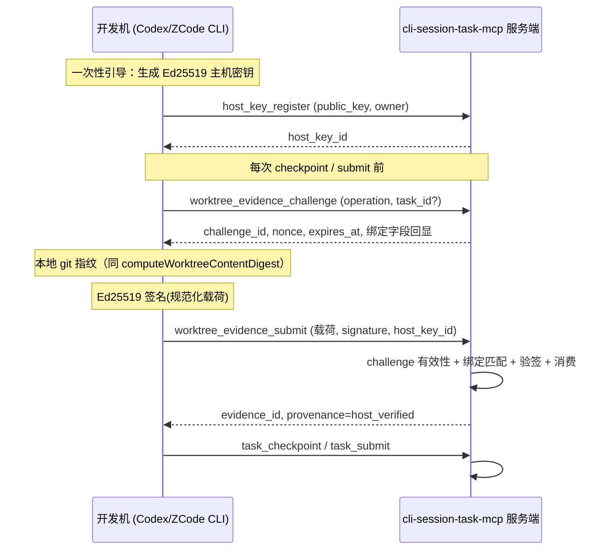

# 设计规格：主机可信 Worktree 证据链（Host-Verified Worktree Evidence）

- 日期：2026-09-22
- 状态：已实施（P0+P1 同版本，migration v14；实现与测试见 `tests/integration/core/host-evidence.test.ts`）
- 关联：CLI Task `5be8a50c-87b5-4e89-866a-65d3f3477579`（owner=jande）
- 基线：main @ `509702c`（与 origin/main 同步，工作树干净）

---

## 1. 背景与问题

CLI Session Task 的 checkpoint / submit / 恢复 / 冲突检测依赖服务端对 worktree 的直接探测
（`RepoProbe.inspect`：realpath → worktree 白名单 → `git rev-parse` / `status` → 内容摘要）。
当 session 绑定的 worktree 位于开发机（远端）而服务端无法访问时，
`#probePathWithRemoteFallback`（src/core/task-service.ts:4229）当前有两个隐式降级：

1. **证据错误归属**：远端 worktree 探测抛 `REPOSITORY_NOT_ALLOWED` 后，探测
   `repository.path` 指向的服务端 checkout，并把该 checkout 的验证结果整体改写
   `worktree_path` 为请求中的远端路径（task-service.ts:4242-4246）。单一可变的服务端
   checkout 证据由此被冒充为另一台主机上 worktree 的 `server_verified` 证据。
2. **Opaque snapshot**：checkout 也探测失败时，生成 `head_commit = remote:<path>`、
   无 `content_digest` 的快照（task-service.ts:4252-4260）。该路径下 checkpoint 的
   指纹只能落到 `client_reported`，`#assertFreshSubmissionEvidence` 随即以
   `CHECKPOINT_REQUIRED` 拒绝 submit——远端场景要么产生假证据、要么完全无法提交。

## 2. 目标与非目标

### 目标

- **P0（安全修正）**：删除两条隐式降级，fail-closed。无法取得目标远端 worktree 的可信
  证据时返回稳定错误码 `REMOTE_WORKTREE_EVIDENCE_REQUIRED`。服务端真实直连且路径
  允许的 worktree 行为完全不变。
- **P1（能力补齐）**：建立基于主机 challenge 签名的可信证据链。开发机用已登记的
  Ed25519 主机密钥对「服务端一次性 challenge + 本地 worktree 指纹」签名，服务端验签
  通过后以 `provenance = host_verified` 保存证据，使远端 worktree 的 checkpoint /
  submit 与服务端直连场景拥有同等门禁效力。

### 非目标

- 不改变 `client_reported` 的门禁地位：客户端自述指纹永远不能通过 submit 校验。
- 不引入服务端到开发机的反向连接（SSH 等）；取证始终由开发机主动发起。
- 不做全仓库内容加密传输；签名覆盖摘要而非文件内容。
- 不改变现有任务状态机、租约与依赖验证流程（仅扩展证据来源）。

## 3. 现状关键路径（已核实）

| 关注点 | 现状 |
|---|---|
| 探测入口 | `#probeWorktree(session)` → `#probePathWithRemoteFallback`（start/checkpoint/switch/submit/recovery 共 7 处调用） |
| 内容摘要 | `computeWorktreeContentDigest`（src/repo/worktree-fingerprint.ts）：sha256 over `format=cli-session-task-worktree.v1` + HEAD + `git diff --binary HEAD` + untracked 内容。**签名证据直接复用该算法，保证两种 provenance 的 digest 可比** |
| 指纹 schema | `taskCodeFingerprintSchema`（task-recovery-contracts.ts:15）：`provenance ∈ {server_verified, client_reported}` |
| submit 门禁 | `#assertFreshSubmissionEvidence`（task-service.ts:3416）：全部 `server_verified` + digest 与实时探测一致 |
| 恢复判定 | `#recoveryEvidenceState`（task-service.ts:3465）：同样依赖实时探测比对 |
| 人工验收 | `humanAccept` 读 submit 时冻结的 checkpoint 指纹与 `repo_snapshots` 历史，不做实时探测 |
| challenge 先例 | `board_pairing_challenges`：一次性、TTL、消费型，本设计沿用该模式 |
| 租约 | `ActiveTaskLease.generation`（默认 1，session 接管时 +1） |
| 迁移机制 | `migrationMetadata` + 顺序 DDL，当前版本 13，新设计为 v14 |

## 4. P0 设计：删除隐式降级

### 4.1 行为变更

`#probePathWithRemoteFallback` 重构为 `#probeSessionWorktree(repositoryId, worktreePath)`：

```text
1. #probePath(worktreePath) 成功            → RepoSnapshotDraft（来源 server_verified，现状不变）
2. 抛 REPOSITORY_NOT_ALLOWED 时：
   a. 存在绑定 (repository_id, worktree_path) 且未过期的 host 证据（P1，见 §5）
      → 由保存的 host 证据构造 RepoSnapshotDraft（来源 host_verified）
   b. 否则 → 抛 PlatformDomainError("REMOTE_WORKTREE_EVIDENCE_REQUIRED")
```

删除：服务端 checkout 替代分支（4239-4251）与 opaque snapshot 分支（4252-4260）。

### 4.2 错误契约

```text
REMOTE_WORKTREE_EVIDENCE_REQUIRED
  message: "Worktree <path> is not reachable from the server and no trusted
            host evidence is on file; refusing to fabricate evidence"
  retryable: true
  recovery_actions:
    - "On the developer machine, run `cli-session-task-mcp evidence collect` "
      "to obtain host-verified worktree evidence, then retry."
    - "If the worktree is meant to be server-direct, verify it is a git "
      "worktree of the registered repository path."
```

`REMOTE_WORKTREE_EVIDENCE_REQUIRED` 同时加入 `RepoProbeErrorCode` 联合类型与
MCP 错误码文档。`startTask` / `switchTask` 等在事务外探测的调用点自然继承该错误；
冲突检测（`#leftSide`）在无证据时按现有「无指纹」路径降级为 warning 而非 hard
conflict（保持可诊断）。

### 4.3 P0 兼容性影响

- 服务端直连（worktree 物理在服务器上且在白名单）：无变化。
- 远端 worktree：从「假证据 / opaque」直接切换到 host 证据链（P0+P1 同版本发布，
  见 §9）。尚未注册主机密钥的开发机会收到 `REMOTE_WORKTREE_EVIDENCE_REQUIRED`
  及注册指引，属于一次性迁移路径，发布说明标注即可。

## 5. P1 设计：主机 challenge 签名证据链

### 5.1 总体流程



### 5.2 密码学选择

| 项 | 决策 | 理由 |
|---|---|---|
| 签名算法 | **Ed25519**（`node:crypto` 原生） | 零新依赖、签名 64B、验证快、无随机性陷阱 |
| 公钥编码 | SPKI DER → base64 | Node 标准 import/export，跨主机一致 |
| 签名内容 | 载荷的规范化 UTF-8 JSON 字节 | 见 §5.5 canonical form |
| nonce | 服务端 crypto.randomBytes(32) | 防枚举、防预测 |
| 摘要 | 复用 `sha256:…` content_digest | 与 server_verified 证据同构可比 |

### 5.3 主机密钥管理

**存储（开发机侧）**：`~/.cli-session-task/host-key.pem`（PKCS#8 私钥，mode 0600）+
`~/.cli-session-task/host-key.json`（host_key_id、public_key_b64、registered_at）。
私钥永不离开主机；证据提交只发送公钥标识与签名。

**服务端表 `host_keys`**（migration v14）：

```sql
CREATE TABLE host_keys (
  host_key_id    TEXT PRIMARY KEY,
  owner          TEXT NOT NULL,             -- 必须等于 git config user.name
  label          TEXT NOT NULL,             -- 主机名/说明
  public_key_b64 TEXT NOT NULL UNIQUE,      -- SPKI DER base64
  client_family  TEXT,                      -- codex | claude_code | generic_mcp
  status         TEXT NOT NULL DEFAULT 'active'
                 CHECK (status IN ('active','revoked')),
  rotated_to     TEXT REFERENCES host_keys(host_key_id),
  created_at     TEXT NOT NULL,
  revoked_at     TEXT,
  last_used_at   TEXT,
  CHECK ((status = 'revoked') = (revoked_at IS NOT NULL))
) STRICT;
CREATE INDEX host_keys_owner_active_idx ON host_keys(owner) WHERE status = 'active';
```

**注册（已决策：只认 owner，无审批流）**：新 MCP 工具 `host_key_register`（参数：
public_key_b64、label、owner）。同一 `(owner, public_key_b64)` 幂等返回既有
host_key_id。注册即绑定 owner——该主机此后只能为同 owner 的 session 取证。
内网部署不设注册审批：唯一信任判定是 owner 字符串与 session.owner 严格相等。
host key 的撤销/轮换不依赖 Web Board：最小实现为 CLI/SQL 直接操作 `host_keys`
表（`status='revoked'`），Board 管理页仅作为后续可选增强。

**轮换**：`host_key_register` 支持 `rotation_signature`——用旧密钥对新公钥的
SHA-256 摘要签名。验证通过则旧 key 置 `revoked(rotated_to=新)`，新 key 继承 owner。
丢失旧钥时走 Board 人工撤销 + 重新注册。

**撤销**：Board 人工操作（`status='revoked'`）。撤销即刻生效：后续 challenge 签发
与证据提交全部拒绝。**已保存证据不追溯作废**——签名时刻密钥有效即证据有效；
撤销语义是切断未来，不重写历史（验收读的是 submit 时冻结的快照，天然满足）。

### 5.4 Challenge 设计

**表 `host_evidence_challenges`**（migration v14）：

```sql
CREATE TABLE host_evidence_challenges (
  challenge_id     TEXT PRIMARY KEY,
  nonce_b64        TEXT NOT NULL,
  operation        TEXT NOT NULL CHECK (operation IN ('checkpoint','submit')),
  session_id       TEXT NOT NULL REFERENCES sessions(session_id) ON DELETE CASCADE,
  repository_id    TEXT NOT NULL REFERENCES repositories(repository_id) ON DELETE CASCADE,
  task_id          TEXT REFERENCES tasks(task_id) ON DELETE CASCADE,
  lease_generation INTEGER,                  -- 签发时该 task 租约的 generation
  expected_worktree_path TEXT NOT NULL,      -- 服务端规范化后的绝对路径
  host_key_id      TEXT REFERENCES host_keys(host_key_id),
  created_at       TEXT NOT NULL,
  expires_at       TEXT NOT NULL,            -- created_at + 120s
  consumed_at      TEXT
) STRICT;
CREATE INDEX host_challenges_expires_idx ON host_evidence_challenges(expires_at);
```

**签发**：MCP 工具 `worktree_evidence_challenge(operation, task_id, operation_id)`：

- 校验 session 存在、`worktree_path` 已绑定、owner 已登记；
- `operation=submit` 时要求 task 处于可提交状态且 session 持有该 task 租约，
  `lease_generation` 固定为签发时刻值；`operation=checkpoint` 时 task_id 可选
  （无租约恢复场景允许仅绑定 session）；
- `expected_worktree_path = normalize(session.worktree_path)`（服务端不可达，规范化
  仅做词法处理：realpath 失败时退化为 `path.resolve` + 平台分隔符归一）；
- TTL 默认 120 秒（`RuntimeConfig.hostChallengeTtlMs`，可配）；未消费的过期
  challenge 由既有清理任务顺带删除。

**时间参数的约束语义**（两个参数约束链路上两段不同的行为，防两种不同的旧证据）：

- **Challenge TTL（默认 120s）约束取证动作本身**：从签发 challenge 到开发机完成
  指纹 → 签名 → 提交，全过程必须在 TTL 内。本地指纹是几条 git 命令加文件哈希，
  典型仓库秒级完成，120s 留有余量但不允许「先拿 challenge、事后任意时间再交
  指纹」。它防的是 **challenge 囤积重放**：没有 TTL，服务端无法区分证据反映的
  是提交时刻的工作树还是很久以前的工作树。时间判定全部使用服务端时钟
  （`expires_at` 由服务端写入、`captured_at` 窗口与服务端 `now` 比对），开发机
  时钟偏移不影响安全性。
- **证据消费窗口（默认 15min，`RuntimeConfig.hostEvidenceWindowMs`）约束取证到
  提交的间隔**：验签通过后证据仅在窗口内可被 checkpoint/submit 消费。它防的是
  **取证后改码再提交**：窗口过期后提交命中 `REMOTE_WORKTREE_EVIDENCE_REQUIRED`，
  重新取证只需一条命令。15min 覆盖「取证 → 跑完 verification → 提交」的正常
  节拍；submit 门禁仍要求 checkpoint 指纹与本次证据 digest 逐项一致，窗口与
  digest 比对构成双重保险。
- 两个参数均为 RuntimeConfig 配置项而非硬编码，内网部署可按仓库规模与工作
  节奏调整；修改后立即对新签发的 challenge / 新保存的证据生效，不影响存量。

**绑定字段（全部不可伪造地进入验签比对）**：operation、session_id、repository_id、
task_id、lease_generation、expected_worktree_path、nonce。

### 5.5 证据载荷与签名

**签名载荷 `host_worktree_evidence.v1`**（开发机本地组装）：

```jsonc
{
  "v": 1,
  "kind": "host_worktree_evidence.v1",
  "challenge_id": "<uuid>",
  "nonce_b64": "<32B base64，回显 challenge>",
  "repository_id": "…",             // 必须与 challenge 绑定一致
  "worktree_path": "…",             // 开发机 realpath 结果，必须与 expected 一致（规范化比对）
  "head_commit": "<40 hex>",
  "branch": "…",
  "changed_files": ["…"],           // git status --porcelain=v2 解析，排序
  "content_digest": "sha256:<64hex>", // computeWorktreeContentDigest 同算法
  "captured_at": "<ISO 8601>",
  "host_key_id": "…"
}
```

**Canonical form**（签名前后两端一致实现，新增共享模块
`src/shared/canonical-json.ts`）：对象键按 UTF-8 字典序、无填充空白、UTF-8 编码、
数字用 JSON 最短形式（载荷中仅 `v` 为整数 1，避免浮点歧义）。签名 =
Ed25519 over canonical bytes，base64 传输。

**提交**：MCP 工具 `worktree_evidence_submit(operation_id, payload, signature_b64)`。

**服务端验证（单一事务内，顺序固定）**：

1. 载荷 zod schema 校验（含 `content_digest`/`head_commit` 格式）；
2. challenge 存在、`consumed_at IS NULL`、`now < expires_at`，否则
   `CHALLENGE_EXPIRED` / `CHALLENGE_REPLAY`；
3. 载荷字段与 challenge 绑定逐一匹配（challenge_id、nonce、operation、session、
   repository、task、lease_generation、worktree_path 规范化比对），不匹配 →
   `HOST_EVIDENCE_MISMATCH`；
4. host_key 存在、`status='active'`、owner === session.owner，否则 `HOST_KEY_REJECTED`；
5. Ed25519 验签，失败 → `HOST_KEY_REJECTED`；
6. `captured_at ∈ [challenge.created_at, expires_at]`（防事后取证冒充）；
7. 消费 challenge（`consumed_at=now`，幂等键 `operation_id` 防重复提交）并落库。

**表 `host_evidence`**（migration v14，保存验证结果与原文以备审计）：

```sql
CREATE TABLE host_evidence (
  evidence_id     TEXT PRIMARY KEY,
  host_key_id     TEXT NOT NULL REFERENCES host_keys(host_key_id),
  challenge_id    TEXT NOT NULL UNIQUE REFERENCES host_evidence_challenges(challenge_id),
  session_id      TEXT NOT NULL REFERENCES sessions(session_id) ON DELETE CASCADE,
  task_id         TEXT REFERENCES tasks(task_id) ON DELETE SET NULL,
  repository_id   TEXT NOT NULL REFERENCES repositories(repository_id) ON DELETE CASCADE,
  worktree_path   TEXT NOT NULL,
  head_commit     TEXT NOT NULL,
  branch          TEXT,
  changed_files_json TEXT NOT NULL CHECK (json_valid(changed_files_json)),
  content_digest  TEXT NOT NULL,
  signature_b64   TEXT NOT NULL,
  payload_json    TEXT NOT NULL CHECK (json_valid(payload_json)),
  captured_at     TEXT NOT NULL,
  verified_at     TEXT NOT NULL,
  expires_at      TEXT NOT NULL            -- verified_at + hostEvidenceWindowMs（消费窗口）
) STRICT;
CREATE INDEX host_evidence_lookup_idx
  ON host_evidence(repository_id, worktree_path, expires_at);
```

### 5.6 证据消费：`#probeSessionWorktree` 的 host 分支

P0 §4.1 的 2a 分支实现为：查 `host_evidence` 中 `(repository_id, worktree_path)` 匹配、
`verified_at + 15min` 内最新的一条；构造

```text
RepoSnapshotDraft {
  repository_id, repository_path = registered repository.path,
  worktree_path = evidence.worktree_path,
  head_commit, branch, changed_files, content_digest,
  captured_at = evidence.captured_at,
  provenance_source = "host_verified"      // 新增内部字段
}
```

- **checkpoint/submit**：draft 进入现有 `#materializeCheckpoint` /
  `#assertFreshSubmissionEvidence`；两处将可信来源集合从
  `{server_verified}` 扩为 `{server_verified, host_verified}`。
  host_verified 下 submit 校验 digest 与「本次 session 最近一条 host 证据」一致
  （draft 即来自该证据，逻辑与现有 fingerprintMatches 同构）。
- **一次性窗口**：challenge 消费后证据仅在 `hostEvidenceWindowMs`（默认 15min）内
  有效，checkpoint / submit 必须在窗口内完成——保证「签名的是正在提交的代码」，
  防止取证后长时间改码再提交。
- **冲突检测**：`host_verified` 快照参与 `#leftSide` / `#evaluateAgainstActiveSides`
  的方式与 `server_verified` 完全一致（digest + changed_files 比对）。
- **写库**：`insertRepoSnapshot` 新增 `provenance`、`host_evidence_id` 列
  （见 §7），host 分支填 `host_verified` + 证据 ID。

### 5.7 恢复与人工验收语义

- `#recoveryEvidenceState`：
  - 快照 provenance 为 `server_verified` → 保持现状（实时探测比对）；
  - 快照 provenance 为 `host_verified` → **不再实时重探**（服务端本就不可达），
    判定改为「submit 时冻结的指纹 + 关联 host_evidence 记录完整」→ `fresh`；
    host_evidence 记录缺失/损坏 → `unverifiable`；
  - 远端路径探测失败不再静默降级，`REMOTE_WORKTREE_EVIDENCE_REQUIRED` 由调用方
    作为「需要重新取证」提示。
- 人工验收（`humanAccept`）：继续读 submit 时冻结的 checkpoint 指纹与快照，零变更。
  由于 host_verified 快照与服务器 checkout 物理无关，「另一任务切换服务端 checkout
  导致过期」的问题从根上消除。

### 5.8 开发机侧 CLI

新增子命令（已决策：走 HTTP 内网直连，src/cli/ 复用 http-app 既有端点）：

```text
cli-session-task-mcp host-key generate                 # 生成密钥并打印注册命令
cli-session-task-mcp host-key register --server URL    # 注册/轮换
cli-session-task-mcp evidence collect \
  --server URL --session <id> --operation checkpoint|submit [--task <id>]
  # 一条命令完成：challenge → 本地指纹 → 签名 → submit → 打印 evidence_id
```

agent 侧工作流即：`evidence collect` → 立即 `task_checkpoint` / `task_submit`。
指纹算法代码从 `src/repo/worktree-fingerprint.ts` 直接复用（同仓库 monorepo，
无复制）。

## 6. 场景矩阵（覆盖 Handoff 要求的全部场景）

| # | 场景 | 行为 |
|---|---|---|
| 1 | 双分支同时待验收（两个远端 worktree） | 各自独立 challenge（绑定 task + worktree + lease generation）与证据；互不干扰；服务端 checkout 切换不影响任一验收 |
| 2 | 脏工作树 | digest 覆盖 tracked diff + untracked 内容；changed_files 全量签名；取证后任何改动 → digest 不匹配 → 重新取证 |
| 3 | 错误 HEAD / 路径 | head_commit 在签名载荷内；worktree_path 与 challenge.expected 逐字节（规范化后）比对 → `HOST_EVIDENCE_MISMATCH` |
| 4 | 跨仓库 / 跨任务重放 | repository_id、task_id、session_id、lease_generation 全部由 challenge 绑定；challenge 一次性消费 → `CHALLENGE_REPLAY` |
| 5 | 过期 challenge | TTL（默认 120s）+ `captured_at` 时间窗校验 → `CHALLENGE_EXPIRED` |
| 6 | 签名错误 / 密钥撤销 | Ed25519 verify 失败或 key 非 active → `HOST_KEY_REJECTED`；撤销不追溯历史证据 |
| 7 | 服务端直连 worktree | `#probePath` 成功优先，全程 `server_verified`，不触发 host 通道（兼容不变） |
| 8 | 主机密钥轮换 | 旧钥签名新公钥摘要 → 自动轮换（rotated_to 链）；失窃 → Board 撤销 |
| 9 | 旧数据库 | v14 纯增量迁移；历史 opaque snapshot（`remote:` 前缀）保留只读，恢复视图按 `unverifiable` 处理 |
| 10 | client_reported 绕过 | 门禁集合显式为 `{server_verified, host_verified}`，`client_reported` 仍被 `CHECKPOINT_REQUIRED` 拒绝 |

## 7. 数据库迁移（v14）与降级策略

**migration v14 `add_host_verified_evidence`**（纯增量）：

1. 新表 `host_keys`、`host_evidence_challenges`、`host_evidence`（§5.3-§5.5）；
2. `repo_snapshots` 增列：

```sql
ALTER TABLE repo_snapshots ADD COLUMN provenance TEXT NOT NULL
  DEFAULT 'server_verified' CHECK (provenance IN ('server_verified','host_verified'));
ALTER TABLE repo_snapshots ADD COLUMN host_evidence_id TEXT REFERENCES host_evidence(evidence_id);
```

3. 契约同步：`taskCodeFingerprintSchema.provenance` 枚举加入 `host_verified`；
   `RepoSnapshotDraft` 增加可选 `provenance_source`。

**降级**：v14 全部为新增表 + 带 DEFAULT 的新列。回滚到 v13 二进制后：旧代码按列名
INSERT/SELECT `repo_snapshots` 不受新列影响（未指定列取 DEFAULT），新表被忽略；
旧二进制下远端场景回到 P0 前的降级行为（**注意：P0 与 v14 同版本发布，若只回滚
二进制不回滚 schema，则远端场景重新暴露旧缺陷**——回滚操作规程须明确「二进制与
schema 一起回滚」或接受该窗口）。SQLite 无 schema 版本回退脚本，迁移单向；完整
回滚 = 恢复备份 + 重放 v13。发布顺序：先 schema（向后兼容）后二进制。

## 8. 测试计划

**单元测试**

- canonical-json：键排序、嵌套、Unicode、与签名两端一致性；
- challenge 生命周期：签发绑定、TTL、一次性消费、幂等（operation_id 重放）；
- 验签矩阵：伪造签名、错 key、撤销 key、owner 不匹配、绑定字段逐一篡改（每个
  字段一条用例）、`captured_at` 越窗；
- `#probeSessionWorktree`：直连成功 / 远端无证据 → `REMOTE_WORKTREE_EVIDENCE_REQUIRED`
  / host 证据命中与过期；
- `#assertFreshSubmissionEvidence` / `#materializeCheckpoint`：host_verified 通过、
  client_reported 仍拒绝。

**集成测试**

- 远端全链路：challenge → collect → checkpoint → submit → humanAccept（快照冻结断言）；
- 双任务双 worktree 并行提交与验收互不污染；
- 取证后修改文件再 submit → `CHECKPOINT_REQUIRED`；
- 迁移：v13 数据库升级 v14 后全量回归；v14 库被 v13 二进制读写（降级窗口语义）。

**门禁回归**：现有全部测试套件保持绿色（尤其 conflict-policy、task-recovery）。

## 9. 实施拆分（已决策：P0+P1 同一版本发布）

不做 P0 单独发布，远端场景不经历「显式报错、不可用」的中间窗口。开发顺序仍分
四步（每步独立可测），但全部合入同一 release：

1. **步骤 1（P0）**：删除两条隐式降级 + `REMOTE_WORKTREE_EVIDENCE_REQUIRED` +
   测试。合入后远端场景在本地测试中表现为新错误码，由后续步骤补齐通道。
2. **步骤 2（基础设施）**：canonical-json、`RuntimeConfig` 时间参数、host_keys
   表与 `host_key_register`（注册/轮换）、CLI `host-key` 子命令。
3. **步骤 3（证据链）**：challenge + evidence 表与两个 MCP 工具、HTTP 端点、
   `#probeSessionWorktree` host 分支、provenance 扩展、submit/checkpoint/恢复
   接入、CLI `evidence collect`。
4. **步骤 4（文档与收尾）**：集成文档更新（内网 HTTP 取证流程、密钥注册、
   撤销 SQL）、全量回归。

发布门禁：迁移 v14 + 全部功能同版本；发布说明标注远端场景的迁移路径
（注册 host key → `evidence collect` → 正常 checkpoint/submit）。

## 10. 审核决策记录（2026-09-22，已全部定夺）

| # | 问题 | 决策 |
|---|---|---|
| 1 | Challenge TTL / 证据消费窗口数值 | 默认 120s / 15min，改为 `RuntimeConfig` 可配置项（`hostChallengeTtlMs` / `hostEvidenceWindowMs`），约束语义见 §5.4 |
| 2 | host key 注册策略 | **只认 owner**：无审批流，唯一判定是 owner 与 session.owner 严格相等；撤销/轮换最小实现走 CLI/SQL，Board 管理页为可选增强 |
| 3 | P0 是否单独发布 | **不单独发**：P0+P1 同一版本发布，无中间不可用窗口 |
| 4 | `evidence collect` 通道 | **HTTP 内网直连**（复用 http-app 端点），不走 MCP stdio 分步调用 |
