# Codex 三工具开发流水线

本文档定义 Codebase Memory、cli-session-task-mcp 和 PowerContext 在 Codex 中的协作边界，
目标是让 Agent 在会话恢复、上下游验证和返修过程中延续同一个任务事实链，同时保留人工最终
验收。



## 职责边界

| 组件 | 唯一职责 | 不应保存 |
| --- | --- | --- |
| Codebase Memory | 代码结构、符号、调用关系和影响面 | 任务状态、租约、验收状态 |
| cli-session-task-mcp | 任务版本、worktree、租约、checkpoint、验证周期、返修请求和人工验收门禁 | 长期项目知识、重复代码图谱 |
| PowerContext | 跨会话的架构决定、项目约定、复用经验和低频交接 | 任务版本、租约、验证 run、实时进度 |

PowerContext 使用两级作用域：机器工作区 `codex-macmini` 是父级，仓库对应的项目 Scope 是
子级。`cli-session-task-mcp` 的项目记忆绑定到子级，避免召回其他仓库的任务内容。PowerContext
服务监听 `127.0.0.1:8787`；认证值只保存在本机配置中，不写入仓库、任务或记忆。

## 项目 Hook

仓库内的 [`.codex/hooks.json`](../../.codex/hooks.json) 在 `startup`、`resume`、`clear` 和
`compact` 时运行 [SessionStart 脚本](../../.codex/hooks/session-start.mjs)。脚本读取实际
Git worktree、`user.name` 和 `user.email`，向模型注入恢复顺序。

Hook 只注入上下文，不在启动阶段直接写任务。Codex 的 SessionStart 可能早于 MCP 连接完成；
在这里执行 `task_start` 或 checkpoint 会产生不可恢复的超时、重复 operation 或版本竞争。
首次加载或 Hook 内容变化后，用户需要在 Codex `/hooks` 中检查并信任新的定义。

PowerContext 插件已经负责 `UserPromptSubmit` 的记忆召回和 Scope 注入，项目 Hook 不重复调用
`search_memory`。项目也不配置逐次 `PostToolUse` checkpoint；checkpoint 必须表达完成项、验证
结论、阻塞和下一步，而不是复制每一次文件编辑。

## 活跃会话执行顺序

1. 使用 Codebase Memory 的 `search_graph`、`trace_path` 和 `get_code_snippet` 确认影响面。
2. 从当前 worktree 读取 Git 身份，调用 `session_context`。owner 必须使用 `git config
   user.name` 的原始值。
3. 已知任务先调用 `task_recovery_get`；未知任务依次检查 `task_list`、
   `dependency_validation_list` 和 `dependency_repair_list`，再决定恢复、返修或创建任务。
4. 修改前执行 `task_attach`、`task_conflicts` 和 `task_start`，获取当前版本与租约。
5. 在语义里程碑调用 `task_checkpoint`。每次写操作使用新的 `operation_id`；响应不确定时用
   `operation_result_get` 查询，不能盲目重放不同请求。
6. 仅把会跨任务复用的决定或经验写入 PowerContext。任务实时状态始终以 CLI Task 为准。
7. 运行最新代码的本仓验证后调用 `task_submit`。服务端校验证据、任务版本和租约，将任务置为
   `pending_acceptance`，并为该提交创建新的下游依赖验证周期。

共享服务无法读取开发机 worktree 时，仓库登记路径必须指向服务端的受信任验证 checkout。
Agent 推送提交后，由部署或镜像同步流程把该 checkout 快进到目标提交；随后再执行最终
checkpoint。服务端只会用该 checkout 生成 `server_verified` 指纹。checkout 不存在、未同步、
工作树不干净或 checkpoint 后发生变化时，`task_submit` 继续返回 `CHECKPOINT_REQUIRED`。
验证 checkout 只提供代码证据，不参与任务归属、冲突 scope 或租约；同一 repository 的 Agent
仍可从其他 worktree 认领任务，任务 scope 会记录实际 Session worktree。

## 下游验证与上游返修

`task_submit` 会为当前提交版本创建新的下游验证周期。下游 Agent 调用：

```text
dependency_validation_list
→ dependency_validation_receive
→ dependency_validation_checkpoint / heartbeat
→ dependency_validation_complete
```

- `passed`：满足当前周期的依赖门禁，但不会把上游任务标为 `done`。
- `rejected`：原子创建上游 `dependency_repair_request`，保存安全的失败原因和证据引用。
- `error` 或租约超时：验证请求保持可重试，不创建业务返修请求。

上游 Agent 调用 `dependency_repair_list` 发现待处理返修，再用
`dependency_repair_receive` 原子领取请求、将任务从 `pending_acceptance` 恢复到 `in_progress`
并取得新租约。修复和验证完成后再次 `task_submit`，服务端创建下一验证周期，旧周期历史保持
不可变。

## 主动唤醒边界

Hook 只在已有 Codex 会话发生生命周期事件时运行，不能唤醒休眠或不存在的上游、下游
Agent。完整的主动链路需要一个外部 dispatcher 或 Codex heartbeat：

1. 按 owner 和 repository 定期读取 `dependency_validation_list` 与
   `dependency_repair_list`。
2. 有新请求时唤醒对应任务，并让 Agent 使用 `receive` 领取；dispatcher 自身不伪造验证结果。
3. 没有新请求时保持静默；失败时保留队列状态，下一轮继续。

没有 dispatcher 时，流程仍然安全，但推进时机变为下次 SessionStart/Resume。项目 Hook 会提醒
Agent先检查两个队列，因此不会丢失任务，只是不具备实时唤醒能力。

## 人工验收门禁

人工门禁由 CLI Task 的服务端状态机和 Board 实现，不依赖 Codex 工具审批。不要为
`task_submit` 配置 `permissionDecision: "ask"`；Codex PreToolUse 不支持该决定值，而且工具审批
也不能代替任务 owner 对 `pending_acceptance` 的业务验收。

最终流程是：最新依赖周期通过后，任务继续停留在 `pending_acceptance`；任务 owner 在 Board
明确接受或驳回。Agent 无权直接写入 `done`。

## 故障与并发处理

- MCP 未连接、Git 身份缺失、worktree 不一致或租约无效时停止修改。
- `expected_version` 冲突后重新读取 `task_get` 或 `task_recovery_get`，不得自行递增。
- 写请求超时先查 `operation_result_get`；只有完全相同的请求才复用原 `operation_id`。
- PowerContext 暂时不可用时不复制任务事实到其他记忆；CLI Task 流程可以继续，长期记忆稍后补写。
- Codebase Memory 索引过期时先更新图谱，再据此判断影响面。
