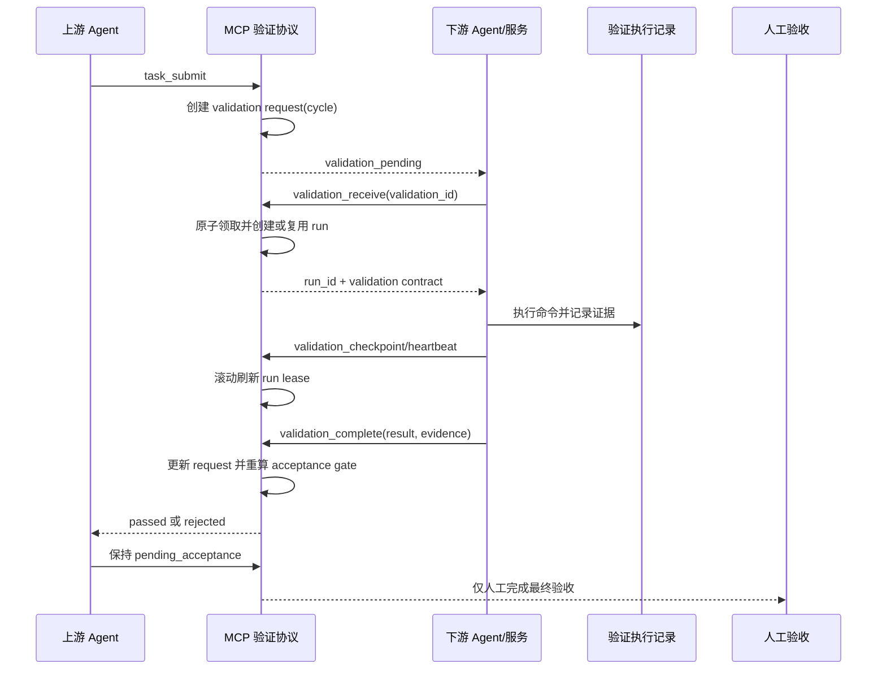

# 下游 Agent 依赖验证联动设计

状态：待人工 review

日期：2026-09-01

## 1. 背景与目标

当前系统在上游 `task_submit` 时自动创建 `dependency_validations`，并由上游验收门禁等待所有活跃下游通过；但下游结果仍由 Board 人工 `respond` 写入。目标是把下游验证改为 Agent/服务自动接收、执行、回传，人工只保留最终验收。

本设计解决以下问题：

- 下游如何明确接收并领取验证请求；
- 如何为每个请求创建独立的验证执行任务；
- 如何记录执行证据、失败与重试；
- 如何把结果可靠地反馈给上游验收门禁；
- 如何避免跨仓库越权、重复领取和旧周期结果污染新周期。

不在本设计范围内：验证命令的业务生成器、跨部署实例的消息总线实现、人工验收规则本身。

## 2. 当前实现基线

当前代码已经具备第一层协议：

1. `TaskService.submitTask` 将任务置为 `pending_acceptance`，调用 `#requestDependencyValidations`。
2. `#requestDependencyValidations` 为每个活跃 downstream 创建 `pending` 记录，增加 cycle，并发出 `dependency_validation_requested` 事件。
3. `humanRespondDependencyValidation` 校验 downstream owner 后直接写入 `passed` 或 `rejected`。
4. `#assertDependencyValidationGate` 只允许最新 cycle 的所有活跃 downstream 均为 `passed` 时进入人工验收。

因此不需要另造一套上游触发机制，主要改造下游响应路径并增加执行层。

## 3. 推荐架构

保留验证请求与验证执行两层：

### 3.1 验证请求层：`dependency_validations`

这是上下游关系和最终结果的协议记录，继续使用现有状态：

`pending -> passed | rejected`；当上游产生新 cycle 时，旧的未完成请求变为 `superseded`。

请求记录应补充或关联一个不可变的非敏感验证契约，至少包括 upstream task/version、目标 revision、验证范围、命令和超时策略。命令只作为下游执行提示，实际执行仍发生在下游 Agent 的本地 worktree。

### 3.2 执行层：`dependency_validation_runs`

每个请求至少有一个执行记录，每次重试增加 `attempt`。建议字段：

- `run_id`、`validation_id`、`attempt`；
- `status`：`queued | claimed | running | passed | rejected | error | cancelled`；
- `owner`、`session_id`、`heartbeat_at`、`lease_expires_at`；
- `started_at`、`completed_at`、`updated_at`；
- `verification_evidence`（命令、结果摘要、commit/worktree）；
- `failure_reason`、`error_reason`；
- `operation_id`，用于 Agent 重试幂等。

`rejected` 表示验证条件不满足；`error` 表示 runner 崩溃、超时、租约丢失等基础设施异常，不能伪装成业务验证失败。

## 4. 状态与操作

### 4.1 `dependency_validation_list`

下游 Agent 按当前绑定 session、owner 和 repository 查询分配给自己的 `pending` 请求。结果必须包含 upstream/downstream task、cycle、验证契约和当前 run 状态。

### 4.2 `dependency_validation_receive`

这是领取/确认，不是通过。服务在一个事务内完成：

1. 校验 `validation_id` 仍属于当前最新 cycle，且 downstream task 未终止；
2. 校验 transport session、Git owner、repository 和 downstream task 权限；
3. 若没有活跃 run，则创建 `claimed` run；若验证由独立 worker 异步接管，可先创建 `queued` 再由 worker 原子转为 `claimed`；若已有活跃 run，则返回原 run；
4. 标记 request 已读并发出 `dependency_validation_received` 事件。

同一 `validation_id + operation_id` 重试必须返回相同结果。并发领取只能成功一个，其他调用返回已有 run 或明确的版本冲突。

### 4.3 `dependency_validation_checkpoint`

长时间验证通过 checkpoint/heartbeat 续租。每次续租都校验 owner、session、当前 run 和未过期租约，并按现有任务 lease 规则滚动更新 `heartbeat_at` 与 `lease_expires_at`。它只更新执行进度和租约，不改变 request 的最终结果。

### 4.4 `dependency_validation_complete`

下游 Agent/服务在本地验证完成后调用。服务必须校验 run 的 owner、session、租约和当前 cycle，然后在一个事务内：

1. 要求 run 处于 `claimed` 或 `running`；
2. `passed` 必须带非空且全部通过的证据；
3. `rejected` 必须带具体原因和失败证据；
4. `error` 仅记录执行异常，并保留重试入口，request 继续保持 `pending`；
5. 写入业务 run 终态时，同时更新 request 为 `passed`/`rejected`；
6. 发出 upstream/downstream 两侧事件，重新计算上游 gate。

旧 cycle 或已 `superseded` 的 run 不能改变当前 gate。

## 5. 重试、租约与异常

- Agent 在 `receive` 后崩溃时，run 保持 `claimed`；滚动租约过期后可被同 owner 的新 session 重新领取。
- 验证持续期间必须通过 checkpoint/heartbeat 滚动续期，不设置固定的 30 分钟总时长。
- `error`/超时自动创建下一次 attempt，但不得覆盖历史证据。
- 业务验证失败使用 `rejected`，由上游修复后重新提交，生成新 cycle。
- 下游 task 被取消或完成时，未完成请求应被系统标记为 `superseded` 或从 gate 中排除。
- 不允许通过人工响应、直接修改数据库或伪造上游事件绕过 gate。

实现时必须复用或补齐现有 `ActiveTaskLease` 的滚动续期语义。当前代码的 `#lease` 主要在 start/switch/adopt 时创建 lease；如果 checkpoint 路径没有刷新 `heartbeat_at`/`expires_at`，需要在实现中补齐，而不能把 validation run 改成固定时长租约。

## 6. 权限与消息边界

下游 Agent 只能操作分配给其绑定 owner/session 的 downstream task 和 validation run，不能直接修改 upstream task。上游只消费验证结果和 gate 状态。

同一 MCP 服务内，“推送上游”由事务写入加事件/通知完成，Agent 可通过查询或 SSE 获取结果。未来若上下游位于不同服务，再增加带幂等键的 outbox/callback，不改变核心状态机。

Board 保留验证历史和运行证据的只读展示，移除人工通过/驳回动作。`humanRequestDependencyValidation` 和 `humanRespondDependencyValidation` 不再作为正常流程入口；迁移期可保留兼容读取，但不得继续写入验证结果，之后废弃。

## 7. 实现影响面

1. `src/storage/progress-store.ts`：新增 validation run 类型、证据和状态接口。
2. `src/storage/sqlite-progress-store.ts`、迁移：新增 runs 表、唯一幂等约束、租约和索引。
3. `src/core/task-service.ts`：实现 receive/checkpoint/complete/retry、owner/session/cycle 校验，并保留既有 acceptance gate。
4. `src/mcp/tool-schemas.ts`、`src/mcp/register-tools.ts`：增加 Agent 工具及统一错误恢复信息。
5. `src/server/board-routes.ts`、`src/web/*`：验证操作改为只读展示，保留历史和失败证据。
6. `tests/unit`、`tests/integration`：覆盖并发领取、幂等重试、租约过期、旧 cycle、跨仓库 owner、passed/rejected/error 和 gate 更新。

## 8. 验收标准

- 上游提交后无需人工操作即可产生下游验证请求。
- 下游 Agent 能在自己的 session/worktree 中领取请求并生成唯一执行记录。
- 重复 receive 不会创建重复执行任务；重复 complete 不会产生第二次结果。
- 结果带有可审计的命令、revision、摘要和失败原因。
- 所有下游验证通过后，上游自动解除验证门禁，但仍停留在 `pending_acceptance` 等待人工验收。
- 任一 rejected/error/pending 状态都不能被 Agent 或 Board 绕过为已验收。
- 新 cycle 会隔离旧 cycle 的运行结果。

## 9. 默认决策

- 租约沿用现有滚动续期机制；空闲超时使用服务现有 lease TTL，checkpoint/heartbeat 持续刷新租约。单个 request 最多自动重试 2 次，达到上限后保持阻塞并提供恢复信息，不自动放行。
- 第一阶段保留 Board 验证历史详情和运行证据的只读页面，方便人工验收；Board 不写入验证结果。
